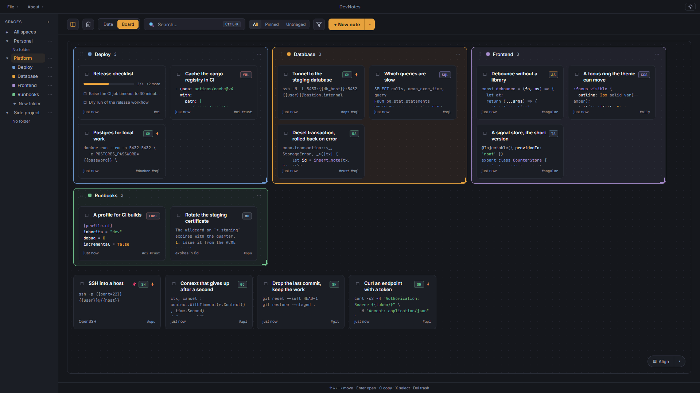

<div align="center">


# DevNotes

**Your notes, your tools and your API client, in one encrypted desktop app.**

Keep snippets and notes, reach thirty-odd developer tools offline, and send HTTP, GraphQL and WebSocket requests.<br>
Everything local, everything behind one passphrase.

[](https://github.com/vmillet-dev/devnotes-rs/releases/latest)
[](https://github.com/vmillet-dev/devnotes-rs/actions/workflows/ci.yml)
[](#install)
[](LICENSE)

[**Download**](https://github.com/vmillet-dev/devnotes-rs/releases/latest) · [Notes](#notes-and-snippets) · [Tools](#tools) · [API client](#api-client) · [Code quality](#code-quality) · [Install](#install) · [Privacy](#privacy)

</div>

<br>

<table>
<tr>
<td width="33%" valign="top">

**📝 Notes and snippets**

Snippets with `{{fields}}`, formatted notes and todo lists, in spaces, folders and tags. `Ctrl+Alt+P` pastes one from any application.

[More ↓](#notes-and-snippets)

</td>
<td width="33%" valign="top">

**🧰 Tools**

Encode, hash, convert, compare, generate, read dates and cron expressions, compute subnets, look up a status code. Thirty-odd tools, none of them online.

[More ↓](#tools)

</td>
<td width="33%" valign="top">

**🌐 API client**

HTTP, GraphQL and WebSocket. Collections, environments and variables, a history of what was sent, and the code of a request for twenty targets.

[More ↓](#api-client)

</td>
</tr>
</table>

**Shared by all three:** local-first and encrypted · no account, no cloud, no telemetry · keyboard first · Windows and Linux.

## Code quality

| Code base               | SonarCloud                                                                                                                                                                                                                                                                                                                                                                                                                                                                                                                                                                                                                                                                                                                                                                                                                                                                                                                                                                                                                                                                                                                                                |
| ----------------------- | --------------------------------------------------------------------------------------------------------------------------------------------------------------------------------------------------------------------------------------------------------------------------------------------------------------------------------------------------------------------------------------------------------------------------------------------------------------------------------------------------------------------------------------------------------------------------------------------------------------------------------------------------------------------------------------------------------------------------------------------------------------------------------------------------------------------------------------------------------------------------------------------------------------------------------------------------------------------------------------------------------------------------------------------------------------------------------------------------------------------------------------------------------- |
| **Back end** — Rust     | [](https://sonarcloud.io/summary/overall?id=devnotes-rust) [](https://sonarcloud.io/component_measures?id=devnotes-rust&metric=coverage) [](https://sonarcloud.io/component_measures?id=devnotes-rust&metric=ncloc) [](https://sonarcloud.io/component_measures?id=devnotes-rust&metric=sqale_rating) [](https://sonarcloud.io/component_measures?id=devnotes-rust&metric=reliability_rating) [](https://sonarcloud.io/component_measures?id=devnotes-rust&metric=security_rating)             |
| **Front end** — Angular | [](https://sonarcloud.io/summary/overall?id=devnotes-front) [](https://sonarcloud.io/component_measures?id=devnotes-front&metric=coverage) [](https://sonarcloud.io/component_measures?id=devnotes-front&metric=ncloc) [](https://sonarcloud.io/component_measures?id=devnotes-front&metric=sqale_rating) [](https://sonarcloud.io/component_measures?id=devnotes-front&metric=reliability_rating) [](https://sonarcloud.io/component_measures?id=devnotes-front&metric=security_rating) |

## Notes and snippets



- **Three kinds of note.** Snippets highlighted in twenty-six languages and formatted with Prettier; Notes written formatted — headings, lists, checkboxes, tables, code blocks — and stored as Markdown; todo lists you tick off.
- **`{{fields}}`.** `ssh -p {{port=22}} {{user}}@{{host}}` asks for its values before it reaches the clipboard, with defaults you set once.
- **Quick paste.** `Ctrl+Alt+P` from any application: search, fill in, copy, and the window steps aside.
- **Organised your way.** Spaces, folders and tags; a board where folders are regions, or the notes by date, priority or format.
- **Search** titles, bodies, lists and tags, each card quoting the line that matched.
- **A JSON snippet** opens as a graph or a tree.
- **Safety nets.** The last twenty versions of a snippet, a trash kept 30 days, and `Ctrl+Z` right after a deletion.
- **Bulk actions, attachments, pasted images**, and export as a `.devnotes` archive or as Markdown.

## Tools

Every tool runs on your machine and calls nothing. Search them, star the ones you use, and keep a result as a note.

| Kind          | Tools                                                                                           |
| ------------- | ----------------------------------------------------------------------------------------------- |
| **Text**      | change case, fix line breaks, count words and characters, compare two texts or two documents    |
| **Encode**    | Base64, URLs, colours, JSON to and from YAML, TOML and XML                                      |
| **Security**  | hash and HMAC, generate passwords, decode and verify a JWT, UUIDs, ULIDs and other identifiers  |
| **Generate**  | JSON test data, fictitious identities, Lorem ipsum, QR codes                                    |
| **Time**      | read a date or a timestamp in every form, place a time in several zones, read a cron expression |
| **Compute**   | data sizes, percentages, Unix permissions, Luhn and IBAN checks, CIDR subnets                   |
| **Reference** | HTTP statuses and headers, MIME types, ports, signals, ASCII, regex, Markdown and Mustache      |

## API client

- **HTTP and GraphQL** requests in tabs, with bodies, authentication and cookies; a GraphQL answer's errors read apart from its data.
- **WebSocket** connections with a live log, and messages kept to send again.
- **Collections and folders** that pass their settings down to their requests.
- **Environments and variables** at every level, each showing where it resolves from; secrets never written to the history, and a protected environment asks before it sends.
- **A history** of what was sent, sealed like your notes, to read again or reopen.
- **Code generation** for twenty targets, from cURL and PowerShell to fetch, axios and Angular's HttpClient.

## Around it

Several libraries, each behind its own passphrase · a daily backup restored in two clicks · light and dark themes · English and French · updates offered inside the application.

## Install

DevNotes runs on **Windows** and **Linux**. Take the file for your system from the [latest release](https://github.com/vmillet-dev/devnotes-rs/releases/latest):

| Platform | File                                | Pick it if                                       |
| -------- | ----------------------------------- | ------------------------------------------------ |
| Windows  | `devnotes_<version>_x64-setup.exe`  | you just want it installed — **the one to take** |
| Windows  | `devnotes_<version>_x64_en-US.msi`  | you deploy software through group policy         |
| Windows  | `devnotes-<version>-windows.exe`    | you want no installer at all                     |
| Linux    | `devnotes_<version>_amd64.AppImage` | any distribution, nothing to install             |
| Linux    | `devnotes_<version>_amd64.deb`      | Debian, Ubuntu and derivatives                   |
| Linux    | `devnotes-<version>-1.x86_64.rpm`   | Fedora, RHEL and derivatives                     |
| Linux    | `devnotes-<version>-linux`          | the bare executable                              |

```bash
chmod +x devnotes_*_amd64.AppImage        # then launch it
sudo apt install ./devnotes_*_amd64.deb   # Debian and Ubuntu
sudo dnf install ./devnotes-*.x86_64.rpm  # Fedora and RHEL
```

<details>
<summary><strong>Windows shows a SmartScreen warning the first time</strong></summary>

<br>

Choose **More info**, then **Run anyway**. The warning is about the publisher's identity, not the file: DevNotes has no code-signing certificate. Its updates are signed and verified before they install, and every release publishes `SHA256SUMS.txt`.

</details>

<details>
<summary><strong>Why there is no macOS build</strong></summary>

<br>

It cannot be tested here, and Gatekeeper wants a paid Apple Developer account with no free way around it on recent versions.

</details>

## Privacy

DevNotes asks for a passphrase the first time it runs, and at every launch after that. It is never stored anywhere. Your notes, their history and their attachments are sealed on disk with AES-256-GCM, and nothing leaves your machine: the HTTP client talks to the servers you name, and the tools call nothing.

> [!WARNING]
> **There is no recovery.** No account, no reset: a lost passphrase is a lost library. An export written in the clear is the only copy that does not depend on it.

[Your library, in detail](docs/security.md) says how it is sealed, what a stolen file still gives away, and where your files are.

## Learn more

| Document                                    | For                                                     |
| ------------------------------------------- | ------------------------------------------------------- |
| [Your library, in detail](docs/security.md) | encryption, backups, and where your data lives          |
| [Changelog](CHANGELOG.md)                   | what changed, and when                                  |
| [Contributing](CONTRIBUTING.md)             | building from source, testing, and the code conventions |
| [Architecture](docs/architecture.md)        | how both halves are built, for whoever changes them     |

## License

DevNotes is free software under the [GNU General Public License v3.0](LICENSE): use it, study it, share it and change it, and a distributed fork stays under the same terms and ships its source.
