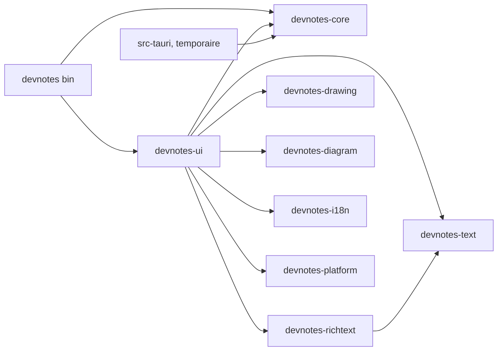
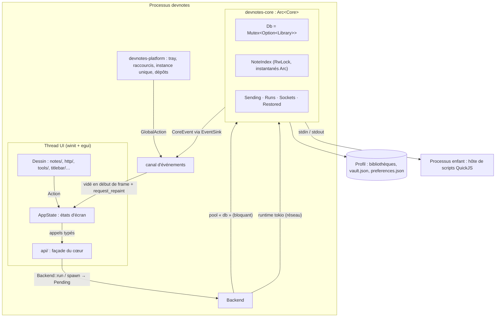
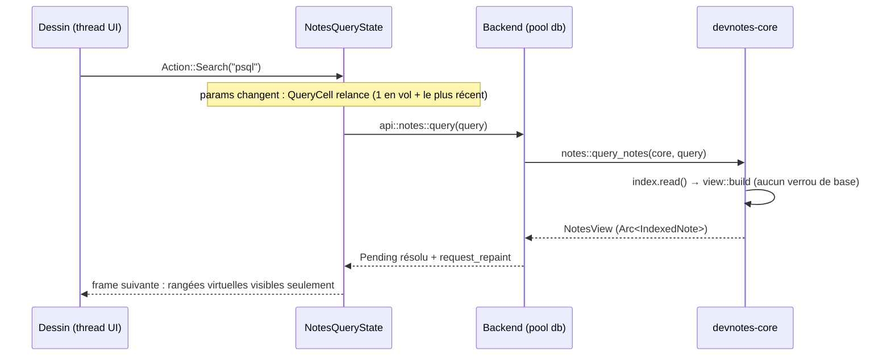
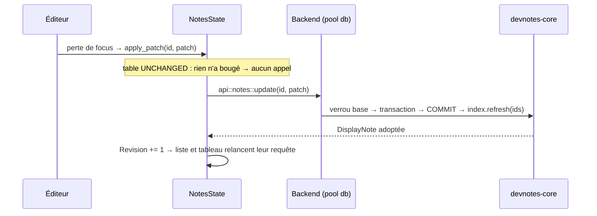
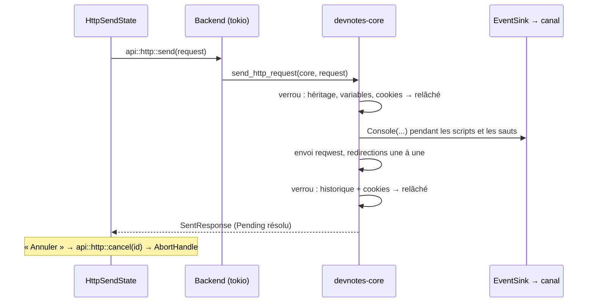
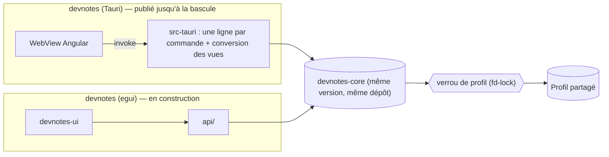
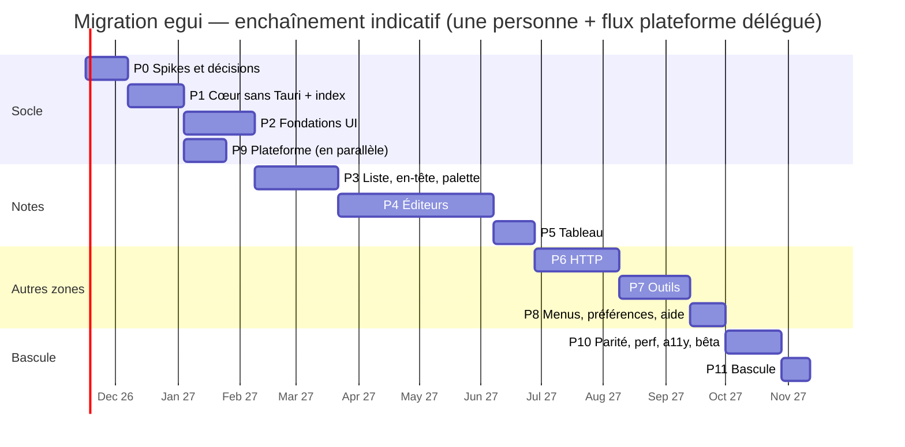

# Plan de migration : d'Angular + Tauri à egui (100 % Rust)

> Statut : **proposition**, à valider avant tout code.
> Périmètre : remplacer le front-end Angular rendu dans une WebView Tauri par une interface
> **egui/eframe** écrite en Rust, dans le même processus que le métier, avec un rendu
> **quasi identique** à l'actuel et des performances correctes sur **30 000 notes** de tous types
> et **2 000 requêtes HTTP**.
> Ce document complète `docs/architecture.md` (cité « → Titre ») ; il ne le remplace pas tant que
> la bascule n'est pas faite.

---

## Sommaire

0. [Résumé](#0-résumé)
1. [Point de départ, chiffré](#1-point-de-départ-chiffré)
2. [Objectifs, non-objectifs, critères de réussite](#2-objectifs-non-objectifs-critères-de-réussite)
3. [Architecture cible](#3-architecture-cible)
4. [Compatibilité des données et de l'installation](#4-compatibilité-des-données-et-de-linstallation)
5. [Parité visuelle : méthode et écarts assumés](#5-parité-visuelle--méthode-et-écarts-assumés)
6. [Performances : corpus, budgets, mesure](#6-performances--corpus-budgets-mesure)
7. [Plan par phases](#7-plan-par-phases)
8. [Stratégie de tests et CI](#8-stratégie-de-tests-et-ci)
9. [Livraison, bascule et retour arrière](#9-livraison-bascule-et-retour-arrière)
10. [Risques](#10-risques)
11. [Décisions à valider](#11-décisions-à-valider)
12. [Documentation et outillage à mettre à jour](#12-documentation-et-outillage-à-mettre-à-jour)

- [Annexe A — Composants Angular → modules egui](#annexe-a--composants-angular--modules-egui)
- [Annexe B — Stores et services → état Rust](#annexe-b--stores-et-services--état-rust)
- [Annexe C — Commandes Tauri → API du cœur](#annexe-c--commandes-tauri--api-du-cœur)
- [Annexe D — Scénarios e2e → scénarios kittest](#annexe-d--scénarios-e2e--scénarios-kittest)
- [Annexe E — Dépendances retirées et ajoutées](#annexe-e--dépendances-retirées-et-ajoutées)

---

## 0. Résumé

**Stratégie : un cœur partagé, deux coquilles, une bascule à parité** (« strangler »).

1. On extrait d'abord tout le Rust existant dans une crate **`devnotes-core` sans Tauri**. Les 190
   commandes deviennent des fonctions Rust ordinaires ; l'application Tauri actuelle devient une
   coquille mince au-dessus et **continue d'être publiée** pendant toute la migration.
2. On construit à côté une coquille **`devnotes` egui** qui appelle les mêmes fonctions, sans
   IPC, sans sérialisation, sans WebView. Elle lit et écrit **les mêmes fichiers** (bibliothèques,
   coffre, préférences) : elle peut être utilisée au quotidien sur une copie de profil dès que la
   zone Notes est portée.
3. On bascule quand la coquille egui atteint la parité fonctionnelle (35 scénarios e2e portés),
   visuelle (rapport de comparaison validé) et de performance (budgets du § 6). La dernière version
   Tauri met à jour vers la première version egui par son updater, sans action de l'utilisateur.

**La clé des performances n'est pas egui, c'est un index de notes en mémoire.** Aujourd'hui,
`query_notes` relit et déchiffre tout le corpus à chaque frappe (403 ms à 8 000 notes de 13 kB,
donc ~1,5 s à 30 000 notes de cette taille). Dans un seul processus, le cœur peut garder, après
déverrouillage, un index déchiffré et « plié » (minuscules, sans accents) du corpus, mis à jour à
chaque écriture : une recherche devient un balayage mémoire de quelques dizaines de millisecondes.
Cet index sert aussi l'application Tauri dès la phase 1, ce qui le met à l'épreuve chez les
utilisateurs avant egui.

**Ce qui coûte le plus** : les éditeurs. Il n'existe pas d'équivalent egui de TipTap (WYSIWYG
Markdown), de CodeMirror (éditeur de code complet), de Fabric.js (dessin) ni de Mermaid. Le plan
leur réserve ~40 % de l'effort, un noyau d'édition de texte commun, et des spikes dès la phase 0.

**Effort estimé** : **~55 semaines-personne** (fourchette 45–70), soit ~13 mois pour une personne à
plein temps, ~8–9 mois avec deux flux en parallèle (cf. § 7). Aucune modification de schéma, de
cryptographie, de dérivation de clé ni de format de fichier n'est nécessaire.

---

## 1. Point de départ, chiffré

### 1.1 Volume

| Partie                            | Taille (lignes)                                                      | Devenir                            |
| --------------------------------- | -------------------------------------------------------------------- | ---------------------------------- |
| Rust `src-tauri/src/`             | 72 836                                                               | conservé (→ `devnotes-core`)       |
| dont fichiers qui nomment `tauri` | 17 fichiers, 9 096 lignes                                            | réécrits en API sans Tauri         |
| Commandes `#[tauri::command]`     | 190                                                                  | fonctions du cœur (annexe C)       |
| TypeScript hors specs             | 52 255                                                               | réécrit en Rust/egui               |
| Gabarits HTML                     | 16 664                                                               | réécrits                           |
| SCSS                              | 23 326 (dont 1 618 globaux)                                          | réécrits en thème + widgets peints |
| Specs Vitest                      | 53 646                                                               | ré-exprimés en tests Rust (§ 8)    |
| Scénarios e2e WebdriverIO         | 35 fichiers                                                          | portés en scénarios `egui_kittest` |
| Composants Angular                | ~180 (55 notes, 41 HTTP, 47 outils, 15 barre de titre, 16 partagés…) | annexe A                           |
| Stores                            | 25 (`core/state`) + 12 (HTTP)                                        | annexe B                           |
| Clés de traduction                | 3 323 par langue (fr, en)                                            | fichiers JSON conservés            |
| Langages de snippet               | 142 (`notes::language`)                                              | coloration à reprendre             |

### 1.2 Ce qui est déjà en Rust (et ne bouge pas)

Stockage SQLite/Diesel et migrations, coffre (Argon2 + AES-GCM, scellement colonne par colonne),
bibliothèques multiples, sauvegardes et restauration, récupération des bibliothèques abîmées,
import/export/partage, pièces jointes, corbeille et révisions, recherche et sections
(`notes::view`), facettes, tableau (`folders::board`), Markdown (`notes::markdown` : aperçu, plan,
découpe en diapositives), feuilles Calcul (`notes::calc`), `{{champs}}` (`notes::placeholder`),
détection de langage, client HTTP complet (envoi, redirections, cookies, variables, GraphQL,
WebSocket, historique, exécuteur de collection, génération de code), scripts de requête dans un
hôte QuickJS séparé, explorateur JSON, et les fonctions pures des 32 dossiers d'outils.

### 1.3 Ce que le front fait encore et qui doit passer en Rust

Les « exceptions front-end » de `CLAUDE.md` disparaissent comme exceptions et deviennent du Rust :

| Aujourd'hui (front)                                                            | Demain (Rust)                                            |
| ------------------------------------------------------------------------------ | -------------------------------------------------------- |
| Formatage du temps relatif, `ClockService`                                     | `ui::services::clock` + horloge injectable               |
| ISO ↔ `Date` à la frontière                                                    | disparaît (types `chrono` de bout en bout)               |
| Coloration syntaxique (CodeMirror/Lezer, 142 langues)                          | `syntect` + grammaires Sublime (§ 3.9)                   |
| Prettier (worker JS, 12 parseurs)                                              | formateurs natifs ou Prettier dans QuickJS (décision D1) |
| Recherche du catalogue d'outils et des références                              | Rust (pli identique à `fold.util.ts`)                    |
| `Intl.DateTimeFormat`/`NumberFormat`/`ListFormat`/`DisplayNames`/`PluralRules` | ICU4X limité à fr/en (§ 3.11)                            |
| Transpileur ICU des pluriels de Transloco                                      | port Rust du transpileur existant                        |
| `CalcFormatter` (écriture des résultats d'une feuille)                         | Rust, à côté de `notes::calc`                            |
| Brouillons, raccourcis, focus, glisser-déposer                                 | état egui                                                |

### 1.4 Bibliothèques JavaScript sans équivalent egui direct

TipTap 3 (éditeur Markdown WYSIWYG), CodeMirror 6 (éditeur de code + recherche/remplacement +
coloration), Fabric.js 7 (éditeur de dessin), Mermaid 12 (diagrammes dans les Notes), Prettier 3
(formatage), Transloco (i18n). Chacune a sa réponse au § 3.9.

### 1.5 Plugins Tauri à remplacer

`single-instance`, `log`, `process`, `dialog`, `opener`, `store`, `clipboard-manager`,
`notification`, `window-state`, `updater`, `global-shortcut`, `autostart`, et l'icône de la zone de
notification (`tray-icon` de Tauri). Chacun a sa crate au § 3.10. La plupart des plugins Tauri
sont eux-mêmes construits sur ces crates (`global-hotkey`, `tray-icon`, `muda`, `auto-launch`,
`notify-rust`, `arboard`) : le comportement natif reste le même.

### 1.6 Particularités qui simplifient

- Cibles : **Windows et Linux** seulement (pas de macOS dans `release.yml`).
- La fenêtre garde **les décorations du système** : la « barre de titre » de l'application est une
  barre de menus dans la fenêtre. Pas de déplacement/redimensionnement maison à écrire.
- Cartes du canevas de **hauteur fixe (150 px)** dans une grille `minmax(220px, 1fr)` : la
  virtualisation est triviale (rangées uniformes par section).
- Le Rust est déjà « feature-first » et ses modèles n'importent ni Diesel ni Tauri.

---

## 2. Objectifs, non-objectifs, critères de réussite

### 2.1 Objectifs

1. **Zéro WebView, zéro JavaScript dans l'interface.** L'hôte de scripts QuickJS reste (il exécute
   les scripts de l'utilisateur, pas l'interface).
2. **Rendu quasi identique** : mêmes jetons de couleur, mêmes polices, mêmes espacements, mêmes
   composants, mêmes états (survol, focus, sélection, armé…), mêmes animations (120/160 ms), deux
   thèmes et deux densités. « Quasi » est défini au § 5.
3. **Performances** : budgets du § 6, mesurés sur un corpus de 30 000 notes et 2 000 requêtes.
4. **Compatibilité totale des données** : un profil existant s'ouvre sans conversion ; on peut
   revenir à la dernière version Tauri pendant la période de double exploitation.
5. **Mise à jour transparente** depuis la dernière version Tauri.
6. **Accessibilité au moins équivalente** (AccessKit : lecteurs d'écran Windows et Orca).

### 2.2 Non-objectifs

- Aucune nouvelle fonctionnalité pendant la migration (gel fonctionnel côté Tauri à partir de la
  phase 3, hors correctifs).
- Aucun changement de format disque, de cryptographie, de dérivation de clé, d'export
  (`FORMAT_VERSION` inchangé), de nom dans `layout.rs`.
- Pas de macOS, pas de mobile, pas de web.
- Pas de réécriture du métier Rust au-delà du découplage de Tauri et de l'index (§ 3.5).

### 2.3 Critères de bascule (tous requis)

- Les 35 scénarios e2e existent en scénarios kittest et passent sur Windows et Linux.
- Rapport de parité visuelle (§ 5) relu et accepté, écarts restants listés.
- Budgets de performance (§ 6) tenus sur les deux corpus de référence.
- Deux semaines de bêta sans incident de données ; mise à jour Tauri → egui testée sur Windows
  (NSIS) et Linux (AppImage).
- `docs/architecture.md`, `CLAUDE.md` et les skills mis à jour (§ 12).

---

## 3. Architecture cible

### 3.1 Espace de travail

```
Cargo.toml                    workspace (resolver 3, lints partagés : unsafe_code = forbid, pedantic)
crates/
├── devnotes-core/            ← src-tauri/src actuel, sans Tauri : métier, SQL, coffre, HTTP, outils
│   ├── src/notes/ …          mêmes features, même découpage <feature>.rs / model.rs / store.rs
│   ├── src/index/            NOUVEAU : index de notes en mémoire (§ 3.5)
│   ├── src/host.rs           NOUVEAU : traits Paths + EventSink (remplacent AppHandle/emit)
│   ├── migrations/  resources/  sandbox/   (déplacés tels quels)
│   ├── benches/  tests/
├── devnotes-text/            NOUVEAU : noyau d'édition (rope, sélection, annuler, recherche),
│                             coloration (syntect), formatage (Prettier-like), champs {{}}
├── devnotes-richtext/        NOUVEAU : modèle de document Markdown, parse/sérialise, échappement
├── devnotes-drawing/         NOUVEAU : scène compatible Fabric, géométrie, rendu PNG/SVG
├── devnotes-diagram/         NOUVEAU : rendu des blocs mermaid (§ 3.9)
├── devnotes-i18n/            NOUVEAU : fr.json/en.json, pluriels ICU, clés générées
├── devnotes-platform/        NOUVEAU : tray, raccourcis globaux, autostart, instance unique,
│                             notifications, dialogues, presse-papiers, ouverture, updater, chemins
├── devnotes-ui/              NOUVEAU : l'application egui (thème, widgets, zones, état)
└── devnotes/                 NOUVEAU : binaire (main : hôte de scripts ou eframe)
src-tauri/                    coquille Tauri actuelle, mince, jusqu'à la bascule — puis supprimée
src/ e2e/ package.json …      front Angular, jusqu'à la bascule — puis supprimés
```

`devnotes-core` garde le nom de bibliothèque `devnotes_core` ; les benchs et tests d'intégration
suivent. Le binaire final s'appelle toujours `devnotes` (`devnotes.exe`) : l'installeur, le
raccourci, l'entrée de démarrage automatique et la relance en hôte de scripts
(`--devnotes-script-host`, lu dans `main` avant toute fenêtre) en dépendent.



### 3.2 Règles de dépendance (elles remplacent la frontière IPC)

| Crate                                                | Peut dépendre de                     | Ne doit jamais dépendre de                 |
| ---------------------------------------------------- | ------------------------------------ | ------------------------------------------ |
| `devnotes-core`                                      | Diesel, crypto, reqwest, tokio       | egui, eframe, winit, Tauri, platform       |
| `devnotes-text`, `-richtext`, `-drawing`, `-diagram` | `unicode-*`, `syntect`, `tiny-skia`… | egui (le rendu egui est dans `ui`), Diesel |
| `devnotes-platform`                                  | crates natives (tray-icon, rfd…)     | egui, Diesel, core                         |
| `devnotes-ui`                                        | tout ce qui précède                  | Diesel, `rusqlite`, SQL brut               |

Les principes de `CLAUDE.md` se transposent :

- **Le traitement des données reste au cœur.** L'UI ne filtre, ne trie, ne groupe pas ; elle
  demande une vue au cœur. La différence : la vue n'est plus sérialisée en JSON, elle est passée par
  valeur ou par `Arc`.
- **Feature-first côté cœur** : `<feature>.rs` ne contient plus de `#[tauri::command]` mais des
  fonctions de service (`notes::query_notes(core: &Core, query)`, § 3.3.3) — valider, verrouiller,
  déléguer, traduire l'erreur — exactement le rôle des commandes actuelles. `model.rs` et
  `store.rs` ne bougent pas.
- **L'arborescence de l'UI a la forme de l'écran** : `devnotes-ui/src/notes/` (`sidebar`,
  `header`, `canvas`, `overlays`, `ui`), `tools/`, `http/`, `titlebar/`, `banners/` contiennent du
  dessin ; `state/`, `services/`, `api/`, `backend.rs` contiennent ce qui n'a pas de place à
  l'écran ; `widgets/` remplace `shared/` et n'accède à aucun état global.

### 3.3 Le cœur et l'interface dans un seul processus

C'est l'architecture finale : ce qui remplace `invoke()`, `app.manage(...)`, `app.emit(...)` et les
plugins appelés depuis Rust. Elle sert aussi pendant la double exploitation (§ 3.3.10), où la
coquille Tauri et la coquille egui se branchent sur le même cœur.

#### 3.3.1 Vue d'ensemble



Trois règles tiennent tout le reste :

1. **Le thread UI ne fait ni E/S, ni crypto, ni attente.** Tout ce qui touche au cœur part par
   `Backend` et revient par un `Pending` ; aucun `block_on`, aucun verrou pris depuis le dessin.
2. **Le cœur ne sait rien de l'interface.** Il ne connaît ni egui ni Tauri : il reçoit deux traits
   (`Paths`, `EventSink`) et renvoie des valeurs ou des `AppError`.
3. **Une seule façade nomme les fonctions du cœur** : `devnotes-ui/src/api/`. C'est l'équivalent de
   la règle actuelle « seuls `core/data/` et `core/ipc/` appellent les commandes ». Les types du
   modèle (`NotesQuery`, `DisplayNote`, `Language`, `HttpRequest`…) sont, eux, utilisés partout tels
   quels : plus de types miroirs, plus de `note.mapper.ts`.

#### 3.3.2 `Core` : la racine de composition

Aujourd'hui l'état natif est enregistré dans Tauri (`app.manage(Db)`, `Restored`, `Sending`, `Runs`,
`Sockets`) et retrouvé par `app.state::<…>()`. Il devient une structure possédée par la coquille :

```rust
// devnotes-core/src/core.rs — créée une fois par la coquille, partagée en Arc<Core>
pub struct Core {
    db: Db,                           // Mutex<Option<Library>> : inchangé
    index: NoteIndex,                 // § 3.5 ; vide tant que la bibliothèque est fermée
    sending: http::send::Sending,     // envois en vol, corps gardés par id
    runs: http::runner::Runs,
    sockets: http::websocket::Sockets,
    restored: backup::Restored,
    paths: Arc<dyn Paths>,
    events: Arc<dyn EventSink>,
    runtime: tokio::runtime::Handle,  // fourni par la coquille
}

impl Core {
    /// Aucune E/S lourde : la bibliothèque reste fermée jusqu'à `vault::unlock`.
    pub fn new(paths: Arc<dyn Paths>, events: Arc<dyn EventSink>, runtime: Handle) -> Self;
}
```

| État                                                      | Propriétaire                                                                         | Où il vit                                |
| --------------------------------------------------------- | ------------------------------------------------------------------------------------ | ---------------------------------------- |
| Connexion SQLite + clé (`Library`)                        | `Core.db`                                                                            | pool « db »                              |
| Index de notes                                            | `Core.index`                                                                         | pool rayon (construction), lu partout    |
| Envois, exécutions, sockets, restauration mise de côté    | `Core.sending/runs/sockets/restored`                                                 | runtime tokio                            |
| Préférences de l'application et de la bibliothèque        | `ui::services::preferences` (mêmes fichiers) ; le cœur relit seul `automaticBackups` | thread UI (cache) + écriture hors thread |
| Tray, raccourcis globaux, instance unique, démarrage auto | `devnotes-platform`                                                                  | thread plateforme                        |
| Brouillons, sélection, onglets, focus, menus ouverts      | `AppState`                                                                           | thread UI                                |

#### 3.3.3 L'API du cœur : trois familles de fonctions

Les `<feature>.rs` gardent leur rôle (valider, verrouiller, déléguer, traduire l'erreur) ; seule la
signature change, et elle dit sur quel thread on l'appelle :

```rust
// 1. Données : synchrones et bloquantes — appelées sur le pool « db », jamais sur le thread UI.
pub fn query_notes(core: &Core, query: NotesQuery) -> Result<NotesView, AppError>;
pub fn update_note(core: &Core, id: &str, patch: NotePatch) -> Result<DisplayNote, AppError>;
pub fn unlock(core: &Core, passphrase: Zeroizing<String>) -> Result<(), AppError>;

// 2. Réseau : asynchrones, sur le runtime du cœur ; ne tiennent jamais le verrou en attendant.
pub async fn send_http_request(core: Arc<Core>, request: SendRequest) -> Result<SentResponse, AppError>;
pub fn cancel_http_send(core: &Core, id: &str);
pub async fn connect_websocket(core: Arc<Core>, request: ConnectRequest) -> Result<(), AppError>;

// 3. Outils : fonctions pures, comme aujourd'hui dans tools/* (le `off_thread` part dans la coquille).
pub fn convert_case(request: &CaseRequest) -> CaseAnswer;
```

Un exemple avant/après, pour fixer la forme :

```rust
// Aujourd'hui — src-tauri/src/notes.rs
#[tauri::command]
pub async fn query_notes<R: Runtime>(query: NotesQuery, app: AppHandle<R>) -> Result<NotesView, AppError> {
    blocking(app, move |_, db| { let mut connection = lock(db)?; /* fetch, decorations, view::build */ }).await
}

// Demain — devnotes-core/src/notes.rs
pub fn query_notes(core: &Core, query: NotesQuery) -> Result<NotesView, AppError> {
    let decorations = { let mut c = lock(core.db())?; store::decorations(&mut c, &query)? }; // verrou relâché
    let index = core.index().read()?;            // jamais le verrou de la base
    Ok(view::build(index.matching(&query), index.facets(&query), &query, decorations))
}
```

**`NotesView` change de forme**, pas de sens : ses sections portent des
`Card { note: Arc<IndexedNote>, hit: Option<SearchHit>, matches: bool }` au lieu de `DisplayNote`
copiées, et l'aperçu est calculé pour les seules cartes affichées. Pendant la double exploitation,
`src-tauri` convertit cette vue en l'actuel `NotesView` sérialisé, si bien que `bindings.ts` et le
front Angular ne voient rien.

**Ce qui sort du cœur.** Quatre endroits touchent encore la plateforme depuis Rust :

| Aujourd'hui                                                    | Demain                                                                                                    |
| -------------------------------------------------------------- | --------------------------------------------------------------------------------------------------------- |
| `attach_clipboard_image` lit le presse-papiers (plugin)        | l'UI lit l'image (`arboard`), le cœur reçoit des octets : `attachments::attach_image(core, note_id, png)` |
| `copy_qr_code` écrit dans le presse-papiers (plugin)           | le cœur rend le PNG, l'UI le copie                                                                        |
| `backup::take` lit `automaticBackups` par `tauri-plugin-store` | le cœur lit `preferences.json` lui-même (`serde_json`, `Paths::profile`, `layout::PREFERENCES`)           |
| `resource_dir()`, `app_data_dir()`                             | `Paths`                                                                                                   |

`desktop.rs` (tray, raccourcis globaux, `sync_tray`, `hold_quit`, `set_window_behavior`) quitte le
cœur pour `devnotes-platform`, appelé par l'UI. Les dialogues de fichiers restent ce qu'ils sont
déjà : l'interface choisit le chemin, le cœur reçoit un chemin.

**Erreurs.** `AppError { code, params, detail }` ne change pas. L'UI la traduit par un `match`
exhaustif sur `ErrorCode` (`ui::services::errors`) : un code ajouté ne compile plus tant qu'il n'a
pas sa clé, ce qui remplace `CODE_KEYS` + `IPC_ERROR_CODES`. `detail` va au journal, jamais à
l'écran.

#### 3.3.4 `Paths` et `EventSink` : ce que le cœur demande à sa coquille

```rust
// devnotes-core/src/host.rs
pub trait Paths: Send + Sync {
    fn profile(&self) -> &Path;       // app_data_dir : registre, libraries/, preferences.json
    fn resources(&self) -> &Path;     // identity/ (listes de l'outil identité)
    fn plaintext(&self) -> PathBuf;   // copies en clair des pièces jointes ouvertes
}

pub trait EventSink: Send + Sync {
    fn emit(&self, event: CoreEvent);
}

#[non_exhaustive]
pub enum CoreEvent {
    Socket { id: String, event: SocketEvent },   // remplace WEBSOCKET_EVENT
    Console(ConsoleEvent),                       // remplace HTTP_CONSOLE_EVENT
    Run(RunEvent),                               // remplace HTTP_RUN_EVENT
    IndexProgress { done: u32, total: u32 },     // nouveau : construction de l'index
    IndexReady,
}
```

| Implémentation           | `Paths`                            | `EventSink`                                              |
| ------------------------ | ---------------------------------- | -------------------------------------------------------- |
| `src-tauri` (temporaire) | `app.path()` de Tauri              | `app.emit(...)` avec les noms d'événements actuels       |
| `devnotes-ui`            | `devnotes-platform::paths` (§ 4.1) | `crossbeam::Sender<CoreEvent>` + `ctx.request_repaint()` |
| tests                    | dossier temporaire                 | `RecordingSink` qui garde les événements                 |

`GlobalAction` (tray, raccourcis, seconde instance) ne passe pas par le cœur : la plateforme
l'envoie sur le même canal que l'UI vide.

#### 3.3.5 Côté interface : `Backend`, `api/`, `Pending`, `QueryCell`, `Revision`

```rust
// devnotes-ui/src/backend.rs
pub struct Backend {
    core: Arc<Core>,
    db_pool: rayon::ThreadPool,        // 2–4 threads : la base n'a qu'un verrou
    runtime: tokio::runtime::Runtime,  // multi-thread, 2 workers : réseau, updater
    ctx: egui::Context,                // pour réveiller l'UI à chaque résolution
}

impl Backend {
    pub fn run<T: Send + 'static>(
        &self,
        job: impl FnOnce(&Core) -> Result<T, AppError> + Send + 'static,
    ) -> Pending<T>;

    pub fn spawn<T, F>(&self, job: impl FnOnce(Arc<Core>) -> F + Send + 'static) -> Pending<T>
    where
        F: Future<Output = Result<T, AppError>> + Send + 'static,
        T: Send + 'static;
}

// devnotes-ui/src/api/notes.rs — une fonction par service, rien d'autre
pub fn query(backend: &Backend, query: NotesQuery) -> Pending<NotesView> {
    backend.run(move |core| devnotes_core::notes::query_notes(core, query))
}
```

- **`Pending<T>`** : une poignée sur un résultat à venir (`oneshot`), lue par `poll()` à chaque
  frame ; le travailleur appelle `ctx.request_repaint()` en la résolvant. L'abandonner n'interrompt
  pas un travail commencé sur la base (comme aujourd'hui) ; un envoi HTTP s'annule explicitement
  (`cancel_http_send`).
- **`QueryCell<P: PartialEq + Clone, T>`** : remplace `resource()` + `linkedSignal` + `OneInFlight`.
  Garde la dernière valeur pendant un rechargement, compare ses paramètres structurellement (le piège
  du comparateur d'identité disparaît), garde **un appel en vol et le plus récent en attente**.
- **`Revision`** : compteur incrémenté après chaque écriture adoptée (équivalent `NotesRevision`) ;
  les `QueryCell` de la liste et du tableau l'ont dans leurs paramètres, donc les deux vues se
  rafraîchissent ensemble. Écritures **non optimistes** : persister, adopter la réponse,
  incrémenter.

Chaîne d'appel imposée : **dessin → `Action` → état → `api` → `Backend` → cœur**. Le dessin ne
connaît pas `api`, l'état ne connaît pas egui (il se teste sans fenêtre, contre le vrai cœur sur un
dossier temporaire).

#### 3.3.6 Verrous, threads et instantanés

1. **Ordre des verrous : base → index.** Une écriture prend le verrou de la base, fait sa
   transaction, relit les lignes touchées, puis prend l'index en écriture le temps d'échanger des
   `Arc`. Une requête ne prend que l'index en lecture : `export_notes` (639 ms sous le verrou) ne
   bloque plus la recherche.
2. **Instantanés immuables.** Les entrées de l'index sont des `Arc<IndexedNote>` jamais modifiés en
   place ; une écriture remplace l'`Arc`. Une vue tient ses `Arc` : l'UI dessine sans aucun verrou,
   et une entrée remplacée est libérée (et effacée, `Zeroizing`) quand la dernière vue qui la tenait
   disparaît.
3. **Le réseau ne tient jamais le verrou** (règle actuelle) : un envoi lit sous le verrou ce dont il
   hérite, relâche, envoie, puis reprend le verrou pour l'historique et les cookies.
4. **Ouvrir une autre bibliothèque, restaurer une sauvegarde** : vider le `Mutex` **et** l'index,
   fermer les sockets, annuler envois et exécutions, avant de toucher aux fichiers.
5. **Seule attente bornée du thread UI** : à la sortie, jusqu'à 2 s pour les écritures de brouillon
   en vol.

#### 3.3.7 Une frame

`DevNotesApp::update` fait toujours la même chose, dans cet ordre :

1. **Vider les entrées** : `CoreEvent`, `GlobalAction`, fichiers déposés, révélation demandée par une
   seconde instance.
2. **Récolter les `Pending`** : chaque état adopte ses réponses ; une écriture adoptée incrémente
   `Revision`.
3. **Relancer les `QueryCell`** dont les paramètres ont changé (requête, `Revision`, jour local).
4. **Dessiner** : barre de titre, zone courante, superpositions, `DialogStack`, bannières. Le dessin
   pousse des `Action`.
5. **Appliquer les `Action`** : elles modifient l'état et lancent de nouveaux appels.
6. **Planifier la frame suivante** : animation en cours, prochaine étiquette relative qui change,
   sinon rien (CPU au repos).

#### 3.3.8 Cycles de vie

| Moment                            | Ce qui se passe                                                                                                                                                                                                                                                                                                                                              |
| --------------------------------- | ------------------------------------------------------------------------------------------------------------------------------------------------------------------------------------------------------------------------------------------------------------------------------------------------------------------------------------------------------------ |
| **Lancement**                     | `main` : `--devnotes-script-host` → servir les scripts et sortir ; sinon chemins, journal, instance unique (une seconde instance demande « révéler » et sort), thread plateforme (tray, raccourcis), `Core::new` (bibliothèque fermée), eframe avec la fenêtre invisible à la géométrie restaurée, puis montrée. Première frame : `vault::state` → la porte. |
| **Déverrouillage**                | `api::vault::unlock(Zeroizing)` sur le pool « db » : `gate::unlock`, puis les corvées de `sweep` (copie de sauvegarde, purge de la corbeille et de l'historique, fichiers orphelins, copies en clair) ; puis construction de l'index sur rayon avec `IndexProgress`. L'UI affiche les premières sections dès la première tranche.                            |
| **Changement de bibliothèque**    | `api::libraries::open` (§ 3.3.6, point 4), puis `AppState::reset_library_scope()` : préférences de la bibliothèque rouvertes, états des notes et du HTTP remis à zéro, réglages de l'application gardés, retour à la porte. C'est ce que fait aujourd'hui le rechargement de la page.                                                                        |
| **Restauration d'une sauvegarde** | même vidage, restauration, puis porte.                                                                                                                                                                                                                                                                                                                       |
| **Fermer la fenêtre**             | avec un tray : `CancelClose` + fenêtre cachée ; sans tray : comme Quitter.                                                                                                                                                                                                                                                                                   |
| **Quitter**                       | `HttpLeave` demande pour les requêtes non enregistrées ; brouillons d'éditeur validés (attente bornée) ; raccourcis libérés, tray retiré ; copies en clair balayées ; géométrie écrite ; sortie.                                                                                                                                                             |

#### 3.3.9 Trois parcours de bout en bout







#### 3.3.10 Pendant la double exploitation



- `src-tauri` ne garde que : `lib.rs` (builder, plugins, `collect_commands!`), `desktop.rs`, une
  enveloppe `#[tauri::command]` d'une ligne par service (`blocking(core, |c| service(c, args))`),
  `TauriHost` (`Paths` + `EventSink`), et la conversion des nouvelles vues vers les types sérialisés
  actuels. `bindings.ts` ne change pas, le front Angular non plus.
- Les deux coquilles se construisent dans le même workspace sur le même `devnotes-core` : un
  correctif du cœur part dans les deux.
- Le verrou de profil empêche les deux applications d'ouvrir le même profil en même temps.
- À la bascule, `src-tauri`, la conversion des vues, `TauriHost` et les dérivations `specta`
  disparaissent ; rien d'autre ne bouge dans le cœur.

### 3.4 État de l'interface

- Un `AppState` racine possède les états d'écran ; chaque store Angular devient une structure Rust
  aux champs privés, lue par des accesseurs, modifiée par des méthodes (la règle « signal privé
  derrière `.asReadonly()` » devient la visibilité Rust). Annexe B.
- **File d'intentions** (§ 3.3.7) : les fonctions de dessin reçoivent `&State` et poussent des `Action`
  (`Action::OpenNote(id)`, `Action::Global(GlobalAction::NewNote)`…) ; `AppState::apply` les traite
  en fin de frame. Une seule entrée pour clavier, palette, tray, menus et raccourcis globaux, et pas
  de conflit d'emprunt entre dessin et mutation.
- **Valeurs dérivées** : calculées à la demande, ou mémorisées (`Memo<K, V>`) quand elles coûtent
  (plan de mise en page d'une section, `LayoutJob` coloré).
- **Horloge** : un trait `Clock` (vrai, faux en test) ; les étiquettes relatives demandent un
  rafraîchissement au moment où elles changent (`request_repaint_after`), pas toutes les 30 s.
- **Ce qui disparaît** : `@defer` et ses pièges d'import, `NgZone`/zoneless, `computed` +
  comparateurs, `bindings.ts`, `note.mapper.ts`, `IpcError`, `CODE_KEYS`/`IPC_ERROR_CODES` en
  double, constantes passées par `.constant(...)`, et la page des notes « cachée jamais détruite »
  (en mode immédiat, une zone non dessinée ne coûte rien et son état reste dans `AppState`).

### 3.5 L'index de notes en mémoire (cœur, phase 1)

**Pourquoi.** Le coût de `query_notes` est la lecture et le déchiffrement de tous les corps, pas la
recherche (→ « The baseline »). Un chiffrement colonne par colonne interdit FTS5 (qui écrirait du
clair sur disque) ; garder l'index **en mémoire** respecte le modèle de menace (→ « What this
protects against, and what it does not » : le chiffrement protège au repos, pas une machine
compromise pendant que l'application tourne).

**Contenu, par note vivante** (`deleted_at IS NULL`) :

| Champ                                                                                                 | Usage                                     |
| ----------------------------------------------------------------------------------------------------- | ----------------------------------------- |
| id, kind, language, space, folder, priority, pinned, instants (créée, modifiée, échéance) en `i64`    | filtres, tri, sections, facettes          |
| tags (identifiants internés), nombre de pièces jointes, noms des `{{champs}}`                         | facettes, marques de carte (⚡ 📎)        |
| titre, source (clairs)                                                                                | carte, classement de la palette           |
| texte plié : titre + corps + éléments + tags + source (pour un Dessin : `drawing::words`)             | recherche (`memchr::memmem`)              |
| corps original compressé (`lz4_flex`)                                                                 | citation du résultat, aperçu à la demande |
| aperçu préparé (`PREVIEW_LINES`/`PREVIEW_CHARS`), plan Markdown (`outline`) — paresseux, mis en cache | cartes visibles                           |

**Règles :**

1. `view::build` reste **l'unique** définition des sections, du classement, des facettes et des
   citations ; il est rendu générique sur la source (`impl Iterator<Item = &IndexedNote>`) au lieu
   d'un `Vec<Note>` déchiffré. Une vue ne copie plus les corps : elle rend des identifiants et des
   métadonnées ; l'aperçu n'est calculé que pour les cartes affichées.
2. **Un seul chemin de mise à jour** : chaque écriture du cœur répond déjà de ce qu'elle a changé
   (« Batches answer what they changed ») ; la fonction de service appelle
   `index.refresh(&mut conn, &ids)` après le `COMMIT`, qui relit et redéchiffre ces lignes. Pas de
   delta écrit à la main par opération. Import, restauration de sauvegarde, purge, suppression
   d'espace ou de dossier, renommage de tags : `refresh` des ids touchés ou reconstruction.
3. **Oracle de test** : l'ancien chemin (SQL + déchiffrement + `view::build`) est gardé en
   `#[cfg(test)]` ; des tests de propriétés enchaînent des écritures aléatoires et comparent les
   deux vues, sur tous les critères de `NotesQuery`.
4. **Construction au déverrouillage** sur le pool rayon (lecture SQLite séquentielle, déchiffrement
   et pli parallèles), du plus récent au plus ancien, par tranches : la première section s'affiche
   dès la première tranche, la recherche signale « résultats partiels » jusqu'à la fin.
5. **Sécurité** : les textes de l'index sont en `Zeroizing<…>` et effacés au verrouillage, au
   changement de bibliothèque et à la fermeture ; à relire avec la skill
   `devnotes-security-review`, et à consigner dans « What this protects against… ». Aucun index
   n'est écrit sur disque (un cache scellé serait un nouveau format de fichier : hors périmètre).
6. **Mémoire** : ~1,4 × le corpus en clair. Si le budget du § 6 est dépassé sur le corpus de
   stress, le texte plié passe lui aussi en `lz4` et la recherche décompresse en parallèle.

L'index sert aussi `list_tags` (super-linéaire aujourd'hui, ×64 pour ×10), `count_*`, la palette,
le tableau (`board_view` lit tout l'espace) et l'application Tauri dès sa phase 1.

Les requêtes HTTP n'en ont pas besoin au départ (2 000 noms scellés se déchiffrent en quelques
millisecondes) ; un petit index (nom, URL, chemin pliés) est prévu si `search_http_requests` dépasse
30 ms.

### 3.6 Rendu et virtualisation

Règles du mode immédiat, à faire respecter en revue :

- **Tout ce qui dépasse ~100 éléments est virtualisé.** Le canevas « rend chaque note sans
  virtualisation » aujourd'hui (→ « Motion… ») : en egui, la vue est aplatie en rangées virtuelles
  (en-tête de section, rangées de cartes de hauteur fixe `150 + gap`), le nombre de colonnes se
  déduit de la largeur (`auto-fill, minmax(220px, 1fr)` reproduit en Rust), et seules les rangées
  dans le viewport sont dessinées (`ScrollArea::show_viewport`, décalages cumulés précalculés).
- **Tableau** : coordonnées déjà calculées par `folders::board` ; on ne dessine que les zones et
  cartes qui coupent le viewport. Le flux des cartes dans une zone est calculé **par le même Rust**
  que le rendu : `columns_in` cesse de « prédire le navigateur » et
  `scripts/board-geometry.test.mjs` disparaît.
- **Texte** : les `LayoutJob` coûteux (aperçus colorés, cellules) sont mis en cache par
  `(note, updated_at, thème, largeur)` dans un LRU ; egui ne garde ses galleys que d'une frame à
  l'autre.
- **Images** : miniatures de dessins et de pièces jointes décodées hors du thread UI (`image`),
  téléversées à la première apparition, LRU de textures (~256).
- **Repeindre seulement quand il faut** : entrée, animation en cours, réponse d'un `Pending`,
  événement, étiquette relative qui change. CPU au repos ≈ 0 %.
- **Corps de réponse HTTP et gros snippets** : vue de code virtualisée par lignes (index des débuts
  de ligne, galley par ligne visible, coloration par blocs avec points de reprise de l'état syntect).
- **Profilage** : `puffin` + `puffin_egui` derrière une feature `profiling`, et un compteur de
  temps de frame en mode debug.

### 3.7 Thème et système de design

- **Jetons** : `theme/tokens.rs` reprend un à un les variables de `src/styles/styles.scss`
  (`bg-0…3`, `line`, `line-soft`, `text-0…2`, les trois rôles de l'ambre, `amber-dim`,
  `amber-ink`, les huit teintes et leurs triplets, `line-no`, ombres, durées, espacements de
  densité, hauteur de barre de titre) en deux jeux **sombre** (base) et **clair**, plus la densité
  **compacte**. Le thème « système » suit `ctx.system_theme()`. `scripts/palette.test.mjs` devient
  un test Rust sur ces jetons (contraste 4,5:1 pour le texte, 3:1 pour les traits).
- **Mixins → widgets** : chaque mixin de `_mixins.scss` (`surface`, `accent-state`,
  `unstyled-control`, `status-badge`, `priority-dot`, `text-field`, `eases`, `enters`…) devient une
  fonction de peinture ou un widget de `devnotes-ui/src/widgets/`. Les widgets egui natifs ne sont
  utilisés que restylés via `Visuals`/`Style` ; les composants visibles (cartes, puces, menus,
  segmentés, boîtes de dialogue) sont **peints à la main** pour coller au CSS.
- **Polices** : Inter et JetBrains Mono, embarquées (`include_bytes!`), mêmes tailles en px que le
  CSS (14 px de base). egui ne synthétise pas les graisses : on embarque les **instances
  statiques** utilisées (Inter 400/500/600/700 ; 650 arrondi à 600 ; JetBrains Mono 400/700) comme
  familles nommées, sauf si le moteur de texte retenu lit l'axe `wght` (vérifié au spike S2).
  Repli : Noto Emoji (monochrome), puis polices système chargées par `fontdb` pour les écritures
  non couvertes (CJK).
- **Icônes** : les tracés Lucide de `shared/icon/icon.component.ts` sont rastérisés par `resvg` en
  masques alpha à la taille demandée × `pixels_per_point`, mis en cache et **teintés** par la
  couleur du texte (le comportement de `currentColor`). Les pictogrammes émoji de l'interface (📌 📎
  🗑 👁 🔍 🖼 ⏳) passent en icônes Lucide.
- **Mouvement** : `motion::fast` (120 ms, suit le pointeur) et `motion::enter` (160 ms, ce qui
  entre) via `animate_bool_with_time`/`animate_value_with_time` ; les trois entrées partagées
  (`enter-rise`, `enter-lift`, `enter-fade`) sont trois fonctions d'opacité + décalage ; le spinner
  (800 ms) ; la marque qui s'estompe (2 000 ms). **Un seul interrupteur « mouvement réduit »**
  (préférence + détection du système par une API sûre quand elle existe) coupe tout, comme le bloc
  `prefers-reduced-motion` unique. `scripts/motion.test.mjs` devient un test qui interdit une durée
  écrite en dur hors de `theme::motion`.
- **Anneau de focus** : 2 px `amber-edge`, décalé de 2 px, uniquement après une navigation clavier
  (équivalent `:focus-visible`, suivi de la dernière modalité d'entrée).
- **Barres de défilement** : 9 px, poignée `bg-3` arrondie 5 px, rail transparent
  (`ScrollStyle`).
- **Effets CSS** : ombres (`Shadow` d'epaint), dégradés linéaires (maillage à couleurs de sommet),
  les deux radiaux (éventail), `mask-image` (fondu par dégradé de la couleur de fond),
  `line-clamp` (`max_rows` + caractère de débordement), `text-overflow` (troncature). Le seul
  `backdrop-filter` devient un voile uni (écart E7).

### 3.8 Texte et édition : un noyau commun

egui fournit `TextEdit`, suffisant pour les **champs d'une ligne** (recherche, noms, filtres) et
les petits textes. Pour le reste, un noyau d'édition dans `devnotes-text`, sans egui, testé seul :

- tampon `ropey`, positions en graphèmes (`unicode-segmentation`), sélection simple, historique
  annuler/rétablir regroupé par frappe, opérations (insérer, supprimer mot/ligne, indenter /
  désindenter avec `indentUnit`, déplacer des lignes, commenter), recherche et remplacement (casse,
  mot entier, regex, compteur de correspondances) ;
- un widget egui `EditorView` par-dessus, dans `devnotes-ui/src/widgets/editor/` : galley par
  ligne visible, gouttière (numéros, marques), **indentation suspendue** des lignes repliées (que
  `TextEdit` ne sait pas faire), décorations (champs `{{x}}` donnés par
  `notes::placeholder::field_spans`, correspondances de recherche, résultats Calcul en marge),
  caret, sélection, presse-papiers, **IME** (`ImeOutput` positionné sur le caret), Tab dans le
  texte (`codeIndent`), menu contextuel Couper/Copier/Coller/Tout sélectionner.

Ce noyau sert : l'éditeur de snippet, l'éditeur Calcul, le corps et les scripts d'une requête, la
requête et les variables GraphQL, le composeur WebSocket, et les blocs de code de l'éditeur riche.

**Champ de phrase secrète** : widget dédié sur un tampon `Zeroizing<String>`, **sans historique
d'annulation** (celui de `TextEdit` garde des copies du texte dans la mémoire d'egui), effacé et son
état egui oublié à la validation.

### 3.9 Remplacement des briques JavaScript

| Brique actuelle                                 | Remplacement                                                                  | Notes                                                                                                                                                                                                                                                                                                                                                                                                                                                                                                                             |
| ----------------------------------------------- | ----------------------------------------------------------------------------- | --------------------------------------------------------------------------------------------------------------------------------------------------------------------------------------------------------------------------------------------------------------------------------------------------------------------------------------------------------------------------------------------------------------------------------------------------------------------------------------------------------------------------------- |
| **CodeMirror 6** (éditeur, recherche)           | noyau `devnotes-text` + `EditorView` (§ 3.8)                                  | même raccourcis, même barre de recherche (« Code editor: find-and-replace bar… »)                                                                                                                                                                                                                                                                                                                                                                                                                                                 |
| **Lezer / grammaires CodeMirror** (142 langues) | `syntect` + `two-face` (grammaires de bat), moteur `fancy-regex` (pas de C)   | les 7 classes `tok-*` de `_code-theme.scss` se mappent sur les portées TextMate (`keyword`, `string`, `constant`, `entity.name`, `variable.other.member`, `meta`, `comment`, `markup.deleted`) ; jeu de syntaxes chargé paresseusement sur un thread au démarrage ; une table langue → syntaxe testée de façon exhaustive (`Language` est un enum fermé) ; repli « texte » pour les modes hérités sans grammaire, comblés par des `.sublime-syntax` maison si besoin (HCL, Nix, Prisma, Solidity, Zig sont déjà des modes maison) |
| **TipTap** (Note WYSIWYG)                       | `devnotes-richtext` (modèle) + widget egui `RichEditor`                       | § 3.9.1                                                                                                                                                                                                                                                                                                                                                                                                                                                                                                                           |
| **Fabric.js** (Dessin)                          | `devnotes-drawing` + widget `DrawingCanvas`                                   | § 3.9.2                                                                                                                                                                                                                                                                                                                                                                                                                                                                                                                           |
| **Mermaid**                                     | `devnotes-diagram`                                                            | § 3.9.3                                                                                                                                                                                                                                                                                                                                                                                                                                                                                                                           |
| **Prettier** (12 parseurs)                      | décision **D1** : formateurs natifs (recommandé) ou Prettier dans QuickJS     | § 3.9.4                                                                                                                                                                                                                                                                                                                                                                                                                                                                                                                           |
| **Transloco** + transpileur ICU                 | `devnotes-i18n`                                                               | § 3.11                                                                                                                                                                                                                                                                                                                                                                                                                                                                                                                            |
| `Intl.*`                                        | ICU4X (`icu`, données fr/en)                                                  | § 3.11                                                                                                                                                                                                                                                                                                                                                                                                                                                                                                                            |
| `<input type="date">` natif                     | sélecteur de date dessiné (`egui_extras::DatePickerButton` restylé ou maison) | écart E4                                                                                                                                                                                                                                                                                                                                                                                                                                                                                                                          |

#### 3.9.1 L'éditeur riche (Notes)

Le plus gros morceau du projet. Exigences, reprises de « A Note is written formatted… » : titres,
emphases, code en ligne, listes (puces, numérotées, tâches) imbriquées, citations, tableaux, liens
(Ctrl+clic, `http`/`https` seulement), blocs de code avec langage et coloration, blocs `mermaid`
dessinés sous leur code et repliés hors du caret, images `devnotes:drawing/<id>`, règle
horizontale ; Tab qui imbrique/avance de cellule/tabule ; échappement **à nous**
(`escapeMarkdownText`, jamais dans un `{{champ}}`, `&#9;` en tête de ligne) ; règle d'emphase
espacée (`2 * 3 * 4`) ; collage dans une Note vide → `detect_language` ; recherche dans le texte ;
compteur de mots.

Conception :

1. **Modèle** (`devnotes-richtext`, sans egui) : document = blocs (`Paragraph`, `Heading(n)`,
   `List{ordered, items}`, `Task`, `Quote`, `CodeBlock{lang, text}`, `Table`, `Image`, `Rule`) ;
   contenu en ligne = texte + marques (gras, italique, barré, code, lien). Positions et sélections
   exprimées dans ce modèle ; transactions annulables.
2. **Markdown ↔ modèle** : lecture par `pulldown-cmark` (déjà utilisé par `notes::markdown`),
   écriture par un sérialiseur maison qui reproduit **octet pour octet** la sortie actuelle de
   `@tiptap/markdown` + `escapeMarkdownText` sur un corpus de référence (§ 8). Le corps stocké
   n'est réécrit **que si l'utilisateur a modifié** la Note (la comparaison « inchangé » de
   `applyPatch` est préservée).
3. **Vue** : un `LayoutJob` par bloc, empilés et virtualisés ; caret et sélection traversant les
   blocs ; barre d'outils dans le style de l'application ; blocs de code rendus par `EditorView` en
   mode intégré.
4. **Lecteur** : la même vue en lecture seule sert « Présenter », les notes de version, l'aide et
   l'aperçu (remplace `createRichViewer`).

Livraison en deux crans à l'intérieur de la phase 4 : lecteur complet d'abord (il débloque
Présenter et l'aide), puis éditeur.

#### 3.9.2 Le Dessin

Le corps reste **la scène Fabric telle quelle** (`{ version, scene }`) : c'est un format stocké et
exporté, il ne change pas. `devnotes-drawing` lit et écrit le sous-ensemble utilisé — `Rect`,
`Ellipse`, `Polygon` (losange), `Path` (flèches, main levée en `M/Q/L`), `Textbox`, groupes,
sélection active — avec les propriétés Fabric (`left`/`top` **au centre** depuis Fabric 7,
`scaleX/Y`, `angle`, `strokeWidth`…) et les propriétés propres (`id`, `hue`, `from`, `to`, `ends`).
Tests de compatibilité : chaque scène d'exemple et de test actuelle est relue puis réécrite sans
perte (champs inconnus conservés tels quels dans un `serde_json::Map`).

- Éditeur egui : outils (sélection, rectangle, ellipse, losange, flèche, main levée, texte, par
  leurs lettres), six teintes nommées peintes depuis les jetons, poignées de transformation,
  flèches liées aux bords des formes, historique de 60 états, Échap en cascade.
- **Images** : la miniature (480 px) et la grande image (1 600 px) de `drawing_pictures` sont
  rendues en Rust par `tiny-skia` (texte par les mêmes polices), sur le papier `bg-1` du thème ;
  l'export SVG est écrit directement depuis la scène. Le flux « images prises au vidage, sur blur et
  fermeture » est conservé.

#### 3.9.3 Mermaid

Pas de moteur Mermaid complet en Rust aujourd'hui. Décision **D2** :

- **Recommandé** : évaluer au spike S7 les moteurs natifs disponibles (il en existe de jeunes, par
  exemple `mermaid-rs-renderer` — à vérifier) sur les types réellement écrits par l'utilisateur
  (organigramme, séquence, classes, états, Gantt, camembert). S'il passe, l'intégrer ; sinon,
  écrire dans `devnotes-diagram` un rendu des **organigrammes et diagrammes de séquence** (mise en
  page par `layout-rs` ou une implémentation de Sugiyama), les autres types restant affichés comme
  code avec « type non pris en charge ».
- Dans tous les cas : couleurs depuis les jetons, erreur de syntaxe qui nomme sa ligne, cache des
  64 derniers dessins, redessin après pause de frappe (`REDRAW_AFTER_MS`). Le rendu ne sera pas
  pixel-identique à Mermaid (écart E6).

#### 3.9.4 Formatage (Prettier)

Contrainte conservée : on donne du texte, jamais du code, et chaque `{{…}}` revient intact
(`field-shield.ts` porté en Rust). Exécuté hors du thread UI. Décision **D1** :

- **Recommandé — formateurs natifs** : `dprint-plugin-typescript` (babel, typescript, jsx/tsx),
  `dprint-plugin-json`, `malva` (css, scss, less), `markup_fmt` (html, vue, angular),
  `pretty_yaml`, `dprint-plugin-markdown`, impression canonique de `graphql-parser` (ou un
  formateur sur `http::graphql::scan`). Quelques millisecondes, aucun JS. Sortie « compatible
  Prettier », pas identique : un corpus d'or est produit **une fois** par le Prettier actuel (les
  fixtures de `core/services/format/*.spec.ts` + des échantillons) et les écarts sont listés et
  acceptés un par un.
- **Alternative — Prettier dans QuickJS** : `rquickjs` est déjà une dépendance ; Prettier
  standalone n'a pas besoin de DOM. Sortie identique, mais un interpréteur : à mesurer (bytecode
  précompilé, hôte gardé chaud) ; acceptable seulement si p95 < 500 ms pour 13 kB.

### 3.10 Intégration plateforme (`devnotes-platform`)

| Besoin (plugin Tauri)         | Crate / solution                                                                                                     | Points d'attention                                                                                                                                                                                                                                                                              |
| ----------------------------- | -------------------------------------------------------------------------------------------------------------------- | ----------------------------------------------------------------------------------------------------------------------------------------------------------------------------------------------------------------------------------------------------------------------------------------------- |
| Fenêtre, événements           | `eframe` (winit), rendu `wgpu` (DX12 / Vulkan, repli GL)                                                             | fenêtre créée invisible à la géométrie restaurée, puis montrée : plus de saut ; couleur de fond `bg-0` dès la première frame ; thème de la barre système accordé au thème (`ViewportCommand::SetTheme`) ; **persistance d'eframe désactivée** (elle écrirait l'état d'egui en clair sur disque) |
| `window-state`                | maison : taille, position, maximisé dans un JSON                                                                     | jamais `VISIBLE` (cf. `WINDOW_STATE_FLAGS`) ; lit une fois l'ancien `.window-state.json` du plugin                                                                                                                                                                                              |
| `single-instance`             | `single-instance` + socket locale (`interprocess`)                                                                   | la seconde instance demande « révéler » à la première, puis sort                                                                                                                                                                                                                                |
| `tray-icon`                   | `tray-icon` + `muda`                                                                                                 | sous Linux, il faut un thread GTK dédié (`gtk::init` + boucle) ; libellés traduits en Rust (le tray n'a plus besoin du front)                                                                                                                                                                   |
| `global-shortcut`             | `global-hotkey`                                                                                                      | même crate que le plugin : mêmes limites (pas de Wayland) ; « premier arrivé, premier servi », réponse de ce qui n'a pas pu être pris                                                                                                                                                           |
| `autostart`                   | `auto-launch`                                                                                                        | même nom d'entrée que le plugin (sinon doublon au démarrage)                                                                                                                                                                                                                                    |
| `notification`                | `notify-rust`                                                                                                        | jamais porteur de charge, comme `DesktopNotifier`                                                                                                                                                                                                                                               |
| `dialog`                      | `rfd` (portail XDG / GTK sous Linux)                                                                                 | trait `FileDialog` faussé en test                                                                                                                                                                                                                                                               |
| `clipboard-manager`           | `arboard` (texte et images)                                                                                          | QR code et capture d'image collée                                                                                                                                                                                                                                                               |
| `opener`                      | `open`                                                                                                               | liens limités à `http`/`https` (`ExternalLinksService`)                                                                                                                                                                                                                                         |
| `store`                       | `serde_json` sur les **mêmes** `preferences.json`                                                                    | clés inconnues préservées ; écriture préparée puis renommée                                                                                                                                                                                                                                     |
| `log`                         | `log` + `flexi_logger` vers le même dossier de logs                                                                  | jamais de contenu de note dans un log                                                                                                                                                                                                                                                           |
| `process`                     | `std::process` (relance après mise à jour, sortie)                                                                   |                                                                                                                                                                                                                                                                                                 |
| `updater`                     | maison : `latest.json` + `minisign-verify` (même clé publique) + installeur NSIS passif / remplacement de l'AppImage | § 4.4                                                                                                                                                                                                                                                                                           |
| Dépôt de fichiers             | `RawInput::dropped_files` / `hovered_files` d'egui                                                                   | remplace `FileDropService` ; le glisser-déposer **interne** peut maintenant utiliser l'API DnD d'egui (la limite de la WebView disparaît)                                                                                                                                                       |
| Fermer/minimiser vers le tray | `close_requested` + `CancelClose` + `Visible(false)`                                                                 | **risque R3** : réveil d'une fenêtre cachée par le tray / un raccourci global                                                                                                                                                                                                                   |
| Plein écran (Présenter)       | `ViewportCommand::Fullscreen`                                                                                        | ne rendre que ce qui a été pris                                                                                                                                                                                                                                                                 |

Toutes ces crates exposent des API sûres : `unsafe_code = "forbid"` reste en vigueur dans toutes
nos crates (décision D7). Ce qui n'a pas d'API sûre (détection du « mouvement réduit » de Windows,
par exemple) passe par une lecture sûre (registre via `winreg`, `gsettings`) ou par la préférence.

### 3.11 i18n

- `fr.json` et `en.json` restent la source (déplacés dans `devnotes-i18n/translations/`, intégrés
  par `include_str!`). Le format ne change pas : les traductions existantes sont réutilisées
  telles quelles.
- Un `build.rs` génère une constante par clé : une clé mal écrite **ne compile pas** ; les clés
  dynamiques (`'sections.' + key`) passent par des `enum` dont un test parcourt toutes les
  variantes. Un test vérifie que les deux fichiers ont le même ensemble de clés et les mêmes
  paramètres.
- Le code renvoie toujours `{ key, params }` (`TranslationRef`) ; la traduction a lieu au dessin.
  « Pas de chaîne visible en Rust » devient « pas de chaîne visible hors des fichiers de
  traduction ».
- Pluriels : port Rust du transpileur ICU actuel, avec ses cas de test ; règles de pluriel fr/en
  d'ICU4X. Dates, nombres, listes, noms de langues : ICU4X avec des données réduites à fr/en.
- Le piège « Transloco jette un `{{nom}}` inconnu » disparaît, la règle demeure : jamais de
  contenu utilisateur interpolé dans un gabarit de traduction.

### 3.12 Accessibilité

- egui publie un arbre **AccessKit** (UI Automation sous Windows, AT-SPI sous Linux). Chaque widget
  maison renseigne rôle, nom, état (coché, sélectionné, développé, désactivé) et valeur ; les
  régions `role="status"` deviennent des nœuds `live: polite`.
- Les `data-testid` deviennent des **`author_id` AccessKit** : adressage stable pour les tests,
  sans texte traduit (§ 8).
- Modales : `DialogStack` reprend les rungs de `dialog.model.ts` (ordre d'empilement et priorité
  d'Échap), bloque l'arrière-plan, contient Tab, rend le focus à l'ouvreur.
- Clavier : `CANVAS_KEYS` devient une table Rust ; les raccourcis globaux lisent la **position**
  (`physical_key`, AZERTY), ceux du canevas le **caractère** (`key`) — la fourche actuelle est
  conservée ; navigation par flèches, `aria-activedescendant` de la palette = focus logique dans
  le champ.
- Cibles de 24×24 px, contrôles destructifs rouges au repos : vérifiés par des tests sur l'arbre
  (taille des nœuds interactifs) et par le rapport visuel.

### 3.13 Sécurité : ce qui change

| Disparaît                                                            | Apparaît / à surveiller                                                                                                                                                                  |
| -------------------------------------------------------------------- | ---------------------------------------------------------------------------------------------------------------------------------------------------------------------------------------- |
| CSP, `connect-src`, surface IPC, permissions Tauri (`capabilities/`) | persistance d'eframe à **désactiver** ; aucun chargeur d'images réseau (`egui_extras` sans `http`) : une image Markdown autre que `devnotes:drawing/…` reste du texte, comme aujourd'hui |
| JS tiers dans le processus (TipTap, Mermaid, Fabric, Prettier)       | index déchiffré résident (§ 3.5) : `Zeroizing`, effacement au verrouillage, documentation du modèle de menace                                                                            |
|                                                                      | champ de phrase secrète sans copies (§ 3.8) ; état egui de ce champ oublié après usage                                                                                                   |
|                                                                      | presse-papiers et dépôts de fichiers : mêmes règles qu'aujourd'hui                                                                                                                       |

Inchangé et **hors de portée de la migration** : coffre, Argon2, AES-GCM, `vault.json`, formats
d'export et de sauvegarde, hôte de scripts isolé.

---

## 4. Compatibilité des données et de l'installation

### 4.1 Chemins

Tauri résout ses dossiers à partir de l'identifiant `com.devnotes.app`. `devnotes-platform::paths`
les reproduit **exactement** et un test les compare à ceux de Tauri tant que la coquille existe :

| Rôle                                                                                   | Windows                                | Linux                                                                  |
| -------------------------------------------------------------------------------------- | -------------------------------------- | ---------------------------------------------------------------------- |
| profil (`app_data_dir`) : bibliothèques, registre, `preferences.json` de l'application | `%APPDATA%\com.devnotes.app`           | `$XDG_DATA_HOME/com.devnotes.app`                                      |
| `app_config_dir` (`.window-state.json`)                                                | `%APPDATA%\com.devnotes.app`           | `$XDG_CONFIG_HOME/com.devnotes.app`                                    |
| journaux (`app_log_dir`)                                                               | `%LOCALAPPDATA%\com.devnotes.app\logs` | `$XDG_DATA_HOME/com.devnotes.app/logs`                                 |
| ressources (`identity/`)                                                               | à côté de l'exécutable                 | `/usr/lib/devnotes/` (deb/rpm), `$APPDIR/usr/lib/devnotes/` (AppImage) |

À confirmer au spike S9 sur une installation réelle, puis figé par test. Les noms de `layout.rs` ne
changent pas. Le profil e2e (`tauri.e2e.conf.json`) devient un argument `--profile <dossier>`
réservé aux tests.

### 4.2 Fichiers lus et écrits

- **Bibliothèques** (SQLite, `vault.json`, `attachments/`, `backups/`…) : même code, même cœur.
- **`preferences.json`** (application et bibliothèque) : même fichier, mêmes clés
  (`devnotes.<setting>`, `devnotes.notes.*`, `devnotes.shortcut.<id>`), valeurs JSON
  identiques ; les clés inconnues sont conservées pour qu'un retour à la version Tauri relise ses
  propres réglages. L'adoption des clés de bibliothèque depuis le fichier d'application est gardée.
- **Géométrie de fenêtre** : nouveau fichier ; l'ancien est lu une fois à la première ouverture.
- **Verrou de bibliothèque** : un verrou fichier (`fd-lock`) dans le cœur, pris par les deux
  coquilles, empêche d'ouvrir le même profil depuis Tauri et egui en même temps pendant la double
  exploitation.

### 4.3 Migrations de schéma pendant la double exploitation

Les deux coquilles partagent le même cœur, donc les mêmes migrations. Règle : **aucune migration
qui empêcherait la dernière version Tauri publiée de relire la base** tant que le retour arrière
est promis (cf. « How far back an upgrade reaches »). Le gel fonctionnel rend cette règle facile.

### 4.4 Mise à jour depuis Tauri (version pont)

1. La dernière version Tauri lit `latest.json` (même URL), télécharge l'artefact, vérifie la
   signature minisign avec la clé publique de `tauri.conf.json`, lance l'installeur NSIS en mode
   passif (Windows) ou remplace l'AppImage (Linux).
2. Le premier installeur egui (produit par `cargo-packager`) doit donc : être signé par la **même
   clé** et au même format que `tauri signer` ; s'installer **au même endroit** (installation par
   utilisateur, `%LOCALAPPDATA%\devnotes`) avec **les mêmes clés de désinstallation** et le même
   raccourci, pour remplacer l'installation et non s'y ajouter ; fermer l'instance en cours.
3. L'updater egui reprend le même `latest.json`, la même clé, la même préférence
   `skippedUpdate`, la même invite (notes de version tirées du changelog intégré).
4. Les paquets `.deb`/`.rpm` ne se mettent pas à jour seuls, comme aujourd'hui. `.msi` : décision
   D8 (garder par `cargo-packager`/WiX ou abandonner).
5. Le paquet n'a plus besoin du runtime WebView2 (installeur plus léger) ; le paquet Linux perd ses
   dépendances WebKitGTK et gagne `libxkbcommon`, Vulkan/Mesa, `libayatana-appindicator`, GTK
   (pour `rfd` et le tray).

Ce scénario est **répété en CI** (installer la dernière version Tauri, publier une version egui sur
un `latest.json` de test, vérifier l'unique entrée « Applications », les données intactes) avant
la bascule.

---

## 5. Parité visuelle : méthode et écarts assumés

### 5.1 Ce que « quasi identique » veut dire

- **Identiques** : couleurs (au jeton près), géométrie des composants (± 1 px), espacements,
  rayons, ombres, ordre et contenu des éléments, textes, états, animations (durées, propriétés),
  comportements clavier et pointeur.
- **Proches** : rastérisation du texte et largeurs de chaîne (± 2 % selon le moteur), donc points de
  troncature.
- **Différents, listés** : § 5.3.

### 5.2 Méthode

1. **Gel d'une référence** (phase 2) : le harnais e2e actuel parcourt un catalogue d'environ 150
   états (chaque écran, menu, boîte de dialogue, état vide, état d'erreur ; sombre/clair ;
   confortable/compact ; 1 100×720, 1 920×1 080, 640×480) et enregistre pour chacun :
   - une capture PNG ;
   - un **relevé de géométrie** : la boîte de chaque élément `data-testid` (et de quelques autres)
     en JSON.
     Les captures sont publiées comme artefact de CI (pas dans le dépôt) ; les relevés JSON, petits,
     sont versionnés dans `docs/egui-migration/reference/`.
2. **Côté egui**, les mêmes états sont produits par des scénarios `egui_kittest` (rendu `wgpu`,
   logiciel en CI : lavapipe sous Linux, WARP sous Windows) qui exportent capture et géométrie
   (boîtes des nœuds AccessKit par `author_id`).
3. **Comparaison automatique** : géométrie à ± 1 px (± 2 % pour ce qui dépend d'une largeur de
   texte) ; capture comparée en SSIM (seuil de départ 0,95, ajusté au spike S2), pas en pixels
   exacts.
4. **Rapport** : une page HTML générée côte à côte (référence, egui, différence) pour la relecture
   humaine ; chaque écart est soit corrigé, soit inscrit au § 5.3.
5. Les mesures qui sont déjà des spécifications restent des tests : « la première carte dans la
   moitié haute à 1 100×720 », la barre d'en-tête qui ne déborde pas et passe sur deux rangées
   selon les planchers (`FLOORS`), la barre de sélection qui flotte sans rien déplacer
   (`06-search-and-filters`), la hauteur d'en-tête de zone (`19-board-gesture`).

### 5.3 Écarts assumés

| #   | Écart                                                                                  | Pourquoi                               | Atténuation                                                              |
| --- | -------------------------------------------------------------------------------------- | -------------------------------------- | ------------------------------------------------------------------------ |
| E1  | Rendu du texte (pas d'ajustement ClearType/sous-pixel, crénage selon le moteur d'egui) | moteur de texte propre à egui          | arrondi au pixel, tailles identiques, relevé au spike S2 à 100/125/150 % |
| E2  | Émoji en couleur → monochrome dans le contenu utilisateur                              | epaint ne rend pas les polices couleur | Noto Emoji ; icônes Lucide pour l'interface                              |
| E3  | Infobulles (`title`) natives → dessinées                                               | plus de DOM                            | style des menus, délai égal                                              |
| E4  | Calendrier natif de `<input type="date">` → dessiné                                    | plus de WebView                        | même format localisé, saisie clavier                                     |
| E5  | Correcteur orthographique de la WebView absent                                         | pas d'équivalent egui                  | option D3 : `spellbook` (dictionnaires Hunspell fr/en)                   |
| E6  | Diagrammes Mermaid dessinés autrement                                                  | pas de Mermaid natif complet           | D2                                                                       |
| E7  | Flou d'arrière-plan (`backdrop-filter`) → voile uni                                    | epaint ne floute pas                   | opacité du voile ajustée                                                 |
| E8  | Façonnage complexe (arabe, hébreu, devanagari), ligatures                              | selon le moteur de texte d'egui        | vérifié au spike S2, documenté                                           |
| E9  | Inertie du défilement à la molette/pavé                                                | winit/egui ≠ Chromium                  | réglage de `scroll_animation`                                            |
| E10 | Menu contextuel natif des champs texte → dessiné                                       | plus de WebView                        | Couper/Copier/Coller/Tout sélectionner                                   |

---

## 6. Performances : corpus, budgets, mesure

### 6.1 Corpus de référence

Générés par `benches/corpus.rs` étendu (fichier sur disque, jamais en mémoire — règle actuelle) :

- **Réaliste** (~60 Mo de clair) — 30 000 notes : 20 000 snippets (~1,5 kB, langages variés,
  accents, `{{champs}}`), 5 000 Notes Markdown (~4 kB : titres, listes, tableaux, blocs de code,
  quelques `mermaid`), 3 000 listes (~20 éléments), 1 500 feuilles Calcul (~30 lignes), 500 Dessins
  (scène ~20 kB + deux images) ; 4 espaces, 300 dossiers sur 3 niveaux, 600 tags, 2 000 pièces
  jointes ; **2 000 requêtes HTTP** dans 40 collections et 250 dossiers, 30 environnements, 20 000
  entrées d'historique, 500 cookies.
- **Stress** (~400 Mo de clair) — 30 000 notes de ~13 kB (le corpus des benchs actuels, ×3,75) + le
  même HTTP.

### 6.2 Budgets

Machine de référence : portable 4 cœurs / 8 threads, SSD, GPU intégré, écran 1 920×1 080,
Windows 11 et Ubuntu.

| Mesure                                                          | Réaliste                      | Stress   | Aujourd'hui (repère)                         |
| --------------------------------------------------------------- | ----------------------------- | -------- | -------------------------------------------- |
| Lancement → écran de déverrouillage                             | ≤ 400 ms                      | ≤ 400 ms | WebView + Angular                            |
| Déverrouillage → premières cartes                               | ≤ 600 ms                      | ≤ 800 ms | Argon2 seul : 52,6 ms                        |
| Index complet construit                                         | ≤ 1,5 s                       | ≤ 4 s    | —                                            |
| Frappe dans la recherche → résultats peints (p95)               | ≤ 50 ms                       | ≤ 120 ms | 403 ms à 8 000 × 13 kB, + IPC + `JSON.parse` |
| Défilement du canevas                                           | 60 i/s, p99 frame CPU ≤ 12 ms | idem     | pas de virtualisation                        |
| Ouverture d'une note (13 kB)                                    | ≤ 50 ms                       | ≤ 50 ms  |                                              |
| Ouverture d'un snippet de 1 Mo                                  | ≤ 300 ms                      | ≤ 300 ms |                                              |
| Latence de frappe, éditeur 100 kB / 1 Mo                        | ≤ 16 ms / ≤ 33 ms             | idem     |                                              |
| Écriture d'une note (cœur + index)                              | ≤ 5 ms                        | ≤ 5 ms   | `update_note` 1,5 ms                         |
| Action de lot sur 100 notes                                     | ≤ 30 ms                       | ≤ 30 ms  | ~10 ms                                       |
| `list_tags`                                                     | ≤ 5 ms                        | ≤ 10 ms  | 37,9 ms à 8 000                              |
| Tableau d'un espace de 3 000 cartes : défilement                | 60 i/s                        | 60 i/s   |                                              |
| Rail HTTP (2 000 requêtes) : chargement / dépliage / défilement | ≤ 50 ms / 1 frame / 60 i/s    | idem     |                                              |
| Recherche de requêtes (palette)                                 | ≤ 30 ms                       | ≤ 30 ms  |                                              |
| Historique HTTP 20 000 entrées : première page                  | ≤ 50 ms                       | ≤ 50 ms  |                                              |
| Corps de réponse 1 Mo : affichage coloré, défilement            | ≤ 200 ms, 60 i/s              | idem     | coloré jusqu'à 256 KB                        |
| Mémoire résidente                                               | ≤ 350 Mo                      | ≤ 900 Mo |                                              |
| CPU au repos (fenêtre visible, rien ne bouge)                   | ~0 %                          | ~0 %     |                                              |

### 6.3 Outils de mesure

- `criterion` (existant) pour le cœur et l'index : nouveaux groupes `index_build`, `index_query`
  (vide, recherche, filtres, facettes), `index_refresh`, sur les deux corpus.
- **Banc d'interface** : un binaire de test pilote l'application réelle sans fenêtre
  (`egui_kittest`), rejoue des parcours (défiler 30 000 notes, taper une recherche, ouvrir/fermer
  dix notes, déplier le rail HTTP) et rapporte p50/p95/p99 du temps CPU par frame. Hors CI, comme
  les benchs actuels ; les tableaux de résultats vont dans `docs/architecture.md` (→ « The
  baseline »).
- `puffin` en développement ; journal de durée des appels `Backend` au-dessus de 16 ms en debug.

---

## 7. Plan par phases

Estimations en **semaines-personne (S)** pour une personne qui connaît le code ; fourchette ±25 %.
Chaque phase se termine par du code fusionné sur `main` (pas de branche longue : l'application egui
grandit derrière son propre binaire, l'application Tauri continue d'être publiée).



Avec un second contributeur (ou des agents) sur un flux « Outils + HTTP » dès la fin de P2, P6 et
P7 se font pendant P3–P5 et la bascule avance d'environ quatre mois.

### Phase 0 — Spikes et décisions (3 S)

Des prototypes jetables dans `spikes/` (hors workspace), chacun avec un compte rendu et une
décision consignée (ADR courte dans `docs/egui-migration/adr/`).

| Spike                  | Question                                                                                                                                                                                                                             | Sortie attendue                                                            |
| ---------------------- | ------------------------------------------------------------------------------------------------------------------------------------------------------------------------------------------------------------------------------------ | -------------------------------------------------------------------------- |
| **S1 Coquille**        | eframe + wgpu sous Windows 10/11, Ubuntu X11, Wayland (GNOME, KDE) : cacher/révéler depuis le tray et un raccourci global, instance unique, fermeture vers le tray, plein écran, mise à l'échelle 100–200 %, fenêtre créée invisible | eframe suffit, ou boucle `egui-winit` + `egui-wgpu` maison (R3)            |
| **S2 Texte**           | Inter/JetBrains Mono : graisses, interlettrage, troncature, `max_rows`, émoji, CJK, façonnage ; capture d'une carte et de l'en-tête comparée à la WebView                                                                            | instances statiques ou axes variables ; seuil SSIM ; liste E1/E8 confirmée |
| **S3 Canevas**         | 30 000 cartes factices, sections, survol, défilement                                                                                                                                                                                 | temps de frame mesuré ; schéma de virtualisation validé                    |
| **S4 Index**           | construire l'index sur les deux corpus ; requêtes types                                                                                                                                                                              | temps, mémoire ; besoin ou non de `lz4` pour le texte plié                 |
| **S5 Noyau d'édition** | `ropey` + `EditorView` sur 1 Mo : frappe, sélection, IME (touches mortes françaises, IME japonais sous Windows), indentation suspendue, annuler                                                                                      | latence mesurée ; API du noyau                                             |
| **S6 Éditeur riche**   | paragraphes, titres, listes, marques ; caret entre blocs ; aller-retour Markdown sur les échantillons                                                                                                                                | faisabilité et estimation affinée de P4                                    |
| **S7 Mermaid**         | moteurs natifs disponibles contre les diagrammes des échantillons                                                                                                                                                                    | décision D2                                                                |
| **S8 Formatage**       | formateurs natifs vs Prettier/QuickJS sur les fixtures actuelles                                                                                                                                                                     | décision D1                                                                |
| **S9 Paquets**         | `cargo-packager` : NSIS en mise à jour d'une installation Tauri, signature minisign, AppImage ; chemins réels                                                                                                                        | décision D8 ; chemins figés (§ 4.1)                                        |

**Sortie** : décisions D1–D8 tranchées (§ 11), estimation recalée, risques réévalués.

### Phase 1 — Le cœur sans Tauri, et l'index (4 S)

1. Créer le workspace ; `git mv src-tauri/src` (hors coquille) vers `crates/devnotes-core/src`,
   avec `migrations/`, `resources/`, `sandbox/`, `benches/`, `tests/`.
2. Introduire `Core` et `host.rs` (§ 3.3.2, § 3.3.4) : `trait Paths` et `trait EventSink` ;
   remplacer les usages d'`AppHandle`, `app.state`, `emit`, `resource_dir`, `app_data_dir` ; sortir
   du cœur le presse-papiers (`attach_clipboard_image`, `copy_qr_code`), la lecture de
   `automaticBackups` par le plugin `store`, et `desktop.rs`.
3. Le cœur possède son runtime : `tauri::async_runtime::spawn` → `tokio::spawn` sur un runtime créé
   par la coquille et passé au cœur ; `db::blocking` devient générique (`spawn_blocking`).
4. Transformer chaque commande en fonction de service (annexe C) ; `src-tauri` ne garde que des
   enveloppes `#[tauri::command]` d'une ligne, `lib.rs`, `desktop.rs` et `bindings`. `specta` reste
   une dépendance du cœur jusqu'à la bascule (moins de churn que des `cfg_attr`).
5. Écrire `index/` (§ 3.5), brancher `query_notes`, `board_view`, `list_tags`, `count_*` et la
   palette dessus, garder l'ancien chemin en oracle de test.
6. Ajouter le verrou de bibliothèque (§ 4.2).
7. Publier une version Tauri issue de cette structure (aucun changement visible ; recherche
   beaucoup plus rapide).

**Fin de phase** : `cargo test`, `clippy --all-targets --all-features`, e2e verts ; benchs
`index_*` dans `architecture.md` ; aucun `use tauri` dans `devnotes-core`.

### Phase 2 — Fondations de l'interface (5 S)

- **Binaire** `devnotes` : `main` lit `--devnotes-script-host` d'abord, puis `--profile`, puis lance
  eframe. Fenêtre invisible à la géométrie restaurée, puis montrée.
- **Backend** : `Pending`, `QueryCell`, `Revision`, canal d'événements (§ 3.3).
- **Thème** : jetons, deux thèmes, deux densités, thème système, polices, icônes, mouvement,
  focus, barres de défilement, test de contraste.
- **Kit de widgets** (remplace `shared/`) : bouton (plein, contour, discret, destructif), bouton à
  icône, bouton scindé, puce, pastille de priorité, badges de type et de langage, contrôle segmenté,
  bascule de rail, **menu** (sous-menus, flèches, Échap), **menu de choix** avec filtre à partir de
  9 entrées (`naming: value|label`), infobulle, champ texte, champ de recherche, case,
  `DialogStack` + cadre modal, cadre de rail redimensionnable, poignée de séparation, spinner,
  touches dessinées (`kbd`), liste virtualisée générique, vue de code en lecture seule
  (`code-viewer`), visionneuse de notes de version.
- **Services** : i18n, préférences (deux portées, mêmes fichiers), `SettingsStore` +
  `SettingsDraftStore`, `StatusNotifier`, `ErrorNotifier`, horloge, presse-papiers.
- **Écrans de porte** : `vault-gate` (création, déverrouillage, plancher de 12 caractères à la
  création seulement), `passphrase-prompt`, bannières (erreur, toast d'état), barre de titre avec
  bascule de zone et de thème, coquille des trois zones (`Ctrl+1/2/3` par `KeyboardEvent.code`).
- **Tests** : harnais kittest + export capture/géométrie ; **capture de la référence Angular**
  (§ 5.2).

**Fin de phase** : on déverrouille une vraie bibliothèque dans l'application egui, on change de
thème et de densité, les zones sont des coquilles vides ; le rapport visuel couvre la barre de
titre, la porte et les bannières.

### Phase 3 — Zone Notes : liste, en-tête, palette (6 S)

- **Rail des espaces** (`sidebar/library-tree`) : espaces, dossiers imbriqués, couleurs, épinglage,
  sélection, renommage en place, menus.
- **En-tête** : recherche (anti-rebond 150 ms gardé mais quasi inutile), segmenté des filtres
  rapides, tri, bascule Liste/Tableau (grisée sur « tous les espaces »), commutateurs d'espace et de
  dossier avec ellipse, fil d'Ariane, « Nouvelle note » scindé, éditeurs d'espace et de dossier,
  **panneau de facettes** (types, tags, langages, priorités ; forcé ouvert tant qu'une facette est
  active), mise en page **une rangée / deux rangées** pilotée par les planchers.
- **Canevas liste** : sections virtualisées, fantôme « coller ou créer », **cartes des cinq types**
  (aperçu coloré, plan de Note, éléments de liste cochables, lignes Calcul, miniature de Dessin,
  citation du résultat de recherche), pied de carte (échéance/source/âge, marques, dossier, tags
  entiers + « +N »), pastille d'actions au survol, menu de carte (épingler, priorité ›, copier,
  dupliquer, ranger, déplacer, supprimer), état armé de suppression.
- **Clavier du canevas** (`CANVAS_KEYS`), focus, **sélection multiple** (Ctrl/Maj), barre de
  sélection flottante, actions de lot, **barre d'annulation** et `Ctrl+Z`, panneau **corbeille**,
  **gestionnaire de tags**, remplissage des `{{champs}}` avant copie, invite de nom de dossier.
- **Palette** (`Ctrl+Alt+P`) : notes, requêtes, outils, espaces, commandes ; préfixes `@`, `#`, `>`
  en puces ; masquage de la fenêtre et notification de bureau après copie depuis une autre
  application.
- Un éditeur provisoire (texte brut) permet d'ouvrir et de modifier une note pour l'usage
  quotidien en attendant P4.

**Fin de phase** : scénarios 01, 02, 04, 05, 06, 08, 09, 13, 14 portés et verts ; budgets de
recherche et de défilement tenus ; **jalon M1 : utilisable au quotidien sur une copie de profil**.

### Phase 4 — Éditeurs (11 S)

Placée avant le tableau : c'est le chemin critique et le plus risqué.

- **Cadre d'édition (2 S)** — `note-editor-overlay` : en-tête (titre, type, langage, espace,
  dossier, tags, priorité, échéance), badge de cycle de vie, résumé, pièces jointes (bande, aperçu,
  dépôt, collage d'image, ouverture), panneau des révisions (diff), panneau des champs, côte à côte,
  barre de recherche ; création qui n'écrit rien tant que ça n'en vaut pas la peine
  (`draftMaterialisation`) ; brouillons validés sur perte de focus et à chaque fermeture.
- **Noyau + éditeur de code (3 S)** — `devnotes-text`, `EditorView`, coloration, gouttière, champs,
  recherche/remplacement, indentation, bouton Formater (D1), explorateur JSON (arbre + graphe).
- **Liste et Calcul (1 S)** — réordonner au pointeur et `Alt+↑/↓` ; feuille Calcul avec résultats en
  marge (`evaluate_calc`), `CalcFormatter` en Rust.
- **Éditeur riche (3,5 S)** — lecteur, puis éditeur (§ 3.9.1), blocs de code, liens, images de
  Dessin, Mermaid (D2), recherche, compteur de mots.
- **Présenter (0,5 S)** — diapositives de `present_note`, carte mentale, plein écran rendu seulement
  s'il a été pris.
- **Dessin (1,5 S)** — § 3.9.2, export PNG/SVG, visionneuse d'images (lightbox).

**Fin de phase** : scénarios 03, 07, 11, 22, 26, 27, 33 verts ; corpus d'aller-retour Markdown et de
scènes Fabric à 100 % ; budgets d'ouverture et de frappe tenus ; **jalon M2 : toutes les notes
s'éditent dans egui**.

### Phase 5 — Tableau et dossiers (3 S)

Vue Tableau par espace et par dossier, zones (titre, puces des sous-dossiers, défilement interne),
cartes libres, quatre gestes (déplacer une carte, déplacer une zone, redimensionner, dessiner une
zone puis la nommer) au pointeur avec leurs jumeaux clavier, aimantation `GRID_PX`, sauvegarde
différée (`save_board_layout`), rangement (`board-tidy`), atténuation des non-correspondances,
descente dans un dossier et Échap en cascade (sélection → recherche → niveau du dessus).

**Fin de phase** : scénarios 17, 18, 19, 20, 21 verts ; budget de défilement à 3 000 cartes.

### Phase 6 — Zone HTTP (6 S)

- **Rail** : arbre de `http_tree` aplati et virtualisé (2 000 requêtes), indentation de 8 px par
  niveau avec ligne de niveau, badges de méthode en couleur, menu `⋯` par ligne, création et
  renommage en place (validés à la sortie du champ), suppression avec décompte, déplacements au
  pointeur et `Alt+flèches` avec marque et annonce (`landing`), repli mémorisé
  (`devnotes.notes.http.collapsed`).
- **Onglets** : brouillons, point « modifié », fermeture avec question, onglets rouverts au
  lancement, suivi des renommages/déplacements de l'arbre.
- **Requête** : champ d'URL avec `{{variables}}` colorées, méthode, paramètres et en-têtes
  (tableau clé/valeur, vérification `check_http_headers`, `Nom: valeur` scindé, collage multiligne),
  en-têtes implicites, corps (aucun, JSON, texte, formulaire, multipart, fichier ; types mis de
  côté par onglet ; avertissement « GET avec corps »), GraphQL (requête, variables, diagnostics,
  « Ajouter »), authentification héritée, transport/réglages, scripts (exemples, arrêt), extractions,
  choix d'environnement, sélecteur de variables.
- **Réponse** : statut en couleur (famille `2xx`…), temps, taille, minuteur pendant l'envoi, corps
  (formaté, brut, graphe et arbre JSON, image), en-têtes, cookies, chronologie, tests, console,
  « Effacer », « Enregistrer dans un fichier », « Enregistrer comme note », partage de hauteur par
  la poignée (`httpRequestShare`).
- **Le reste** : WebSocket (composeur, journal virtualisé), historique (liste paginée, entrée,
  restauration en brouillon), exécuteur de collection (ordre, résultats), environnements et
  globales, réglages de conteneur, boîte à cookies, génération de code, enregistrer la requête (crée
  ce qui manque), quitter avec des requêtes non enregistrées.

**Fin de phase** : scénarios 30, 31, 32, 34, 35 verts ; budgets HTTP tenus.

### Phase 7 — Zone Outils (5 S)

- Coquille : accueil (catalogue recherché en Rust sur les noms traduits, catégories, teintes),
  rail, cadre d'outil.
- Contrat `trait Tool` (identifiant, catégorie, icône, `ui()`), catalogue unique
  (`tools/catalogue.rs`), un appel au cœur par outil hors du thread UI, `result` en sortie seulement,
  secrets en champs simples ; widgets partagés : ligne de résultat, ligne de sortie, table de
  référence (filtrable), copier la valeur, import depuis une note (sélecteur).
- Les 32 dossiers d'outils : ASCII, Base64 (et fichiers), casse, contrôles (IBAN, Luhn…), CIDR,
  couleur, conversion de données, cron, dates et durées, diff texte et structuré, hachage, en-têtes
  et statuts HTTP, identifiants, identité (listes lues depuis les ressources), générateur JSON, JWT,
  fins de ligne, lorem, aide-mémoire Markdown / Mustache / regex, types MIME, mots de passe,
  permissions, ports, QR (affichage, copie, enregistrement), signaux, tailles et transferts,
  statistiques de texte, URL, fuseaux.

Bon terrain pour un second contributeur : peu de liens avec le reste, beaucoup de formulaires.

**Fin de phase** : scénario 29 vert, un test kittest par outil (saisie → résultat attendu).

### Phase 8 — Menus, préférences, aide (2,5 S)

Menu Fichier (import, export, partage, avec invite de phrase ; bibliothèques : créer, renommer,
supprimer, ouvrir — ouvrir recharge l'état comme la page se recharge aujourd'hui ; sauvegardes et
restauration), **Préférences** (rail de pages ; Annuler / Appliquer / OK sur un brouillon ; pages
Réglages, Raccourcis avec capture par position ou par caractère et refus motivés, Variables
globales, Sécurité avec changement de phrase), menu À propos (à propos, nouveautés depuis le
changelog intégré, guide de démarrage avec ses illustrations, feuille des raccourcis), invite de
mise à jour.

**Fin de phase** : scénarios 10, 12, 15, 16, 23, 24, 25, 28 verts.

### Phase 9 — Plateforme (3 S, en parallèle dès la fin de P1)

Tout le § 3.10 dans `devnotes-platform`, chaque élément derrière un trait faussable : tray et ses
libellés, raccourcis globaux (`set_global_shortcuts` et sa réponse), démarrage automatique,
instance unique, notifications, fermer/minimiser vers le tray, quitter (avec requêtes non
enregistrées), dépôt de fichiers, presse-papiers image, ouverture des pièces jointes (copies en
clair balayées au lancement et à la sortie), journaux, géométrie de fenêtre et migration de
l'ancien fichier, **updater** (§ 4.4).

**Fin de phase** : liste de contrôle manuelle OS (§ 8.5) passée sur Windows 11 et Ubuntu
(X11 et Wayland).

### Phase 10 — Parité, performance, accessibilité, bêta (4 S)

- Rapport visuel complet, correction des écarts, liste finale du § 5.3.
- Banc d'interface sur les deux corpus, corrections jusqu'aux budgets du § 6.
- Audit d'accessibilité : NVDA et Narrateur (Windows), Orca (Linux), navigation complète au clavier,
  tailles de cibles, contrastes.
- Les 35 scénarios kittest verts sur Windows et Linux ; scénario « mise à jour pont » en CI.
- **Bêta** : canal séparé (`latest-beta.json`, préférence cachée ou build dédié), deux semaines au
  minimum, journal des incidents.

### Phase 11 — Bascule (2 S)

1. Release workflow : `tauri-action` remplacé par `cargo build --release` + `cargo-packager`
   (NSIS, AppImage, deb ; rpm par `cargo-generate-rpm` ; MSI selon D8) + signatures minisign +
   génération de `latest.json` (le script actuel, adapté aux noms d'artefacts).
2. Publier la **version pont** (dernière Tauri, si un correctif de l'updater est nécessaire), puis
   la première version egui (numéro : D5).
3. Supprimer `src/`, `e2e/`, `src-tauri/`, `angular.json`, `tsconfig*`, `eslint.config.mjs`,
   `vitest-base.config.ts`, les dépendances npm de l'application et les crates Tauri/specta ; garder
   Node uniquement pour `sandbox/build.mjs` et les scripts de release (outils de build, pas de
   dépendance d'exécution).
4. Mettre à jour la documentation et l'outillage (§ 12).

---

## 8. Stratégie de tests et CI

### 8.1 Couches

| Couche      | Outil                                                                                    | Remplace                              | Règle                                                                                                                                       |
| ----------- | ---------------------------------------------------------------------------------------- | ------------------------------------- | ------------------------------------------------------------------------------------------------------------------------------------------- |
| Métier      | `cargo test` dans `devnotes-core` (inchangé) + tests de propriétés de l'index            | —                                     | ce qui est montré se teste ici                                                                                                              |
| Noyaux      | tests unitaires de `devnotes-text`, `-richtext`, `-drawing`, `-i18n`                     | specs CodeMirror/TipTap/Fabric/format | corpus d'aller-retour : Markdown (sortie TipTap actuelle), scènes Fabric, formatage (corpus d'or), coloration (une ligne par langue)        |
| État        | tests Rust des structures d'état contre le **vrai cœur** sur une bibliothèque temporaire | specs des stores avec faux dépôts     | plus de faux qui ré-implémentent une règle : seule la plateforme est faussée (dialogues, fenêtre, presse-papiers, notifications, horloge)   |
| Composants  | `egui_kittest` : un widget ou un écran, requêtes par `author_id`/rôle/libellé            | specs de composants Vitest            | asserter sur l'arbre AccessKit, pas sur les pixels                                                                                          |
| Scénarios   | `egui_kittest` : l'application entière, un profil vierge par scénario                    | 35 scénarios WebdriverIO              | annexe D ; « relancer » recrée l'application sur le même profil (une vraie relance cette fois) ; attendre des conditions, jamais des durées |
| Visuel      | kittest + `wgpu` logiciel, capture + géométrie                                           | —                                     | § 5.2                                                                                                                                       |
| Performance | criterion + banc d'interface                                                             | benchs actuels                        | hors CI                                                                                                                                     |
| OS          | liste manuelle par version                                                               | —                                     | § 8.5                                                                                                                                       |

Le portage des specs Vitest n'est pas mécanique : pour chaque spec, on garde les **comportements**
qu'elle protège (les titres des `it(...)` servent d'inventaire) et on les écrit au niveau qui
convient. Les pièges propres à Angular (`whenStable`, faux minuteurs, `@defer`, encapsulation CSS)
disparaissent avec leurs tests.

### 8.2 Adressage

`data-testid="note-card"` → `author_id = "note-card"` posé par un helper
(`ui.ctx().accesskit_node_builder(id, |n| n.set_author_id(...))`). Les noms actuels sont gardés :
les scénarios portés se lisent comme les anciens.

### 8.3 CI pendant la double exploitation

- Jobs actuels inchangés (lint, Vitest, e2e WebdriverIO) tant que `src/` existe.
- Nouveaux jobs : `cargo fmt`, `clippy --workspace --all-targets --all-features -D warnings`,
  `cargo test --workspace` (Linux, Windows), scénarios kittest répartis en groupes comme
  `e2e/groups.json`, capture visuelle (Linux) en artefact.
- `cargo deny` étendu aux nouvelles dépendances (licences compatibles GPL-3.0 : MIT/Apache, OFL
  pour les polices, ISC pour Lucide, licence Unicode pour ICU4X) ; skill `dependency-audit` avant
  chaque ajout.

### 8.4 CI après la bascule

Disparaissent : npm lint/test/build, WebdriverIO, `tauri build --debug --features e2e`. Restent les
jobs Rust, les scénarios kittest, la capture visuelle, `test:scripts` réduit aux scripts de
release, et la construction des paquets.

### 8.5 Liste de contrôle manuelle (par version)

Windows 11 (100 %, 150 %), Ubuntu GNOME Wayland et X11, KDE : installation propre ; mise à jour
depuis la version précédente ; tray (menu, révéler, quitter) ; raccourci global (palette, nouvelle
note, capture) ; démarrage automatique ; seconde instance ; notification après copie ; dialogues
de fichiers ; dépôt de fichier depuis l'explorateur ; collage d'image ; IME (accents français,
japonais) ; lecteur d'écran (fil principal) ; plein écran de Présenter ; deux écrans de DPI
différents.

---

## 9. Livraison, bascule et retour arrière

- **Pendant P1–P10**, les utilisateurs reçoivent des versions Tauri (dont la recherche accélérée
  par l'index dès P1). Le gel fonctionnel commence en P3 ; les correctifs continuent dans le cœur
  partagé, donc profitent aux deux coquilles.
- **Usage quotidien anticipé** à partir du jalon M1 : `devnotes --profile <copie>` ; à partir de M2,
  sur le vrai profil (le verrou empêche l'ouverture simultanée).
- **Bêta publique** en P10 sur un canal séparé.
- **Retour arrière** : les formats sont inchangés et aucune migration irréversible n'est permise
  pendant la période (§ 4.3) ; la dernière version Tauri reste téléchargeable et relit le profil.
  Une version egui défectueuse se corrige par une version egui suivante (même updater).
- **Communication** : une entrée de changelog qui dit ce qui change pour l'utilisateur (plus rapide,
  plus léger, plus de WebView2), et la liste des écarts assumés qui le concernent (E2, E4, E5, E6).

---

## 10. Risques

| #   | Risque                                                                                                                          | Prob.   | Impact | Atténuation                                                                                  |
| --- | ------------------------------------------------------------------------------------------------------------------------------- | ------- | ------ | -------------------------------------------------------------------------------------------- |
| R1  | L'éditeur riche WYSIWYG coûte bien plus que prévu (caret multi-blocs, tableaux, IME, aller-retour Markdown exact)               | élevée  | élevé  | spike S6 ; modèle testé hors egui ; lecteur livré d'abord ; repli temporaire possible (D4)   |
| R2  | Le rendu du texte d'egui s'écarte trop de la WebView (graisses, crénage, flou à 100 %)                                          | moyenne | élevé  | spike S2 dès le début ; instances statiques ; seuils ajustés ; écart E1 assumé et montré tôt |
| R3  | Réveil d'une fenêtre cachée (tray, raccourci global, seconde instance) peu fiable avec eframe                                   | moyenne | moyen  | spike S1 ; repli sur une boucle winit maison avec `EventLoopProxy`                           |
| R4  | Index : mémoire excessive sur le corpus de stress, ou incohérence après une écriture oubliée                                    | moyenne | élevé  | un seul chemin `refresh` ; oracle + tests de propriétés ; `lz4` ; mesure S4                  |
| R5  | Coloration : grammaires manquantes ou différentes pour une partie des 142 langues                                               | moyenne | faible | table exhaustive testée ; `.sublime-syntax` maison ; repli texte                             |
| R6  | Mermaid et Prettier sans équivalent fidèle                                                                                      | élevée  | moyen  | D1, D2 ; corpus d'or ; écarts listés                                                         |
| R7  | Mise à jour pont Tauri → egui qui installe à côté au lieu de remplacer                                                          | moyenne | élevé  | spike S9 ; scénario en CI ; mêmes identifiants NSIS ; version pont si besoin                 |
| R8  | Pilotes graphiques (vieux GPU, VM sans accélération, Wayland exotique)                                                          | moyenne | moyen  | `wgpu` avec repli GL et WARP ; option `--renderer=gl` ; message clair au lieu d'un plantage  |
| R9  | Régressions d'accessibilité (AccessKit moins riche que le DOM)                                                                  | moyenne | moyen  | helper de nœuds obligatoire dans chaque widget ; audit P10 ; tests sur l'arbre               |
| R10 | Dérive du planning : ~180 composants, effort sous-estimé                                                                        | élevée  | moyen  | phases livrables, jalons M1/M2, Tauri qui continue d'être publié, parallélisation P6/P7      |
| R11 | Évolution d'egui (API qui casse entre versions) pendant un an de travail                                                        | élevée  | faible | version épinglée, montée de version volontaire une fois par phase                            |
| R12 | Perte de fonctions « gratuites » de la WebView (correcteur, menus contextuels, sélection de texte partout, zoom `Ctrl+molette`) | élevée  | faible | inventaire en P0 ; E5, E10 ; sélection de texte activée sur les étiquettes utiles            |

---

## 11. Décisions à valider

| #   | Décision                                                    | Recommandation                                                                                                              |
| --- | ----------------------------------------------------------- | --------------------------------------------------------------------------------------------------------------------------- |
| D1  | Formatage : formateurs natifs ou Prettier dans QuickJS      | **natifs**, avec corpus d'or et écarts acceptés ; QuickJS en repli pour un langage mal servi                                |
| D2  | Mermaid : moteur natif tiers, sous-ensemble maison, ou rien | moteur natif s'il passe S7, sinon **organigrammes + séquences** maison                                                      |
| D3  | Correcteur orthographique                                   | **hors bascule**, ajouté ensuite avec `spellbook` si le manque se fait sentir                                               |
| D4  | Bascule conditionnée à l'éditeur riche WYSIWYG complet      | **oui** (c'est ce que « identique » exige) ; un mode « Markdown + aperçu » provisoire n'est acceptable que si R1 se réalise |
| D5  | Numéro de la première version egui                          | une **majeure** (1.0.0) ou la suite de 0.x : à choisir                                                                      |
| D6  | Durée de la double exploitation et de la bêta               | bêta ≥ 2 semaines ; version Tauri téléchargeable 3 mois après la bascule                                                    |
| D7  | `unsafe_code = "forbid"` dans toutes les crates             | **oui** ; uniquement des crates à API sûre                                                                                  |
| D8  | Garder le `.msi` en plus du NSIS                            | à trancher après S9 (le NSIS suffit à l'updater)                                                                            |
| D9  | Langue de ce plan                                           | français, à la demande ; `architecture.md` reste en anglais                                                                 |

---

## 12. Documentation et outillage à mettre à jour

- **`docs/architecture.md`** : chaque phase met à jour les sections qu'elle touche ; à la bascule,
  réécriture de « Overview », « Front-end » (devient « Interface (egui) »), « IPC boundary »
  (devient « Backend et événements »), « State », « Tauri configuration » (devient « Plateforme »),
  « Testing » ; ajout de « Index de notes en mémoire », « Noyau d'édition », « Rendu et
  virtualisation ». Les sections métier ne changent presque pas.
- **`CLAUDE.md`** : commandes (plus de npm pour l'application), principes (frontière cœur/UI à la
  place de l'IPC), pièges retirés (`@defer`, CSP, `bindings.ts`, WebKit, zoneless) et nouveaux
  (thread UI sans E/S, virtualisation, `author_id`, persistance d'eframe désactivée, champ secret).
- **Skills** (`.claude/skills/`) : `angular-ui` → `egui-ui` ; `tauri-integration` →
  `platform-integration` ; `desktop-e2e-testing` → scénarios kittest ; `verify-change` et
  `add-feature` mis à jour ; `angular-developer` retiré de `PROVENANCE.md`.
- **`docs/security.md`** : index résident, champ secret, fin de la CSP.
- **`docs/releasing.md`** : nouveau workflow de paquets et de signatures.
- **`README.md`, `CONTRIBUTING.md`, `docs/tour.gif`** : prérequis (plus de Node ni de WebView2 pour
  l'application), capture refaite.

---

## Annexe A — Composants Angular → modules egui

Chemins relatifs à `crates/devnotes-ui/src/`. Un composant Angular devient en général une fonction
de dessin (`fn show(ui, state, actions)`) ou un widget ; les gabarits, styles et l'état du composant
se retrouvent dans le même fichier Rust.

### Cadre et zones transverses

| Angular (`src/app/…`)                                                                                                                                                                                                                                      | egui                                                                                                                  | Phase  |
| ---------------------------------------------------------------------------------------------------------------------------------------------------------------------------------------------------------------------------------------------------------- | --------------------------------------------------------------------------------------------------------------------- | ------ |
| `app.component`                                                                                                                                                                                                                                            | `app.rs` (cadre, zones, raccourcis de zone)                                                                           | P2     |
| `vault-gate`, `passphrase-prompt`                                                                                                                                                                                                                          | `gate/vault_gate.rs`, `gate/passphrase_prompt.rs`                                                                     | P2     |
| `banners/{error-banner,status-toast,update-prompt}`                                                                                                                                                                                                        | `banners/`                                                                                                            | P2, P8 |
| `titlebar/titlebar`, `about-menu/*`, `file-menu/*` (15)                                                                                                                                                                                                    | `titlebar/`                                                                                                           | P2, P8 |
| `palette`, `placeholder-form`, `save-as-note`                                                                                                                                                                                                              | `palette/`, `placeholder_form.rs`, `save_as_note.rs`                                                                  | P3, P6 |
| `shared/*` (16 : `dialog`, `rail-frame`, `split-handle`, `choice-menu`, `segmented-choice`, `rail-toggle`, `area-switch`, `spinner`, `icon`, `kind-badge`, `language-badge`, `code-viewer`, `json-explorer` + `json-graph` + `json-tree`, `release-notes`) | `widgets/`                                                                                                            | P2, P4 |
| `shared/directives/*` (focus, menus, rangées entières, deux rangées…)                                                                                                                                                                                      | comportements des widgets (`widgets/menu.rs`, `widgets/focus.rs`, `widgets/whole_items.rs`, `notes/header/layout.rs`) | P2, P3 |

### Zone Notes (55 composants)

| Angular (`notes/…`)                                                                                                                                                                                                                                                             | egui (`notes/…`)                                    | Phase  |
| ------------------------------------------------------------------------------------------------------------------------------------------------------------------------------------------------------------------------------------------------------------------------------- | --------------------------------------------------- | ------ |
| `notes-page`, `notes-sidebar`, `library-tree`                                                                                                                                                                                                                                   | `page.rs`, `sidebar/`                               | P3     |
| `header/*` : `notes-header`, `search-box`, `view-switch`, `sort-menu`, `space-switcher`, `folder-switcher`, `folder-breadcrumb`, `new-note-button`, `space-editor`, `folder-editor`, `selection-bar`, `facets-panel`, `kind-rail`, `tag-rail`, `language-rail`, `priority-rail` | `header/`                                           | P3     |
| `canvas/notes-canvas`, `note-section`, `note-card`, `note-card-menu`, `note-outline`, `calc-lines`, `focus-card`                                                                                                                                                                | `canvas/` (grille virtualisée, carte, menu)         | P3     |
| `canvas/board/*` : `board`, `board-zone`, `board-tidy`                                                                                                                                                                                                                          | `canvas/board/`                                     | P5     |
| `overlays/notes-overlays`, `undo-bar`, `trash-panel`, `tag-manager`, `folder-name-prompt`, `image-lightbox`                                                                                                                                                                     | `overlays/`                                         | P3, P4 |
| `overlays/note-editor-overlay/*` : `note-editor-overlay`, `header-summary`, `lifecycle-badge`, `attachment-strip`, `revision-panel`, `placeholder-panel`, `side-by-side`, `search-bar`, `format-button`, `json-view`                                                            | `overlays/editor/`                                  | P4     |
| `code-editor` (+ `editing`, `field-marks`, `hanging-indent`, `line-marks`, `search-panel`, `theme`)                                                                                                                                                                             | `overlays/editor/code.rs` sur `devnotes-text`       | P4     |
| `calc-editor`, `checklist-editor`                                                                                                                                                                                                                                               | `overlays/editor/{calc,checklist}.rs`               | P4     |
| `rich-text-editor` (+ `rich-text.engine`, `markdown-text`, `rich-text-diagrams`, `rich-text-drawings`, `rich-text-search`)                                                                                                                                                      | `overlays/editor/rich.rs` sur `devnotes-richtext`   | P4     |
| `drawing-editor` (+ `drawing-scene`, `drawing-geometry`)                                                                                                                                                                                                                        | `overlays/editor/drawing.rs` sur `devnotes-drawing` | P4     |
| `presentation`, `mind-map`                                                                                                                                                                                                                                                      | `overlays/presentation/`                            | P4     |
| `ui/*` : `copy-button`, `placeholder-fields`, `priority-pill`, `tag-pill`                                                                                                                                                                                                       | `notes/ui/`                                         | P3     |

### Zone HTTP (41 composants)

| Angular (`http/…`)                                                                                                                                                                                                                                                    | egui (`http/…`)    | Phase |
| --------------------------------------------------------------------------------------------------------------------------------------------------------------------------------------------------------------------------------------------------------------------- | ------------------ | ----- |
| `http-page`, `rail/http-rail`, `http-node-menu`, `container-settings-dialog`, `cookie-jar-dialog`                                                                                                                                                                     | `page.rs`, `rail/` | P6    |
| `request/*` : `request-tabs`, `request-editor`, `url-field`, `environment-picker`, `body-editor`, `form-parts-table`, `graphql-editor`, `websocket-composer`, `extraction-list`                                                                                       | `request/`         | P6    |
| `ui/*` : `key-value-table`, `variables-table`, `variable-chip`, `auth-editor`, `transport-editor`, `script-editor`, `examples-menu`, `script-stop`, `new-request-menu`, `protected-question`, `response-view`, `response-body`, `response-tests`, `response-timeline` | `ui/`              | P6    |
| `response/response-pane`, `http-console`, `extract-dialog`                                                                                                                                                                                                            | `response/`        | P6    |
| `history-page`, `runner-page`, `runner-order`, `runner-results`, `socket-log`, `environments-page`, `code-dialog`, `save-request-dialog`, `close-request-dialog`, `leave-requests-dialog`                                                                             | fichiers homonymes | P6    |

### Zone Outils (47 composants)

| Angular (`tools/…`)                                                                                | egui (`tools/…`)                            | Phase |
| -------------------------------------------------------------------------------------------------- | ------------------------------------------- | ----- |
| `tools-page`, `tools-rail`, `tools-home`, `tool-frame`                                             | `page.rs`, `rail.rs`, `home.rs`, `frame.rs` | P7    |
| `ui/*` : `result-row`, `output-row`, `reference-table`, `copy-value`, `note-import`, `note-picker` | `ui/`                                       | P7    |
| `catalogue/<outil>/*` (32 dossiers) + `catalogue.ts`                                               | `catalogue/<outil>.rs` + `catalogue.rs`     | P7    |

## Annexe B — Stores et services → état Rust

| Angular                                                                                                                                                                                                                                          | egui (`devnotes-ui/src/…`)                                                          |
| ------------------------------------------------------------------------------------------------------------------------------------------------------------------------------------------------------------------------------------------------ | ----------------------------------------------------------------------------------- |
| `NotesQueryStore`                                                                                                                                                                                                                                | `state/notes_query.rs` : `QueryCell<NotesQuery, NotesView>` sur l'index             |
| `NoteSelectionStore`                                                                                                                                                                                                                             | `state/selection.rs` (indices dans la liste visible, plage Maj)                     |
| `NotesStore` (`applyPatch`, `draftMaterialisation`)                                                                                                                                                                                              | `state/notes.rs` (un seul écrivain, table `UNCHANGED`)                              |
| `NoteBatchStore`, `UndoStore`                                                                                                                                                                                                                    | `state/batch.rs`, `state/undo.rs` (minuterie de bannière ≠ enregistrement `Ctrl+Z`) |
| `NotesRevision`                                                                                                                                                                                                                                  | `backend::Revision`                                                                 |
| `BoardStore`, `FoldersStore`, `SpacesStore`                                                                                                                                                                                                      | `state/board.rs`, `state/folders.rs`, `state/spaces.rs`                             |
| `TrashStore`, `TagsStore`, `TransferStore`, `PassphrasePromptStore`, `PaletteStore`, `AttachmentsStore`, `PlaceholderFillStore`, `NoteCopyService`                                                                                               | `state/…` homonymes, chargés à l'ouverture comme aujourd'hui                        |
| `NoteRevisionsStore`, `DrawingPicturesStore`, `FieldMarksStore`, `JsonExplorerStore`, `ExplorerLayoutStore`, `VariablesStore`                                                                                                                    | `state/…` homonymes                                                                 |
| `VaultStore`, `LibrariesStore`, `BackupsStore`                                                                                                                                                                                                   | `state/vault.rs`, `state/libraries.rs`, `state/backups.rs`                          |
| `HttpTabsStore`, `HttpSendStore`, `HttpCollectionsStore`, `HttpHistoryStore`, `HttpRunnerStore`, `HttpSocketsStore`, `HttpConsoleStore`, `HttpEnvironmentsStore`, `HttpLeaveStore`, `HttpWorkspaceStore`, `HttpScriptFocusStore`, `http-tree.ts` | `http/state/…`                                                                      |
| `SettingsStore`, `SettingsDraftStore`, `PreferencesService`, `LibraryPreferencesService`                                                                                                                                                         | `services/settings.rs`, `services/preferences.rs`                                   |
| `ShortcutBindingsStore`, `CANVAS_KEYS`                                                                                                                                                                                                           | `services/shortcuts.rs`, `notes/canvas/keys.rs`                                     |
| `ClockService`, relative time                                                                                                                                                                                                                    | `services/clock.rs`, `services/time.rs`                                             |
| `StatusNotifier`, `ErrorNotifier`, `DesktopNotifier`                                                                                                                                                                                             | `services/status.rs`, `services/errors.rs`, `devnotes-platform::notify`             |
| `ClipboardService`, `FileDialogService`, `AppWindowService`, `FileDropService`, `TrayService`, `AutostartService`, `ExternalLinksService`                                                                                                        | traits de `devnotes-platform`                                                       |
| `UpdatesService`, `AppInfoService`                                                                                                                                                                                                               | `services/updates.rs`, `app_info` du cœur                                           |
| `FormatterService` + worker Prettier, `field-shield`                                                                                                                                                                                             | `devnotes-text::format`                                                             |
| `highlighter`, `grammars`                                                                                                                                                                                                                        | `devnotes-text::highlight`                                                          |
| `MermaidRenderer`                                                                                                                                                                                                                                | `devnotes-diagram`                                                                  |
| Transloco, `plural-transpiler`, `LocaleService`                                                                                                                                                                                                  | `devnotes-i18n`                                                                     |
| `OneInFlight`                                                                                                                                                                                                                                    | `backend::QueryCell`                                                                |

## Annexe C — Commandes Tauri → API du cœur

190 commandes. Toutes deviennent des fonctions de service du cœur, appelées par `Backend` ; les
enveloppes Tauri d'une ligne vivent jusqu'à la bascule.

| Feature                         | Commandes | Devenir particulier                                                                                                                                                                                                                             |
| ------------------------------- | --------- | ----------------------------------------------------------------------------------------------------------------------------------------------------------------------------------------------------------------------------------------------- |
| `notes`                         | 41        | `query_notes`, `board_view`, `list_tags`, `count_notes_tagged`, `list_drawings` passent par l'index ; les écritures appellent `index.refresh` ; `drawing_thumbnail`/`drawing_picture` renvoient des octets PNG (plus de data URI)               |
| `http`                          | 60        | `send_http_request`, `connect_websocket`, `run_http_collection` : tâches tokio, événements par `EventSink` ; `http_response_image` renvoie des octets ; corps de réponse passé par `Arc<str>` sans plafond d'IPC (le plafond d'affichage reste) |
| `tools`                         | 37        | fonctions pures ; `save_bytes`, `save_qr_code`, `copy_qr_code`, `export_identities` passent par la plateforme (dialogue, presse-papiers) ; `generate_identity` reçoit le dossier de ressources par `Paths`                                      |
| `folders`                       | 12        | `index.refresh` sur les notes rangées                                                                                                                                                                                                           |
| `attachments`                   | 7         | `open_attachment` par `open` ; `read_attachment` renvoie des octets                                                                                                                                                                             |
| `spaces`                        | 6         | suppression : `refresh` des notes déplacées                                                                                                                                                                                                     |
| `transfer`                      | 5         | dialogues côté UI, reconstruction de l'index après import                                                                                                                                                                                       |
| `libraries`                     | 5         | `open_library` : vide et reconstruit l'index, ferme les sockets, réinitialise l'état de l'UI                                                                                                                                                    |
| `desktop`                       | 5         | `sync_tray`, `set_global_shortcuts`, `release_global_shortcuts`, `set_window_behavior`, `hold_quit` → appels directs à `devnotes-platform`, plus de commandes                                                                                   |
| `vault`                         | 4         | inchangé ; la phrase arrive en `Zeroizing<String>`                                                                                                                                                                                              |
| `backup`                        | 3         | restauration : vide le `Mutex` et l'index d'abord                                                                                                                                                                                               |
| `recovery`, `changelog`, `json` | 2, 2, 1   | inchangés                                                                                                                                                                                                                                       |

## Annexe D — Scénarios e2e → scénarios kittest

Chaque fichier devient `crates/devnotes/tests/scenarios/<nn>_<nom>.rs`, même nom, même ordre,
profil vierge, même groupe de CI.

| #   | Scénario             | Phase | Particularité du portage                                                                             |
| --- | -------------------- | ----- | ---------------------------------------------------------------------------------------------------- |
| 01  | first-launch         | P3    | échantillons semés en une transaction                                                                |
| 02  | note-lifecycle       | P3    |                                                                                                      |
| 03  | editing-a-note       | P4    |                                                                                                      |
| 04  | trash-and-undo       | P3    |                                                                                                      |
| 05  | spaces               | P3    |                                                                                                      |
| 06  | search-and-filters   | P3    | les mesures de mise en page deviennent des assertions sur les boîtes AccessKit, à 640/1 100/1 330 px |
| 07  | checklists           | P4    | réordonner au pointeur simulé                                                                        |
| 08  | placeholder-fields   | P3    |                                                                                                      |
| 09  | quick-palette        | P3    | `GlobalAction` injectée à la place du raccourci système                                              |
| 10  | library-transfer     | P8    | `FileDialog` faussé                                                                                  |
| 11  | attachments          | P4    | dépôt simulé par `RawInput::dropped_files`                                                           |
| 12  | preferences          | P8    |                                                                                                      |
| 13  | multiple-selection   | P3    |                                                                                                      |
| 14  | tag-manager          | P3    |                                                                                                      |
| 15  | preferences-on-disk  | P8    | relit les mêmes `preferences.json` que Tauri                                                         |
| 16  | passphrase-change    | P8    |                                                                                                      |
| 17  | folders              | P5    |                                                                                                      |
| 18  | board                | P5    |                                                                                                      |
| 19  | board-gesture        | P5    | hauteur d'en-tête de zone mesurée contre `ZONE_HEADER`                                               |
| 20  | folder-descent       | P5    |                                                                                                      |
| 21  | folders-travel       | P5    |                                                                                                      |
| 22  | note-history         | P4    |                                                                                                      |
| 23  | backups              | P8    |                                                                                                      |
| 24  | forgotten-passphrase | P8    |                                                                                                      |
| 25  | libraries            | P8    | reste le dernier ; changement de bibliothèque = réinitialisation de l'état                           |
| 26  | formatting           | P4    | corpus d'or du formatage (D1)                                                                        |
| 27  | json-explorer        | P4    |                                                                                                      |
| 28  | areas                | P8    | `Ctrl+1/2/3` par position                                                                            |
| 29  | tools                | P7    |                                                                                                      |
| 30  | http                 | P6    | serveur local de test comme aujourd'hui                                                              |
| 31  | http-environments    | P6    |                                                                                                      |
| 32  | http-code            | P6    |                                                                                                      |
| 33  | calc                 | P4    |                                                                                                      |
| 34  | http-scripts         | P6    | hôte de scripts réel (`CARGO_BIN_EXE_devnotes`)                                                      |
| 35  | http-runner          | P6    |                                                                                                      |

## Annexe E — Dépendances retirées et ajoutées

**Retirées à la bascule** : toutes les dépendances npm de l'application (Angular, CodeMirror et ses
langages, TipTap, Fabric, Mermaid, Prettier, Transloco, `@tauri-apps/*`, `@fontsource-variable/*`,
RxJS, GraphQL) et de test (Vitest, jsdom, WebdriverIO, angular-eslint…) ; côté Rust : `tauri`,
`tauri-build`, `tauri-specta`, `specta`, `specta-typescript`, les douze `tauri-plugin-*`,
`tauri-plugin-wdio*`.

**Ajoutées** (versions épinglées au moment de l'ajout, après `dependency-audit`) :

| Rôle                | Crates                                                                                                                                                                                                                         |
| ------------------- | ------------------------------------------------------------------------------------------------------------------------------------------------------------------------------------------------------------------------------ |
| Interface           | `eframe` (feature `wgpu`, sans `persistence`), `egui`, `egui_extras` (images, dates ; sans `http`), `egui_kittest` (dev)                                                                                                       |
| Texte               | `ropey`, `syntect` (`default-fancy`), `two-face`, `fontdb`                                                                                                                                                                     |
| Formatage (D1)      | `dprint-plugin-typescript`, `dprint-plugin-json`, `dprint-plugin-markdown`, `malva`, `markup_fmt`, `pretty_yaml`, `graphql-parser`                                                                                             |
| Dessin et images    | `tiny-skia`, `resvg`/`usvg`, `image`                                                                                                                                                                                           |
| Diagrammes (D2)     | moteur retenu au spike S7 et/ou `layout-rs`                                                                                                                                                                                    |
| i18n                | `icu` (données fr/en)                                                                                                                                                                                                          |
| Index               | `rayon`, `memchr`, `lz4_flex`                                                                                                                                                                                                  |
| Plateforme          | `tray-icon`, `muda`, `global-hotkey`, `auto-launch`, `single-instance`, `interprocess`, `notify-rust`, `rfd`, `arboard`, `open`, `minisign-verify`, `flexi_logger`, `fd-lock`, `dirs`, `winreg` (Windows), `gtk` (Linux, tray) |
| Asynchrone          | `tokio` (+ `rt-multi-thread`), `crossbeam-channel`                                                                                                                                                                             |
| Profilage (feature) | `puffin`, `puffin_egui`                                                                                                                                                                                                        |
| Paquets (outils)    | `cargo-packager`, `cargo-generate-rpm`                                                                                                                                                                                         |

Polices et icônes embarquées : Inter et JetBrains Mono (OFL), Noto Emoji (OFL), tracés Lucide (ISC)
— à consigner avec leurs licences.
