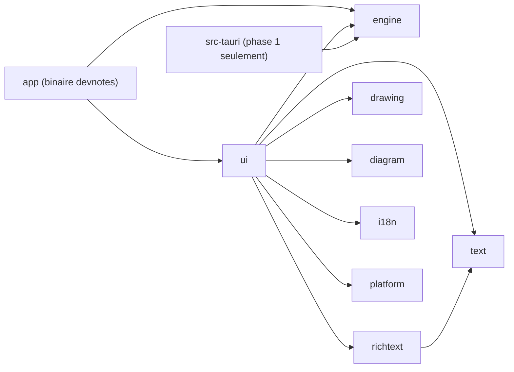
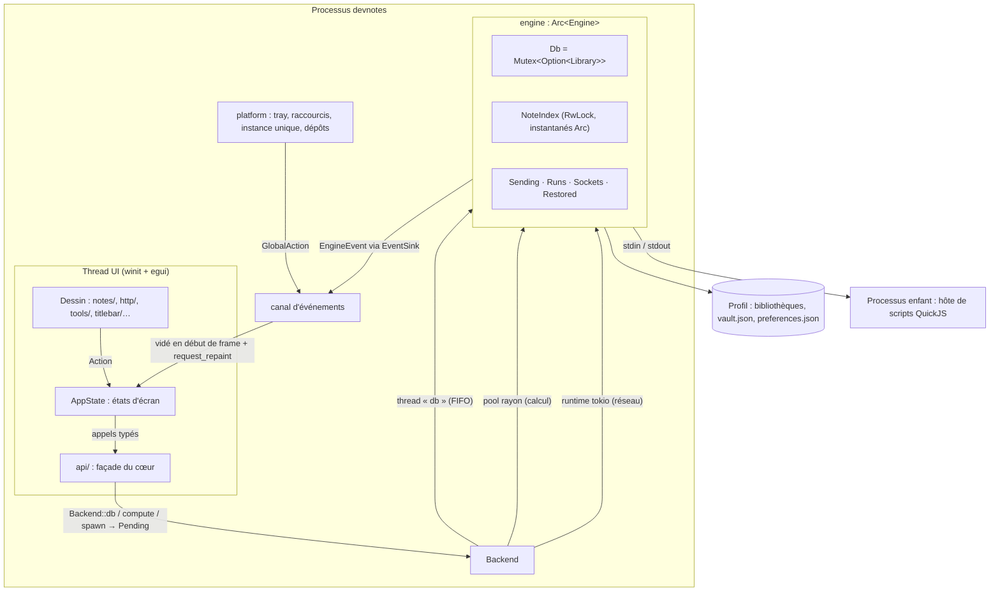
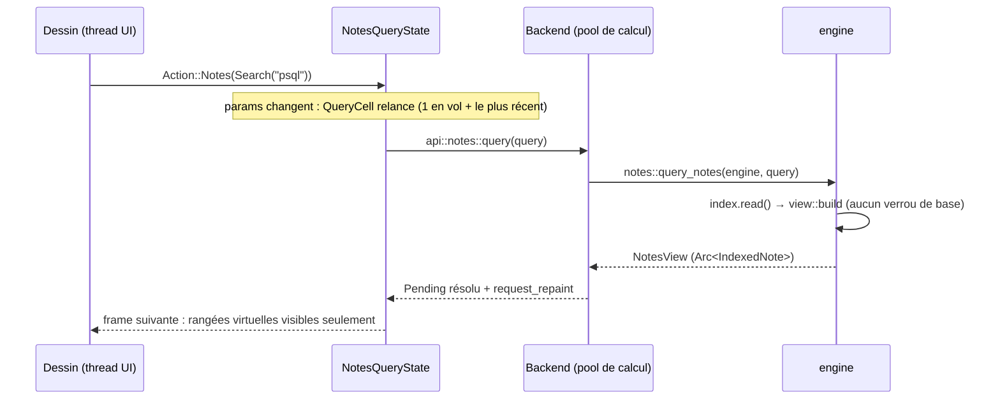
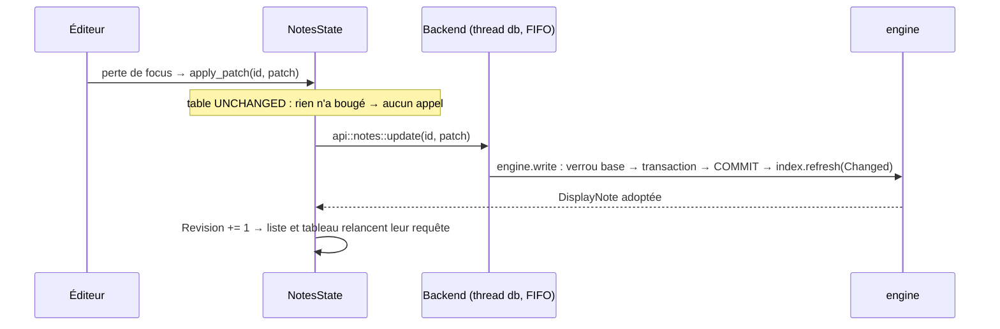
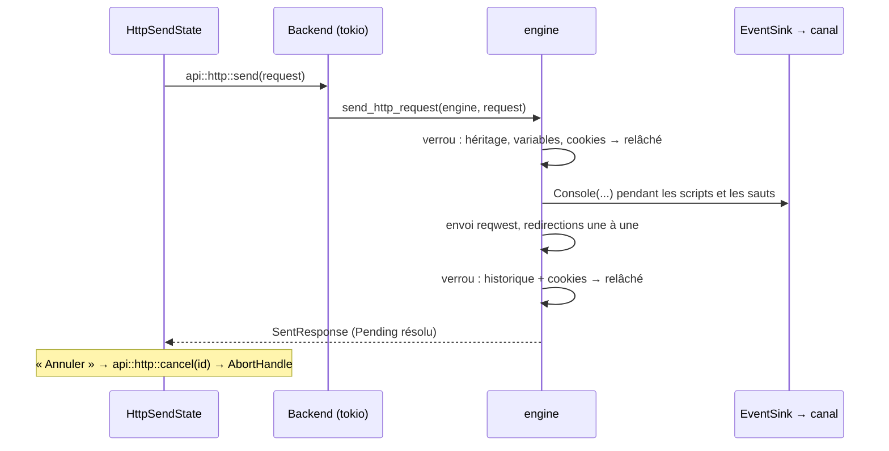
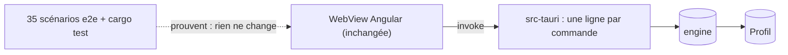
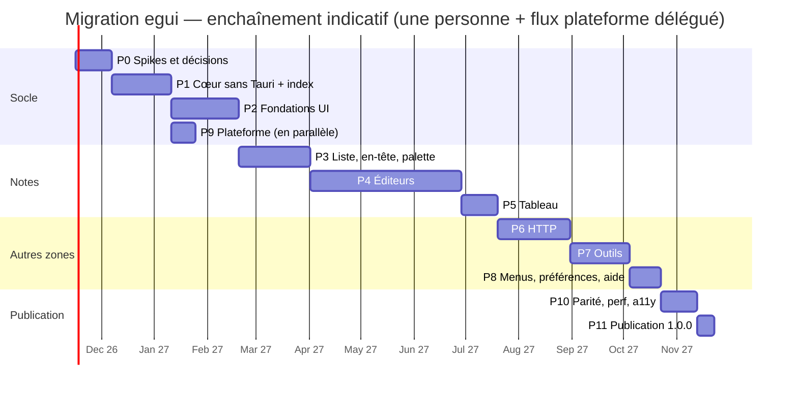

# Plan de migration : d'Angular + Tauri à egui (100 % Rust)

> Statut : **plan arrêté** — décisions prises le 2026-11-02 (§ 11), complétées le même jour après
> relecture (D10–D29). Quatre attendent une mesure dont le critère est déjà écrit : D1 (S8), D15
> (S1), D22 (S5), D26 (S9).
> Périmètre : remplacer le front-end Angular rendu dans une WebView Tauri par une interface
> **egui/eframe** écrite en Rust, dans le même processus que le métier, en retranscrivant **toute
> l'application avec la même apparence** et avec des performances correctes sur **30 000 notes** de
> tous types et **2 000 requêtes HTTP**.
> Ce document complète `docs/architecture.md` (cité « → Titre ») ; il ne le remplace pas tant que
> la 1.0.0 egui n'est pas publiée.

---

## Sommaire

0. [Résumé](#0-résumé)
1. [Point de départ, chiffré](#1-point-de-départ-chiffré)
2. [Objectifs, non-objectifs, critères de réussite](#2-objectifs-non-objectifs-critères-de-réussite)
3. [Architecture cible](#3-architecture-cible)
4. [Données, chemins et installation](#4-données-chemins-et-installation)
5. [Parité visuelle : méthode et écarts assumés](#5-parité-visuelle--méthode-et-écarts-assumés)
6. [Performances : corpus, budgets, mesure](#6-performances--corpus-budgets-mesure)
7. [Plan par phases](#7-plan-par-phases)
8. [Stratégie de tests et CI](#8-stratégie-de-tests-et-ci)
9. [Livraison de la 1.0.0](#9-livraison-de-la-100)
10. [Risques](#10-risques)
11. [Décisions](#11-décisions)
12. [Documentation et outillage à mettre à jour](#12-documentation-et-outillage-à-mettre-à-jour)

- [Annexe A — Composants Angular → modules egui](#annexe-a--composants-angular--modules-egui)
- [Annexe B — Stores et services → état Rust](#annexe-b--stores-et-services--état-rust)
- [Annexe C — Commandes Tauri → API du cœur](#annexe-c--commandes-tauri--api-du-cœur)
- [Annexe D — Scénarios e2e : de WebdriverIO au pilote egui_inspection](#annexe-d--scénarios-e2e--de-webdriverio-au-pilote-egui_inspection)
- [Annexe E — Dépendances retirées et ajoutées](#annexe-e--dépendances-retirées-et-ajoutées)
- [Annexe F — Logique TypeScript hors composants → destination](#annexe-f--logique-typescript-hors-composants--destination)

---

## 0. Résumé

**Stratégie : extraire le cœur sous l'application actuelle, puis écrire l'interface egui à sa place.**
L'application n'a pas d'utilisateurs (D6) : pas de double exploitation, pas de version pont, pas de
bêta, aucune compatibilité promise avec les versions Tauri.

1. **Phase 1** : tout le Rust existant passe dans une crate **`engine` sans Tauri**. Les 190
   commandes deviennent des fonctions Rust ordinaires et l'application Tauri actuelle n'en est plus
   qu'une coquille mince. Rien ne change à l'écran : les 35 scénarios e2e existants prouvent que
   l'extraction et l'index ne changent aucun comportement. À la fin, l'étiquette
   `angular-reference` fige l'application Angular ; la référence visuelle (D24) et les corpus
   d'or des bibliothèques JavaScript qui vont disparaître (D25) sont capturés depuis elle.
2. **Phase 2 et suivantes** : Angular, les e2e WebdriverIO et `src-tauri` quittent `main` ; on y
   construit l'application **egui** (`devnotes`), qui appelle `engine` sans IPC, sans
   sérialisation, sans WebView. L'application Angular se consulte depuis l'étiquette quand un écran
   est porté.
3. **1.0.0** quand l'application egui atteint la parité fonctionnelle (35 scénarios portés),
   visuelle (toute l'application, même apparence) et de performance (budgets du § 6).

**La clé des performances n'est pas egui, c'est un index de notes en mémoire.** Aujourd'hui,
`query_notes` relit et déchiffre tout le corpus à chaque frappe (403 ms à 8 000 notes de 13 kB,
donc ~1,5 s à 30 000 notes de cette taille). Dans un seul processus, le cœur peut garder, après
déverrouillage, un index déchiffré et « plié » (minuscules, sans accents) du corpus, mis à jour à
chaque écriture : une recherche devient un balayage mémoire de quelques dizaines de millisecondes.
Il est écrit dès la phase 1, sous l'application Tauri, ce qui le met à l'épreuve des 35 scénarios
e2e existants avant la première ligne d'egui.

**Ce qui coûte le plus** : les éditeurs. Il n'existe pas d'équivalent egui de TipTap (WYSIWYG
Markdown), de CodeMirror (éditeur de code complet), de Fabric.js (dessin) ni de Mermaid. Le plan
leur réserve ~40 % de l'effort, un noyau d'édition de texte commun, et des spikes dès la phase 0.

**Effort estimé** : **~55 semaines-personne** (fourchette 44–69), soit ~13 mois pour une personne à
plein temps, ~9 mois avec deux flux en parallèle (cf. § 7). Aucune modification de schéma, de
cryptographie, de dérivation de clé ni de format de fichier n'est nécessaire.

---

## 1. Point de départ, chiffré

### 1.1 Volume

| Partie                            | Taille (lignes)                                                      | Devenir                                                              |
| --------------------------------- | -------------------------------------------------------------------- | -------------------------------------------------------------------- |
| Rust `src-tauri/src/`             | 72 836                                                               | conservé (→ `engine`)                                                |
| dont fichiers qui nomment `tauri` | 17 fichiers, 9 096 lignes                                            | réécrits en API sans Tauri                                           |
| Commandes `#[tauri::command]`     | 190                                                                  | fonctions du cœur (annexe C)                                         |
| TypeScript hors specs             | 52 255                                                               | réécrit en Rust/egui                                                 |
| Gabarits HTML                     | 16 664                                                               | réécrits                                                             |
| SCSS                              | 23 326 (dont 1 618 globaux)                                          | réécrits en thème + widgets peints                                   |
| Specs Vitest                      | 53 646                                                               | ré-exprimés en tests Rust (§ 8)                                      |
| Scénarios e2e WebdriverIO         | 35 fichiers                                                          | portés sur le binaire assemblé, piloté par `egui_inspection` (§ 8.3) |
| Composants Angular                | ~180 (55 notes, 41 HTTP, 47 outils, 15 barre de titre, 16 partagés…) | annexe A                                                             |
| Stores                            | 25 (`core/state`) + 12 (HTTP)                                        | annexe B                                                             |
| Clés de traduction                | 3 323 par langue (fr, en)                                            | fichiers JSON conservés                                              |
| Langages de snippet               | 142 (`notes::language`)                                              | coloration à reprendre                                               |

### 1.2 Ce qui est déjà en Rust (et ne bouge pas)

Stockage SQLite/Diesel et migrations, coffre (Argon2 + AES-GCM, scellement colonne par colonne),
bibliothèques multiples, sauvegardes et restauration, récupération des bibliothèques abîmées,
import/export/partage, pièces jointes, corbeille et révisions, recherche et sections
(`notes::view`), facettes, tableau (`folders::board`), Markdown (`notes::markdown` : aperçu, plan,
découpe en diapositives), feuilles Calcul (`notes::calc`), `{{champs}}` (`notes::placeholder`),
détection de langage, client HTTP complet (envoi, redirections, cookies, variables, GraphQL,
WebSocket, historique, exécuteur de collection, génération de code), scripts de requête dans un
hôte QuickJS séparé, explorateur JSON, et les fonctions pures des 32 dossiers d'outils.

### 1.3 Ce que le front fait encore et qui doit passer en Rust

Les « exceptions front-end » de `CLAUDE.md` disparaissent comme exceptions et deviennent du Rust :

| Aujourd'hui (front)                                                            | Demain (Rust)                                            |
| ------------------------------------------------------------------------------ | -------------------------------------------------------- |
| Formatage du temps relatif, `ClockService`                                     | `ui::services::clock` + horloge injectable               |
| ISO ↔ `Date` à la frontière                                                    | disparaît (types `chrono` de bout en bout)               |
| Coloration syntaxique (CodeMirror/Lezer, 142 langues)                          | `syntect` + grammaires Sublime (§ 3.9)                   |
| Prettier (worker JS, 12 parseurs)                                              | formateurs natifs ou Prettier dans QuickJS (décision D1) |
| Recherche du catalogue d'outils et des références                              | le pli du cœur (`notes::view::fold`), appel direct (D12) |
| `Intl.DateTimeFormat`/`NumberFormat`/`ListFormat`/`DisplayNames`/`PluralRules` | formateurs fr/en écrits à la main dans `i18n` (D21)      |
| Transpileur ICU des pluriels de Transloco                                      | port Rust du transpileur existant                        |
| `CalcFormatter`, `calc-format.ts`, `decimal-format.util.ts`                    | `notes::calc` : écriture, somme et moyenne du pied       |
| Règles recopiées du cœur (`isVariableName`, motif des `{{champs}}`…)           | disparaissent : l'UI appelle la fonction du cœur (D12)   |
| Langue du système (`navigator.languages`)                                      | `sys-locale`, même règle (§ 3.11)                        |
| Brouillons, raccourcis, focus, glisser-déposer                                 | état egui                                                |

L'inventaire complet de la logique TypeScript hors composants, fichier par fichier, avec sa
destination, est l'**annexe F** : un fichier qui n'y figure pas n'a pas été oublié, il n'a pas de
logique.

### 1.4 Bibliothèques JavaScript sans équivalent egui direct

TipTap 3 (éditeur Markdown WYSIWYG), CodeMirror 6 (éditeur de code + recherche/remplacement +
coloration), Fabric.js 7 (éditeur de dessin), Mermaid 12 (diagrammes dans les Notes), Prettier 3
(formatage), Transloco (i18n). Chacune a sa réponse au § 3.9.

### 1.5 Plugins Tauri à remplacer

`single-instance`, `log`, `process`, `dialog`, `opener`, `store`, `clipboard-manager`,
`notification`, `window-state`, `updater`, `global-shortcut`, `autostart`, et l'icône de la zone de
notification (`tray-icon` de Tauri). Chacun a sa crate au § 3.10. La plupart des plugins Tauri
sont eux-mêmes construits sur ces crates (`global-hotkey`, `tray-icon`, `muda`, `auto-launch`,
`notify-rust`, `arboard`) : le comportement natif reste le même.

### 1.6 Particularités qui simplifient

- Cibles : **Windows et Linux** seulement (pas de macOS dans `release.yml`).
- La fenêtre garde **les décorations du système** : la « barre de titre » de l'application est une
  barre de menus dans la fenêtre. Pas de déplacement/redimensionnement maison à écrire.
- Cartes du canevas de **hauteur fixe (150 px)** dans une grille `minmax(220px, 1fr)` : la
  virtualisation est triviale (rangées uniformes par section).
- Le Rust est déjà « feature-first » et ses modèles n'importent ni Diesel ni Tauri.

---

## 2. Objectifs, non-objectifs, critères de réussite

### 2.1 Objectifs

1. **Zéro WebView, zéro JavaScript dans l'interface.** L'hôte de scripts QuickJS reste (il exécute
   les scripts de l'utilisateur, pas l'interface).
2. **Toute l'application garde son apparence** : chaque écran, menu, boîte de dialogue et état de
   l'application Angular est retranscrit en egui avec les mêmes jetons de couleur, polices,
   espacements, composants, états (survol, focus, sélection, armé…), animations (120/160 ms), deux
   thèmes et deux densités. Aucun écran simplifié, aucun mode provisoire (D4) ; « quasi » ne couvre
   que les limites techniques du § 5.3.
3. **Performances** : budgets du § 6, mesurés sur un corpus de 30 000 notes et 2 000 requêtes.
4. **Formats sur disque inchangés** : le cœur n'est pas réécrit, donc un profil existant s'ouvre
   tel quel — par construction, sans que ce soit une garantie testée (D6).
5. **Mises à jour signées egui → egui** dès la 1.0.0 (§ 4.3).
6. **Accessibilité au moins équivalente** (AccessKit : lecteurs d'écran Windows et Orca).

### 2.2 Non-objectifs

- Aucune nouvelle fonctionnalité pendant la migration.
- Aucune compatibilité avec les versions Tauri : ni version pont, ni bêta, ni retour arrière, ni gel
  des migrations de schéma (D6).
- Pas de correcteur orthographique (D3).
- Aucun changement de format disque, de cryptographie, de dérivation de clé, d'export
  (`FORMAT_VERSION` inchangé), de nom dans `layout.rs`.
- Pas de macOS, pas de mobile, pas de web.
- Pas de réécriture du métier Rust au-delà du découplage de Tauri et de l'index (§ 3.5).

### 2.3 Critères de publication de la 1.0.0 (tous requis)

- Les 35 scénarios e2e sont portés sur le pilote `egui_inspection` et passent sur Windows et Linux,
  contre le binaire assemblé.
- Rapport de parité visuelle (§ 5) relu et accepté sur toute l'application, écarts restants
  limités au § 5.3.
- Budgets de performance (§ 6) tenus sur les deux corpus de référence.
- Installation propre et mise à jour 1.0.0 → 1.0.1 testées (NSIS, AppImage).
- `docs/architecture.md`, `CLAUDE.md` et les skills mis à jour (§ 12).

### 2.4 Règles d'écriture du code

Le code sera maintenu par un humain : **concis mais lisible**, et **KISS** (_keep it simple,
stupid_). Ces règles sont aussi dans `CLAUDE.md`, que Claude Code lit à chaque session, et dans
les skills `egui-ui` et `rust-guidelines` (§ 12).

- La solution la plus simple qui marche. Pas d'abstraction — trait, générique, macro, couche — avant
  son deuxième usage réel : les briques du § 3 (`QueryCell`, `Memo`, la file d'`Action`…) s'écrivent
  quand le premier écran en a besoin, pas avant.
- Petites fonctions à une responsabilité, noms qui disent ce que sont les choses, retours anticipés
  plutôt qu'imbrication. Un écran qui grossit se découpe en fonctions de dessin nommées, pas en
  couches.
- Pas d'astuce pour gagner trois lignes ; entre ajouter et supprimer pour corriger, supprimer.
- Commentaires : des décisions, pas de la narration (règle actuelle du projet).
- Idiomes Rust : les _Pragmatic Rust Guidelines_ de Microsoft (skill `rust-guidelines`), les règles
  du projet l'emportant là où elles diffèrent.
- En revue : une abstraction ajoutée dit quel second usage la justifie.

---

## 3. Architecture cible

### 3.1 Espace de travail

```
Cargo.toml                    workspace (resolver 3, lints partagés : unsafe_code = forbid, pedantic)
crates/
├── engine/                   ← src-tauri/src actuel, sans Tauri : métier, SQL, coffre, HTTP, outils
│   ├── src/notes/ …          mêmes features, même découpage <feature>.rs / model.rs / store.rs
│   ├── src/index/            NOUVEAU : index de notes en mémoire (§ 3.5)
│   ├── src/host.rs           NOUVEAU : traits Paths + EventSink (remplacent AppHandle/emit)
│   ├── migrations/  resources/  sandbox/   (déplacés tels quels)
│   ├── benches/  tests/
├── text/                     NOUVEAU : noyau d'édition (rope, sélection, annuler, recherche,
│                             complétion, survol), coloration (syntect), formatage, bouclier {{…}}
├── richtext/                 NOUVEAU : modèle de document Markdown, parse/sérialise, échappement,
│                             collage HTML
├── drawing/                  NOUVEAU : scène compatible Fabric, géométrie, coupure des lignes,
│                             rendu SVG puis PNG (resvg)
├── diagram/                  NOUVEAU : rendu des blocs mermaid (§ 3.9)
├── i18n/                     NOUVEAU : fr.json/en.json, pluriels ICU, clés générées
├── platform/                 NOUVEAU : tray, raccourcis globaux, autostart, instance unique,
│                             notifications, dialogues, presse-papiers, ouverture, updater, chemins
├── ui/                       NOUVEAU : l'application egui (thème, widgets, zones, état)
└── app/                      NOUVEAU : le binaire `devnotes` (main : hôte de scripts ou eframe)
src-tauri/                    coquille Tauri mince : phase 1 seulement (filet des e2e), supprimée en P2
src/ e2e/ angular.json …      front Angular et e2e : supprimés en P2, consultables sur angular-reference
```

**Nommage.** Les crates portent un nom court, sans préfixe : le dossier `crates/` et le workspace
disent déjà de quel projet elles sont, et aucune n'est publiée. Le cœur s'appelle **`engine`** et
non `core` : une dépendance nommée `core` masquerait la crate `core` de Rust, que les macros
dérivées (serde, diesel, thiserror…) désignent en `::core::…`. Les autres noms (`text`, `ui`,
`i18n`…) ne heurtent ni la bibliothèque standard ni une dépendance du workspace ; un nouveau nom est
vérifié contre `Cargo.lock` avant d'être pris. Les benchs et tests d'intégration du cœur importent
`engine` au lieu de `devnotes_lib`.

Le binaire final s'appelle toujours `devnotes` (`devnotes.exe`), déclaré par `[[bin]] name =
"devnotes"` dans la crate `app` : l'installeur, le raccourci, l'entrée de démarrage automatique et
la relance en hôte de scripts (`--devnotes-script-host`, lu dans `main` avant toute fenêtre) en
dépendent.



### 3.2 Règles de dépendance (elles remplacent la frontière IPC)

| Crate                                    | Peut dépendre de                              | Ne doit jamais dépendre de                                 |
| ---------------------------------------- | --------------------------------------------- | ---------------------------------------------------------- |
| `engine`                                 | Diesel, crypto, reqwest, tokio                | egui, eframe, winit, Tauri, `platform`                     |
| `text`, `richtext`, `drawing`, `diagram` | `unicode-*`, `syntect`, `resvg`, `html5ever`… | egui (le rendu egui est dans `ui`), Diesel, `engine` (D10) |
| `platform`                               | crates natives (tray-icon, rfd…)              | egui, Diesel, `engine`                                     |
| `ui`                                     | tout ce qui précède                           | Diesel, `rusqlite`, SQL brut                               |

**Une règle, une définition (D10).** `engine` ne dépend d'aucune des crates nouvelles ; `text`,
`richtext`, `drawing`, `diagram` sont des feuilles (seule arête interne : `richtext → text`, pour le
bouclier `{{…}}`). Une règle de données — ce qu'est un `{{champ}}` (`notes::placeholder`), une
variable HTTP (`http::variables`), un nom de variable (`http::environments::is_variable_name`), le
texte d'un Dessin (`notes::drawing::words`), le plan d'une Note (`notes::markdown`) — n'est définie
qu'au cœur. Une crate d'édition ne la redéfinit pas : `ui` lui passe le résultat en argument
(plages de champs à décorer, langage, plages à protéger). Deux cas restent, chacun avec sa règle :

- le **bouclier `{{…}}`** de `text` : tout `{{…}}` d'une ligne est laissé intact par l'échappement
  Markdown et par le formatage (la règle de `markdown-text.ts` et `field-shield.ts`, plus large que
  la grammaire des champs) ; ce n'est pas la définition d'un champ ;
- les **options de `pulldown-cmark`** de `richtext` et de `notes::markdown` sont les mêmes : un
  test de `ui`, seule crate qui voit les deux, les compare.

Les principes de `CLAUDE.md` se transposent :

- **Le traitement des données reste au cœur.** L'UI ne filtre, ne trie, ne groupe pas ; elle
  demande une vue au cœur. La différence : la vue n'est plus sérialisée en JSON, elle est passée par
  valeur ou par `Arc`. Une règle que le front recopiait du cœur (`isVariableName`, le motif des
  champs passé par `.constant(...)`) disparaît : l'UI appelle la fonction du cœur (D12).
- **Feature-first côté cœur** : `<feature>.rs` ne contient plus de `#[tauri::command]` mais des
  fonctions de service (`notes::query_notes(engine: &Engine, query)`, § 3.3.3) — valider, verrouiller,
  déléguer, traduire l'erreur — exactement le rôle des commandes actuelles. `model.rs` et
  `store.rs` ne bougent pas.
- **L'arborescence de l'UI a la forme de l'écran** : `ui/src/notes/` (`sidebar`,
  `header`, `canvas`, `overlays`, `ui`), `tools/`, `http/`, `titlebar/`, `banners/` contiennent du
  dessin ; `state/`, `services/`, `api/`, `backend.rs` contiennent ce qui n'a pas de place à
  l'écran ; `widgets/` remplace `shared/` et n'accède à aucun état global.

### 3.3 Le cœur et l'interface dans un seul processus

C'est l'architecture finale : ce qui remplace `invoke()`, `app.manage(...)`, `app.emit(...)` et les
plugins appelés depuis Rust. Le § 3.3.10 dit comment elle se met en place sous l'application
actuelle pendant la phase 1.

#### 3.3.1 Vue d'ensemble



Trois règles tiennent tout le reste :

1. **Le thread UI ne fait ni E/S, ni crypto, ni attente.** Tout ce qui touche au cœur part par
   `Backend` et revient par un `Pending` ; aucun `block_on`, aucun verrou pris depuis le dessin.
   Seule exception, bornée : les fonctions pures du § 3.3.5 (D12).
2. **Le cœur ne sait rien de l'interface.** Il ne connaît ni egui ni Tauri : il reçoit deux traits
   (`Paths`, `EventSink`) et renvoie des valeurs ou des `AppError`.
3. **Une seule façade nomme les fonctions du cœur** : `ui/src/api/`. C'est l'équivalent de
   la règle actuelle « seuls `core/data/` et `core/ipc/` appellent les commandes ». Les types du
   modèle (`NotesQuery`, `DisplayNote`, `Language`, `HttpRequest`…) sont, eux, utilisés partout tels
   quels : plus de types miroirs, plus de `note.mapper.ts`.

#### 3.3.2 `Engine` : la racine de composition

Aujourd'hui l'état natif est enregistré dans Tauri (`app.manage(Db)`, `Restored`, `Sending`, `Runs`,
`Sockets`) et retrouvé par `app.state::<…>()`. Il devient une structure possédée par la coquille :

```rust
// engine/src/lib.rs — créée une fois par la coquille, partagée en Arc<Engine>
pub struct Engine {
    db: Db,                           // Mutex<Option<Library>> : inchangé
    index: NoteIndex,                 // § 3.5 ; vide tant que la bibliothèque est fermée
    sending: http::send::Sending,     // envois en vol, corps gardés par id
    runs: http::runner::Runs,
    sockets: http::websocket::Sockets,
    restored: backup::Restored,
    paths: Arc<dyn Paths>,
    events: Arc<dyn EventSink>,
    runtime: tokio::runtime::Handle,  // fourni par la coquille
}

impl Engine {
    /// Aucune E/S lourde : la bibliothèque reste fermée jusqu'à `vault::unlock`.
    pub fn new(paths: Arc<dyn Paths>, events: Arc<dyn EventSink>, runtime: Handle) -> Self;
}
```

| État                                                      | Propriétaire                                                                         | Où il vit                                |
| --------------------------------------------------------- | ------------------------------------------------------------------------------------ | ---------------------------------------- |
| Connexion SQLite + clé (`Library`)                        | `Engine.db`                                                                          | thread « db »                            |
| Index de notes                                            | `Engine.index`                                                                       | pool rayon (construction), lu partout    |
| Envois, exécutions, sockets, restauration mise de côté    | `Engine.sending/runs/sockets/restored`                                               | runtime tokio                            |
| Préférences de l'application et de la bibliothèque        | `ui::services::preferences` (mêmes fichiers) ; le cœur relit seul `automaticBackups` | thread UI (cache) + écriture hors thread |
| Tray, raccourcis globaux, instance unique, démarrage auto | `platform`                                                                           | thread plateforme                        |
| Brouillons, sélection, onglets, focus, menus ouverts      | `AppState`                                                                           | thread UI                                |

#### 3.3.3 L'API du cœur : trois familles de fonctions

Les `<feature>.rs` gardent leur rôle (valider, verrouiller, déléguer, traduire l'erreur) ; seule la
signature change, et elle dit sur quel thread on l'appelle :

```rust
// 1. Données : synchrones et bloquantes — appelées sur le thread « db » si elles prennent le verrou
//    de la base, sur le pool de calcul si elles ne lisent que l'index ; jamais sur le thread UI.
pub fn query_notes(engine: &Engine, query: NotesQuery) -> Result<NotesView, AppError>;
pub fn update_note(engine: &Engine, id: &str, patch: NotePatch) -> Result<DisplayNote, AppError>;
pub fn unlock(engine: &Engine, passphrase: Zeroizing<String>) -> Result<(), AppError>;

// 2. Réseau : asynchrones, sur le runtime du cœur ; ne tiennent jamais le verrou en attendant.
pub async fn send_http_request(engine: Arc<Engine>, request: SendRequest) -> Result<SentResponse, AppError>;
pub fn cancel_http_send(engine: &Engine, id: &str);
pub async fn connect_websocket(engine: Arc<Engine>, request: ConnectRequest) -> Result<(), AppError>;

// 3. Outils : fonctions pures, comme aujourd'hui dans tools/* (le `off_thread` part dans la coquille).
pub fn convert_case(request: &CaseRequest) -> CaseAnswer;
```

Un exemple avant/après, pour fixer la forme :

```rust
// Aujourd'hui — src-tauri/src/notes.rs
#[tauri::command]
pub async fn query_notes<R: Runtime>(query: NotesQuery, app: AppHandle<R>) -> Result<NotesView, AppError> {
    blocking(app, move |_, db| { let mut connection = lock(db)?; /* fetch, decorations, view::build */ }).await
}

// Demain — engine/src/notes.rs
pub fn query_notes(engine: &Engine, query: NotesQuery) -> Result<NotesView, AppError> {
    let index = engine.index().read()?; // jamais le verrou de la base, décorations comprises
    Ok(view::build(index.matching(&query), index.facets(&query), index.decorations(&query), &query))
}
```

Les **décorations** que `query_notes` lit aujourd'hui sous le verrou (`store::decorations` :
nombre de pièces jointes par note, valeurs globales des `{{champs}}`, dossiers de l'espace par id)
vivent dans l'index (§ 3.5) : sans cela, une recherche attendrait encore derrière `export_notes`.

**`NotesView` change de forme**, pas de sens : ses sections portent des
`Card { note: Arc<IndexedNote>, hit: Option<SearchHit>, matches: bool }` au lieu de `DisplayNote`
copiées, et l'aperçu est calculé pour les seules cartes affichées. Ce changement de forme a lieu
en phase 2, une fois `src-tauri` retiré : la phase 1 garde la vue actuelle, pour que les scénarios
e2e valident l'extraction et l'index tels quels.

**Ce qui sort du cœur.** Quatre endroits touchent encore la plateforme depuis Rust :

| Aujourd'hui                                                    | Demain                                                                                                      |
| -------------------------------------------------------------- | ----------------------------------------------------------------------------------------------------------- |
| `attach_clipboard_image` lit le presse-papiers (plugin)        | l'UI lit l'image (`arboard`), le cœur reçoit des octets : `attachments::attach_image(engine, note_id, png)` |
| `copy_qr_code` écrit dans le presse-papiers (plugin)           | le cœur rend le PNG, l'UI le copie                                                                          |
| `backup::take` lit `automaticBackups` par `tauri-plugin-store` | le cœur lit `preferences.json` lui-même (`serde_json`, `Paths::profile`, `layout::PREFERENCES`)             |
| `resource_dir()`, `app_data_dir()`                             | `Paths`                                                                                                     |

`desktop.rs` (tray, raccourcis globaux, `sync_tray`, `hold_quit`, `set_window_behavior`) quitte le
cœur pour `platform`, appelé par l'UI. Les dialogues de fichiers restent ce qu'ils sont
déjà : l'interface choisit le chemin, le cœur reçoit un chemin.

**Erreurs.** `AppError { code, params, detail }` ne change pas. L'UI la traduit par un `match`
exhaustif sur `ErrorCode` (`ui::services::errors`) : un code ajouté ne compile plus tant qu'il n'a
pas sa clé, ce qui remplace `CODE_KEYS` + `IPC_ERROR_CODES`. `detail` va au journal, jamais à
l'écran.

#### 3.3.4 `Paths` et `EventSink` : ce que le cœur demande à sa coquille

```rust
// engine/src/host.rs
pub trait Paths: Send + Sync {
    fn profile(&self) -> &Path;       // app_data_dir : registre, libraries/, preferences.json
    fn resources(&self) -> &Path;     // identity/ (listes de l'outil identité)
    fn plaintext(&self) -> PathBuf;   // copies en clair des pièces jointes ouvertes
}

pub trait EventSink: Send + Sync {
    fn emit(&self, event: EngineEvent);
}

#[non_exhaustive]
pub enum EngineEvent {
    Socket { id: String, event: SocketEvent },   // remplace WEBSOCKET_EVENT
    Console(ConsoleEvent),                       // remplace HTTP_CONSOLE_EVENT
    Run(RunEvent),                               // remplace HTTP_RUN_EVENT
    IndexProgress { done: u32, total: u32 },     // nouveau : construction de l'index
    IndexReady,
}
```

| Implémentation        | `Paths`                   | `EventSink`                                        |
| --------------------- | ------------------------- | -------------------------------------------------- |
| `src-tauri` (phase 1) | `app.path()` de Tauri     | `app.emit(...)` avec les noms d'événements actuels |
| `ui`                  | `platform::paths` (§ 4.1) | `crossbeam::Sender<Input>` + `Waker` (D20)         |
| tests                 | dossier temporaire        | `RecordingSink` qui garde les événements           |

`GlobalAction` (tray, raccourcis, seconde instance) ne passe pas par le cœur : la plateforme
l'envoie sur le même canal que l'UI vide.

**Le réveil (D20).** Le canal et l'`egui::Context` n'existent pas au même moment : l'instance
unique et le thread plateforme démarrent avant la fenêtre. `main` crée donc le canal d'entrées
(`Input` : `EngineEvent`, `GlobalAction`, message d'une seconde instance) et un `Waker` — un
`Arc<OnceLock<egui::Context>>` dont `wake()` appelle `request_repaint()` s'il est rempli. Tous les
émetteurs reçoivent l'émetteur du canal et le `Waker`. La closure de création d'eframe remplit le
`Waker`, puis crée `Engine`, `Backend` et `AppState`. Ce qui arrive avant la première frame attend
dans le canal, vidé au début de chaque frame.

#### 3.3.5 Côté interface : `Backend`, `api/`, `Pending`, `QueryCell`, `Revision`

```rust
// ui/src/backend.rs
pub struct Backend {
    engine: Arc<Engine>,
    db: DbThread,                      // un thread, FIFO : tout ce qui peut prendre le verrou de la base
    runtime: tokio::runtime::Runtime,  // multi-thread, 2 workers : réseau, updater
    waker: Waker,                      // réveille l'UI à chaque résolution (§ 3.3.4)
}

impl Backend {
    /// Thread « db », dans l'ordre d'envoi : écritures, et lectures qui prennent le verrou.
    pub fn db<T: Send + 'static>(
        &self,
        job: impl FnOnce(&Engine) -> Result<T, AppError> + Send + 'static,
    ) -> Pending<T>;

    /// Pool rayon global : ne prend jamais le verrou (index, outils, formatage, images).
    pub fn compute<T: Send + 'static>(
        &self,
        job: impl FnOnce(&Engine) -> Result<T, AppError> + Send + 'static,
    ) -> Pending<T>;

    /// Runtime tokio : réseau.
    pub fn spawn<T, F>(&self, job: impl FnOnce(Arc<Engine>) -> F + Send + 'static) -> Pending<T>
    where
        F: Future<Output = Result<T, AppError>> + Send + 'static,
        T: Send + 'static;

    /// Tests seulement : attend que tout ce qui a été lancé soit résolu.
    #[cfg(test)]
    pub fn settle(&self);
}

// ui/src/api/notes.rs — une fonction par service, rien d'autre ; elle choisit sa file
pub fn query(backend: &Backend, query: NotesQuery) -> Pending<NotesView> {
    backend.compute(move |e| engine::notes::query_notes(e, query))
}

pub fn update(backend: &Backend, id: String, patch: NotePatch) -> Pending<DisplayNote> {
    backend.db(move |e| engine::notes::update_note(e, &id, patch))
}
```

- **Trois files, une règle (D11).** Ce qui peut prendre le verrou de la base passe par `db` : un
  seul thread, qui exécute dans l'ordre d'envoi. Deux écritures d'une même note ne se doublent
  jamais (un `Mutex` ne garantit pas l'ordre d'arrivée), et plusieurs threads n'iraient pas plus
  vite derrière un verrou unique. Ce qui ne lit que l'index ou ne touche pas la base (requête de
  notes, palette, compteurs, outils, formatage, coloration, décodage d'images) passe par `compute`,
  sur le pool rayon global — le même que la construction de l'index : une recherche ne fait pas la
  queue derrière un export. Le réseau passe par `spawn`. Chaque fonction d'`api/` choisit sa file
  une fois pour toutes ; dans le doute, `db`.
- **Appels directs (D12).** Une fonction pure du cœur — sans verrou, sans E/S — s'appelle depuis
  le thread UI, sans `Pending`, quand son entrée est bornée par ce que l'écran montre et qu'elle
  tient sous 1 ms au p95 sur la machine de référence pour la plus grande de ces entrées. Elle passe
  quand même par `api/`, la façade restant seule à nommer le cœur. Directs : plages des `{{champs}}`
  (`notes::placeholder::spans`) et des variables HTTP des lignes affichées, validation d'un nom de
  variable, pli d'une saisie de recherche du catalogue, secret présumé et nom proposé d'une
  extraction. Par `compute` : évaluation d'une feuille Calcul (taille non bornée ; l'anti-rebond de
  120 ms est gardé), formatage, calcul d'un outil, `explore_json`, coloration d'un corps de réponse.
- **`Pending<T>`** : une poignée sur un résultat à venir (`oneshot`), lue par `poll()` à chaque
  frame ; le travailleur appelle `Waker::wake()` en la résolvant. L'abandonner n'interrompt pas un
  travail commencé sur la base (comme aujourd'hui) ; un envoi HTTP s'annule explicitement
  (`cancel_http_send`). Un travail qui panique résout son `Pending` en `AppError` (D18) : aucun
  `Pending` ne reste sans réponse.
- **`QueryCell<P: PartialEq + Clone, T>`** : remplace `resource()` + `linkedSignal` + `OneInFlight`.
  Garde la dernière valeur pendant un rechargement, compare ses paramètres structurellement (le piège
  du comparateur d'identité disparaît), garde **un appel en vol et le plus récent en attente**.
- **`Revision`** : compteur incrémenté après chaque écriture adoptée (équivalent `NotesRevision`) ;
  les `QueryCell` de la liste et du tableau l'ont dans leurs paramètres, donc les deux vues se
  rafraîchissent ensemble. Écritures **non optimistes** : persister, adopter la réponse,
  incrémenter.

Chaîne d'appel imposée : **dessin → `Action` → état → `api` → `Backend` → cœur** (§ 3.4 pour le
partage entre dessin et état). Le dessin ne connaît pas `api`, sauf les appels directs de D12 ;
l'état ne connaît pas egui. Il se teste sans fenêtre, contre le vrai cœur sur un dossier
temporaire et le vrai `Backend`, et attend ses réponses par `settle()` : une condition, jamais une
durée.

#### 3.3.6 Verrous, threads et instantanés

1. **Ordre des verrous : base → index.** Une écriture (thread « db ») prend le verrou de la base,
   fait sa transaction, relit les lignes touchées, puis prend l'index en écriture le temps
   d'échanger des `Arc`. Une requête (pool de calcul) ne prend que l'index en lecture, décorations
   comprises (§ 3.3.3) : `export_notes` (639 ms sous le verrou) ne bloque plus la recherche.
2. **Instantanés immuables.** Les entrées de l'index sont des `Arc<IndexedNote>` jamais modifiés en
   place ; une écriture remplace l'`Arc`. Une vue tient ses `Arc` : l'UI dessine sans aucun verrou,
   et une entrée remplacée est libérée (et effacée, `Zeroizing`) quand la dernière vue qui la tenait
   disparaît.
3. **Le réseau ne tient jamais le verrou** (règle actuelle) : un envoi lit sous le verrou ce dont il
   hérite, relâche, envoie, puis reprend le verrou pour l'historique et les cookies.
4. **Ouvrir une autre bibliothèque, restaurer une sauvegarde** : vider le `Mutex` **et** l'index,
   fermer les sockets, annuler envois et exécutions, avant de toucher aux fichiers.
5. **Seule attente du thread UI** : à la sortie, fenêtre déjà cachée, le temps que la file « db »
   se vide (D19, 30 s au plus).

#### 3.3.7 Une frame

`DevNotesApp::update` fait toujours la même chose, dans cet ordre :

1. **Vider les entrées** : `EngineEvent`, `GlobalAction`, fichiers déposés, message d'une seconde
   instance (« révéler », ou une action en saveur `e2e`).
2. **Récolter les `Pending`** : chaque état adopte ses réponses ; une écriture adoptée incrémente
   `Revision`.
3. **Relancer les `QueryCell`** dont les paramètres ont changé (requête, `Revision`, jour local).
4. **Dessiner** : barre de titre, zone courante, superpositions, `DialogStack`, bannières. Le dessin
   pousse des `Action` ; un widget qui a le focus consomme les touches qu'il traite.
5. **Répartir le clavier restant** (`keys::dispatch`, D14) : ce que les widgets n'ont pas consommé
   devient des `Action`, par niveaux.
6. **Appliquer les `Action`** : elles modifient l'état et lancent de nouveaux appels.
7. **Planifier la frame suivante** : animation en cours, prochaine étiquette relative qui change,
   sinon rien (CPU au repos).

#### 3.3.8 Cycles de vie

| Moment                            | Ce qui se passe                                                                                                                                                                                                                                                                                                                                                                                                                                                                                                                                          |
| --------------------------------- | -------------------------------------------------------------------------------------------------------------------------------------------------------------------------------------------------------------------------------------------------------------------------------------------------------------------------------------------------------------------------------------------------------------------------------------------------------------------------------------------------------------------------------------------------------- |
| **Lancement**                     | `main` : `--devnotes-script-host` → servir les scripts et sortir ; sinon chemins (profil par défaut ou `--profile`), journal et crochet de panique (D18), instance unique du profil (D16 : une seconde instance envoie « révéler » et sort), canal d'entrées et `Waker` (D20), thread plateforme (tray, raccourcis), eframe avec la fenêtre invisible à la géométrie restaurée ; dans la closure de création : `Waker` rempli, `Engine::new` (bibliothèque fermée), `Backend`, `AppState` ; fenêtre montrée. Première frame : `vault::state` → la porte. |
| **Déverrouillage**                | `api::vault::unlock(Zeroizing)` sur le thread « db » : `gate::unlock`, puis les corvées de `sweep` (copie de sauvegarde, purge de la corbeille et de l'historique, fichiers orphelins, copies en clair) ; puis construction de l'index sur rayon avec `IndexProgress`. L'UI affiche les premières sections dès la première tranche.                                                                                                                                                                                                                      |
| **Changement de bibliothèque**    | `api::libraries::open` (§ 3.3.6, point 4), puis `AppState::reset_library_scope()` : préférences de la bibliothèque rouvertes, états des notes et du HTTP remis à zéro, `LibraryCaches` et états des widgets d'egui vidés (D17), réglages de l'application gardés, retour à la porte. C'est ce que fait aujourd'hui le rechargement de la page.                                                                                                                                                                                                           |
| **Restauration d'une sauvegarde** | même vidage, restauration, puis porte.                                                                                                                                                                                                                                                                                                                                                                                                                                                                                                                   |
| **Fermer la fenêtre**             | avec un tray : `CancelClose` + fenêtre cachée ; sans tray : comme Quitter.                                                                                                                                                                                                                                                                                                                                                                                                                                                                               |
| **Quitter**                       | `HttpLeave` demande pour les requêtes non enregistrées ; brouillons d'éditeur envoyés à la file « db » ; fenêtre cachée ; file « db » fermée aux nouvelles tâches puis vidée, écritures commencées comprises (D19) ; raccourcis libérés, tray retiré ; copies en clair balayées ; géométrie écrite ; sortie.                                                                                                                                                                                                                                             |

#### 3.3.9 Trois parcours de bout en bout







#### 3.3.10 Pendant la phase 1 : le cœur extrait sous l'application actuelle



- `src-tauri` ne garde que `lib.rs` (builder, plugins, `collect_commands!`), `desktop.rs`, une
  enveloppe `#[tauri::command]` d'une ligne par service (`blocking(engine, |e| service(e, args))`)
  et `TauriHost` (`Paths` + `EventSink`). Les vues gardent leur forme actuelle : `bindings.ts` et
  le front Angular ne changent pas.
- Les 35 scénarios e2e, les tests Rust et l'oracle de l'index (§ 3.5) sont le filet : l'extraction
  et l'index ne changent aucun comportement visible.
- En fin de phase, l'étiquette `angular-reference` fige cette version ; la référence visuelle
  (§ 5.2) en est capturée.
- En phase 2, `src-tauri`, `TauriHost`, les dérivations `specta`, Angular et les e2e WebdriverIO
  quittent `main` ; `NotesView` passe aux instantanés `Arc` (§ 3.3.3).
- **Les deux applications ne partagent jamais un profil (D16).** L'index en mémoire suppose qu'aucun
  autre processus n'écrit la base : un second écrivain le rendrait faux sans le moindre signal.
  Jusqu'à la 1.0.0, le binaire egui prend par défaut le profil `com.devnotes.app.dev` (l'application
  `angular-reference` garde `com.devnotes.app`) ; deux instances egui sur un même profil sont
  empêchées par l'instance unique, propre à chaque profil (§ 3.10).

### 3.4 État de l'interface

- Un `AppState` racine possède les états d'écran ; chaque store Angular devient une structure Rust
  aux champs privés, lue par des accesseurs, modifiée par des méthodes (la règle « signal privé
  derrière `.asReadonly()` » devient la visibilité Rust). Annexe B.
- **État et vue d'un écran (D13).** Chaque écran a deux structures, toutes deux dans `AppState` :
  - son **état** (`…State`) : ce que d'autres écrans ou le cœur voient — note ouverte, sélection,
    requête, onglets, brouillon validé ;
  - sa **vue** (`…View`) : ce que seul son dessin voit — texte en cours de saisie, tampon d'un
    éditeur, menu ouvert, défilement, geste en cours.

  Le dessin reçoit `&…State` et `&mut …View`, et pousse des `Action`. Une vue change pendant le
  dessin (un `TextEdit` écrit dans un `&mut String`) ; un état ne change que dans `apply`. Un texte
  saisi entre dans l'état par une `Action` quand il est validé — Entrée, perte de focus, fermeture,
  les moments d'aujourd'hui. `apply` peut lire une vue (valider le brouillon d'un éditeur avant
  d'ouvrir une autre note) ; le dessin ne modifie jamais un état.

- **File d'intentions** (§ 3.3.7) : `Action` a une variante par zone, qui porte l'énumération de
  sa zone — `Action::Notes(notes::Action)`, `Action::Http(http::Action)`, `Action::Tools(…)`,
  `Action::App(…)` (zones, thème, boîtes de dialogue, bibliothèques), `Action::Global(GlobalAction)`
  — et chaque `apply` de zone vit à côté de son état. `AppState::apply` les traite en fin de frame.
  Une seule entrée pour clavier, palette, tray, menus et raccourcis globaux, et pas de conflit
  d'emprunt entre dessin et mutation.
- **Valeurs dérivées** : calculées à la demande, ou mémorisées (`Memo<K, V>`) quand elles coûtent
  (plan de mise en page d'une section, `LayoutJob` coloré). Tout cache qui garde du contenu d'une
  bibliothèque — `LayoutJob`, textures, `Memo`, dessins Mermaid — est un champ de
  `LibraryCaches`, lui-même un seul champ d'`AppState` (D17).
- **Horloge** : un trait `Clock` (vrai, faux en test) ; les étiquettes relatives demandent un
  rafraîchissement au moment où elles changent (`request_repaint_after`), pas toutes les 30 s.
- **Ce qui disparaît** : `@defer` et ses pièges d'import, `NgZone`/zoneless, `computed` +
  comparateurs, `bindings.ts`, `note.mapper.ts`, `IpcError`, `CODE_KEYS`/`IPC_ERROR_CODES` en
  double, constantes passées par `.constant(...)`, et la page des notes « cachée jamais détruite »
  (en mode immédiat, une zone non dessinée ne coûte rien et son état reste dans `AppState`).

### 3.5 L'index de notes en mémoire (cœur, phase 1)

**Pourquoi.** Le coût de `query_notes` est la lecture et le déchiffrement de tous les corps, pas la
recherche (→ « The baseline »). Un chiffrement colonne par colonne interdit FTS5 (qui écrirait du
clair sur disque) ; garder l'index **en mémoire** respecte le modèle de menace (→ « What this
protects against, and what it does not » : le chiffrement protège au repos, pas une machine
compromise pendant que l'application tourne).

**Contenu, par note vivante** (`deleted_at IS NULL`) :

| Champ                                                                                                 | Usage                                     |
| ----------------------------------------------------------------------------------------------------- | ----------------------------------------- |
| id, kind, language, space, folder, priority, pinned, instants (créée, modifiée, échéance) en `i64`    | filtres, tri, sections, facettes          |
| tags (identifiants internés), nombre de pièces jointes, noms des `{{champs}}`                         | facettes, marques de carte (⚡ 📎)        |
| titre, source (clairs)                                                                                | carte, classement de la palette           |
| texte plié : titre + corps + éléments + tags + source (Dessin : `notes::drawing::words`)              | recherche (`memchr::memmem`)              |
| corps original compressé (`lz4_flex`)                                                                 | citation du résultat, aperçu à la demande |
| aperçu préparé (`PREVIEW_LINES`/`PREVIEW_CHARS`), plan Markdown (`outline`) — paresseux, mis en cache | cartes visibles                           |

L'aperçu et le plan paresseux sont des `OnceLock` de l'entrée : une entrée reste immuable une fois
publiée. **Pour toute la bibliothèque**, l'index garde aussi les décorations de
`store::decorations` : dossiers par id (pour les puces de carte) et valeurs globales des
`{{champs}}`, scellées sur disque et donc en `Zeroizing` ici.

**Règles :**

1. `view::build` reste **l'unique** définition des sections, du classement, des facettes et des
   citations ; il est rendu générique sur la source (`impl Iterator<Item = &IndexedNote>`) au lieu
   d'un `Vec<Note>` déchiffré. Une vue ne copie plus les corps : elle rend des identifiants et des
   métadonnées ; l'aperçu n'est calculé que pour les cartes affichées.
2. **Un seul chemin de mise à jour** : une fonction de service qui écrit passe par
   `engine.write(|conn| …)`, dont la closure rend sa valeur et un
   `Changed { notes, folders, globals, rebuild }`. `write` fait le `COMMIT`, puis
   `index.refresh(&mut conn, &changed)`, qui relit et redéchiffre ces lignes ; aucune fonction de
   service n'appelle `refresh` elle-même, et il n'y a pas de delta écrit à la main par opération.
   Chaque écriture répond déjà de ce qu'elle a changé (« Batches answer what they changed ») ; en
   phase 1, chaque commande qui écrit (annexe C) déclare son `Changed`, y compris les moins
   visibles : valeurs de champs et variables globales, ajout ou retrait d'une pièce jointe
   (compteur), « Enregistrer comme note » du HTTP, échantillons du premier lancement. Import,
   restauration, suppression d'espace ou de dossier, renommage de tags : ids touchés ou `rebuild`.
   Les purges de `sweep` précèdent la construction de l'index et n'ont rien à déclarer.
3. **Oracle de test** : l'ancien chemin (SQL + déchiffrement + `view::build`) est gardé en
   `#[cfg(test)]` ; des tests de propriétés enchaînent des écritures aléatoires et comparent les
   deux vues, sur tous les critères de `NotesQuery`.
4. **Construction au déverrouillage** sur le pool rayon (lecture SQLite séquentielle, déchiffrement
   et pli parallèles), du plus récent au plus ancien, par tranches : la première section s'affiche
   dès la première tranche, la recherche signale « résultats partiels » jusqu'à la fin. Chaque
   tranche est un travail distinct du pool rayon global, celui de `compute` (D11) : une requête
   lancée pendant la construction passe entre deux tranches au lieu d'attendre la fin.
5. **Sécurité** : les textes de l'index sont en `Zeroizing<…>` et effacés au changement de
   bibliothèque, à la restauration d'une sauvegarde et à la sortie. L'application n'a pas d'action
   « verrouiller » (le coffre n'a que `vault_state`, `create_vault`, `unlock_vault`,
   `change_passphrase`) et la migration n'en ajoute pas. À relire avec la skill
   `devnotes-security-review`, et à consigner dans « What this protects against… ». Aucun index
   n'est écrit sur disque (un cache scellé serait un nouveau format de fichier : hors périmètre).
6. **Mémoire** : ~1,4 × le corpus en clair. Si le budget du § 6 est dépassé sur le corpus de
   stress, le texte plié passe lui aussi en `lz4` et la recherche décompresse en parallèle.

L'index sert aussi `list_tags` (super-linéaire aujourd'hui, ×64 pour ×10), `count_*`, la palette,
le tableau (`board_view` lit tout l'espace) et, pendant la phase 1, l'application Tauri.

Les requêtes HTTP n'en ont pas besoin au départ (2 000 noms scellés se déchiffrent en quelques
millisecondes) ; un petit index (nom, URL, chemin pliés) est prévu si `search_http_requests` dépasse
30 ms.

### 3.6 Rendu et virtualisation

Règles du mode immédiat, à faire respecter en revue :

- **Tout ce qui dépasse ~100 éléments est virtualisé.** Le canevas « rend chaque note sans
  virtualisation » aujourd'hui (→ « Motion… ») : en egui, la vue est aplatie en rangées virtuelles
  (en-tête de section, rangées de cartes de hauteur fixe `150 + gap`), le nombre de colonnes se
  déduit de la largeur (`auto-fill, minmax(220px, 1fr)` reproduit en Rust), et seules les rangées
  dans le viewport sont dessinées (`ScrollArea::show_viewport`, décalages cumulés précalculés).
- **Tableau** : coordonnées déjà calculées par `folders::board` ; on ne dessine que les zones et
  cartes qui coupent le viewport. Le flux des cartes dans une zone est calculé **par le même Rust**
  que le rendu : `columns_in` cesse de « prédire le navigateur » et
  `scripts/board-geometry.test.mjs` disparaît.
- **Texte** : les `LayoutJob` coûteux (aperçus colorés, cellules) sont mis en cache par
  `(note, updated_at, thème, largeur)` dans un LRU de `LibraryCaches` (D17) ; egui ne garde ses
  galleys que d'une frame à l'autre.
- **Images** : miniatures de dessins et de pièces jointes décodées hors du thread UI (`compute`),
  téléversées à la première apparition, LRU de textures (~256) dans `LibraryCaches`. Formats
  décodés : liste fermée de D28.
- **Repeindre seulement quand il faut** : entrée, animation en cours, réponse d'un `Pending`,
  événement, étiquette relative qui change. CPU au repos ≈ 0 %.
- **Corps de réponse HTTP et gros snippets** : vue de code virtualisée par lignes (index des débuts
  de ligne, galley par ligne visible, coloration par blocs avec points de reprise de l'état syntect).
- **Profilage** : `puffin` + `puffin_egui` derrière une feature `profiling`, et un compteur de
  temps de frame en mode debug.

### 3.7 Thème et système de design

- **Jetons** : `theme/tokens.rs` reprend un à un les variables de `src/styles/styles.scss`
  (`bg-0…3`, `line`, `line-soft`, `text-0…2`, les trois rôles de l'ambre, `amber-dim`,
  `amber-ink`, les huit teintes et leurs triplets, `line-no`, ombres, durées, espacements de
  densité, hauteur de barre de titre) en deux jeux **sombre** (base) et **clair**, plus la densité
  **compacte**. Le thème « système » suit `ctx.system_theme()`. `scripts/palette.test.mjs` devient
  un test Rust sur ces jetons (contraste 4,5:1 pour le texte, 3:1 pour les traits).
- **Mixins → widgets** : chaque mixin de `_mixins.scss` (`surface`, `accent-state`,
  `unstyled-control`, `status-badge`, `priority-dot`, `text-field`, `eases`, `enters`…) devient une
  fonction de peinture ou un widget de `ui/src/widgets/`. Les widgets egui natifs ne sont
  utilisés que restylés via `Visuals`/`Style` ; les composants visibles (cartes, puces, menus,
  segmentés, boîtes de dialogue) sont **peints à la main** pour coller au CSS.
- **Polices** : Inter et JetBrains Mono, embarquées (`include_bytes!`), mêmes tailles en px que le
  CSS (14 px de base). Depuis la 0.37, `epaint` lit les polices par `skrifa`, façonne le texte par
  `harfrust` (portage Rust de HarfBuzz) et rastérise par `vello_cpu` ; eframe offre une feature
  `system_fonts`. Le spike S2 tranche trois points, règle écrite d'avance :
  - si `epaint` applique l'axe `wght` des polices variables, on embarque les **fichiers variables
    d'aujourd'hui** (ceux de `@fontsource-variable`) et la graisse 650 reste 650 ; sinon les
    **instances statiques** utilisées (Inter 400/500/600/700, 650 arrondi à 600 ; JetBrains Mono
    400/700), en familles nommées ;
  - si le façonnage couvre l'arabe, l'hébreu et le devanagari, l'écart E8 disparaît ;
  - repli des écritures non couvertes (CJK) : Noto Emoji (monochrome), puis polices système par la
    feature `system_fonts` d'eframe si elle les charge à la demande, sinon par `fontdb`.
- **Icônes** : les tracés Lucide de `shared/icon/icon.component.ts` sont rastérisés par `resvg` en
  masques alpha à la taille demandée × `pixels_per_point`, mis en cache et **teintés** par la
  couleur du texte (le comportement de `currentColor`). Les pictogrammes émoji de l'interface (📌 📎
  🗑 👁 🔍 🖼 ⏳) passent en icônes Lucide.
- **Mouvement** : `motion::fast` (120 ms, suit le pointeur) et `motion::enter` (160 ms, ce qui
  entre) via `animate_bool_with_time`/`animate_value_with_time` ; les trois entrées partagées
  (`enter-rise`, `enter-lift`, `enter-fade`) sont trois fonctions d'opacité + décalage ; le spinner
  (800 ms) ; la marque qui s'estompe (2 000 ms). **Un seul interrupteur « mouvement réduit »**
  (préférence + détection du système par une API sûre quand elle existe) coupe tout, comme le bloc
  `prefers-reduced-motion` unique. `scripts/motion.test.mjs` devient un test qui interdit une durée
  écrite en dur hors de `theme::motion`.
- **Anneau de focus** : 2 px `amber-edge`, décalé de 2 px, uniquement après une navigation clavier
  (équivalent `:focus-visible`, suivi de la dernière modalité d'entrée).
- **Barres de défilement** : 9 px, poignée `bg-3` arrondie 5 px, rail transparent
  (`ScrollStyle`).
- **Effets CSS** : ombres (`Shadow` d'epaint), dégradés linéaires (maillage à couleurs de sommet),
  les deux radiaux (éventail), `mask-image` (fondu par dégradé de la couleur de fond),
  `line-clamp` (`max_rows` + caractère de débordement), `text-overflow` (troncature). Le seul
  `backdrop-filter` devient un voile uni (écart E7).

### 3.8 Texte et édition : un noyau commun

egui fournit `TextEdit`, suffisant pour les **champs d'une ligne** (recherche, noms, filtres) et
les petits textes. Pour le reste, un noyau d'édition dans la crate `text`, sans egui, testé seul :

- tampon `ropey`, positions en graphèmes (`unicode-segmentation`), sélection simple, historique
  annuler/rétablir regroupé par frappe, opérations (insérer, supprimer mot/ligne, indenter /
  désindenter avec `indentUnit`, déplacer des lignes, commenter), recherche et remplacement (casse,
  mot entier, regex, compteur de correspondances) ;
- un widget egui `EditorView` par-dessus, dans `ui/src/widgets/editor/` : galley par
  ligne visible, gouttière (numéros, marques), **indentation suspendue** des lignes repliées (que
  `TextEdit` ne sait pas faire), décorations, caret, sélection, presse-papiers, **IME**
  (`ImeOutput` positionné sur le caret), Tab dans le texte (`codeIndent`), menu contextuel
  Couper/Copier/Coller/Tout sélectionner ;
- deux bulles, données par l'appelant et dessinées par `EditorView` : la **complétion** (liste
  proposée au caret, `Tab`/`Entrée` pour accepter, Échap pour fermer) et l'**infobulle au survol**
  (texte pour une position). Calcul s'en sert aujourd'hui (`calc-editor.component.ts` :
  `autocompletion`, `hoverTooltip`) : mots de la table `CALC_WORDS` du cœur à partir de 3
  caractères, valeur exacte d'un nom survolé.

Le noyau ne connaît aucune règle de données (D10) : les décorations — plages des `{{champs}}`
(`notes::placeholder::spans`), des variables HTTP, des correspondances de recherche, résultats
Calcul en marge — lui sont données en plages par l'appelant.

Ce noyau sert : l'éditeur de snippet, l'éditeur Calcul, le corps et les scripts d'une requête, la
requête et les variables GraphQL, le composeur WebSocket, et les blocs de code de l'éditeur riche.

**Champ de phrase secrète** : widget dédié sur un tampon `Zeroizing<String>`, **sans historique
d'annulation** (celui de `TextEdit` garde des copies du texte dans la mémoire d'egui), effacé et son
état egui oublié à la validation.

### 3.9 Remplacement des briques JavaScript

| Brique actuelle                                 | Remplacement                                                                   | Notes                                                                                                                                                                                                                                                                                                                                                                                                                                                                                                                                                                                                           |
| ----------------------------------------------- | ------------------------------------------------------------------------------ | --------------------------------------------------------------------------------------------------------------------------------------------------------------------------------------------------------------------------------------------------------------------------------------------------------------------------------------------------------------------------------------------------------------------------------------------------------------------------------------------------------------------------------------------------------------------------------------------------------------- |
| **CodeMirror 6** (éditeur, recherche)           | noyau `text` + `EditorView` (§ 3.8)                                            | même raccourcis, même barre de recherche (« Code editor: find-and-replace bar… »)                                                                                                                                                                                                                                                                                                                                                                                                                                                                                                                               |
| **Lezer / grammaires CodeMirror** (142 langues) | `syntect` + `two-face` (grammaires de bat), moteur de regex choisi au S5 (D22) | les 7 classes `tok-*` de `_code-theme.scss` se mappent sur les portées TextMate (`keyword`, `string`, `constant`, `entity.name`, `variable.other.member`, `meta`, `comment`, `markup.deleted`) ; jeu de syntaxes chargé paresseusement sur un thread au démarrage ; une table langue → syntaxe testée de façon exhaustive (`Language` est un enum fermé) ; repli « texte » pour les modes hérités sans grammaire, comblés par des `.sublime-syntax` maison si besoin (HCL, Nix, Prisma, Solidity, Zig sont déjà des modes maison) ; les grammaires TextMate ne découpent pas les jetons comme Lezer : écart E11 |
| **TipTap** (Note WYSIWYG)                       | `richtext` (modèle) + widget egui `RichEditor`                                 | § 3.9.1                                                                                                                                                                                                                                                                                                                                                                                                                                                                                                                                                                                                         |
| **Fabric.js** (Dessin)                          | `drawing` + widget `DrawingCanvas`                                             | § 3.9.2                                                                                                                                                                                                                                                                                                                                                                                                                                                                                                                                                                                                         |
| **Mermaid**                                     | `diagram`                                                                      | § 3.9.3                                                                                                                                                                                                                                                                                                                                                                                                                                                                                                                                                                                                         |
| **Prettier** (12 parseurs)                      | décision **D1** : formateurs natifs (recommandé) ou Prettier dans QuickJS      | § 3.9.4                                                                                                                                                                                                                                                                                                                                                                                                                                                                                                                                                                                                         |
| **Transloco** + transpileur ICU                 | `i18n`                                                                         | § 3.11                                                                                                                                                                                                                                                                                                                                                                                                                                                                                                                                                                                                          |
| `Intl.*`                                        | formateurs fr/en écrits à la main (`i18n::format`, D21)                        | § 3.11                                                                                                                                                                                                                                                                                                                                                                                                                                                                                                                                                                                                          |
| `<input type="date">` natif                     | sélecteur de date dessiné (`egui_extras::DatePickerButton` restylé ou maison)  | écart E4                                                                                                                                                                                                                                                                                                                                                                                                                                                                                                                                                                                                        |

#### 3.9.1 L'éditeur riche (Notes)

Le plus gros morceau du projet. Exigences, reprises de « A Note is written formatted… » : titres,
emphases, code en ligne, listes (puces, numérotées, tâches) imbriquées, citations, tableaux, liens
(Ctrl+clic, `http`/`https` seulement), blocs de code avec langage et coloration, blocs `mermaid`
dessinés sous leur code et repliés hors du caret, images `devnotes:drawing/<id>`, règle
horizontale ; Tab qui imbrique/avance de cellule/tabule ; échappement **à nous**
(`escapeMarkdownText`, jamais dans un `{{champ}}`, `&#9;` en tête de ligne) ; règle d'emphase
espacée (`2 * 3 * 4`) ; recherche dans le texte ; compteur de mots. Le Markdown de GitHub et rien
de plus (pas de souligné). S'y ajoutent, absents de la première version de ce plan :

- **règles de saisie** : celles du `StarterKit` de TipTap (`# ` à `###### `, `- `, `* `, `+ `,
  `1. `, `[ ] `, `[x] `, `> `, ` ``` `, `---`, `**gras**`, `*italique*`, `~~barré~~`,
  `` `code` ``) et la règle maison `SpacedEmphasis` de `rich-text.engine.ts`, qui garde
  l'astérisque d'une emphase espacée ;
- **raccourcis** de mise en forme, ceux du `StarterKit` (Ctrl+B, Ctrl+I, Ctrl+Maj+S, Ctrl+E,
  Ctrl+Alt+1…6, Ctrl+Maj+7/8/9, Ctrl+Maj+B, Ctrl+Alt+C, Maj+Entrée ; la liste exacte est relevée
  en P1 avec les corpus d'or, D25), et Maj+Tab qui retire la tabulation de tête ;
- **outils de tableau**, montrés quand le caret est dans un tableau : ajouter une ligne, une
  colonne ; supprimer la ligne, la colonne, le tableau ;
- **collage** : une image seule devient une pièce jointe ; un texte simple dans une Note vide est
  soumis à `detect_language` ; le HTML d'une page garde sa mise en forme (gras, italique, liens,
  titres, listes, citations, tableaux : la règle `formatted()` de
  `rich-text-editor.component.ts`) ; le HTML d'un éditeur de code (`pre`, `code`) colle du texte.

Conception :

1. **Modèle** (`richtext`, sans egui) : document = blocs (`Paragraph`, `Heading(n)`,
   `List{ordered, items}`, `Task`, `Quote`, `CodeBlock{lang, text}`, `Table`, `Image`, `Rule`) ;
   contenu en ligne = texte + marques (gras, italique, barré, code, lien). Positions et sélections
   exprimées dans ce modèle ; transactions annulables.
2. **Markdown ↔ modèle** : lecture par `pulldown-cmark` (déjà utilisé par `notes::markdown`),
   écriture par un sérialiseur maison qui reproduit **octet pour octet** la sortie actuelle de
   `@tiptap/markdown` + `escapeMarkdownText` sur un corpus de référence (§ 8). Le corps stocké
   n'est réécrit **que si l'utilisateur a modifié** la Note (la comparaison « inchangé » de
   `applyPatch` est préservée).
3. **Vue** : un `LayoutJob` par bloc, empilés et virtualisés ; caret et sélection traversant les
   blocs ; barre d'outils dans le style de l'application ; blocs de code rendus par `EditorView` en
   mode intégré.
4. **Lecteur** : la même vue en lecture seule sert « Présenter », les notes de version, l'aide et
   l'aperçu (remplace `createRichViewer`).
5. **Collage** : egui ne livre au widget que le texte collé ; sur Ctrl+V, `RichEditor` lit
   lui-même le presse-papiers par `arboard` (image, `text/html`, texte). Le HTML est lu par
   `html5ever` et converti par `richtext::from_html`, balises de `formatted()` seulement, le reste
   en texte ; le résultat est comparé au corpus d'or du collage (D25). Le spike S6 vérifie
   qu'`arboard` lit `text/html` sous Windows, X11 et Wayland ; sinon le collage garde le texte seul
   (écart E15).

Livraison en deux crans à l'intérieur de la phase 4 : lecteur complet d'abord (il débloque
Présenter et l'aide), puis éditeur.

#### 3.9.2 Le Dessin

Le corps reste **la scène Fabric telle quelle** (`{ version, scene }`) : c'est un format stocké et
exporté, il ne change pas. `drawing` lit et écrit le sous-ensemble utilisé — `Rect`,
`Ellipse`, `Polygon` (losange), `Path` (flèches, main levée en `M/Q/L`), `Textbox`, groupes,
sélection active — avec les propriétés Fabric (`left`/`top` **au centre** depuis Fabric 7,
`scaleX/Y`, `angle`, `strokeWidth`…) et les propriétés propres (`id`, `hue`, `from`, `to`, `ends`).
Tests de compatibilité : chaque scène d'exemple et de test actuelle est relue puis réécrite sans
perte (champs inconnus conservés tels quels dans un `serde_json::Map`).

- Éditeur egui : outils (sélection, rectangle, ellipse, losange, flèche, main levée, texte, par
  leurs lettres), six teintes nommées peintes depuis les jetons, poignées de transformation,
  flèches liées aux bords des formes, historique de 60 états, Échap en cascade.
- **Texte d'un `Textbox` (D23)** : Fabric recalcule ses retours à la ligne au rendu, à la largeur
  stockée. `drawing` reprend une seule fois son algorithme (coupure aux espaces, mesure par les
  avances de la police embarquée) et rend des lignes ; l'éditeur dessine ces lignes avec epaint sans
  recouper, et les images les reçoivent telles quelles. Un dessin existant peut se couper un mot
  plus tôt ou plus tard qu'avec la mesure du navigateur : écart E14.
- **Images (D23)** : une seule voie. `drawing` écrit le SVG depuis la scène (c'est l'export SVG),
  avec les lignes ci-dessus et les polices embarquées ; `resvg` le rastérise pour la miniature
  (480 px), la grande image (1 600 px) et l'export PNG, sur le papier `bg-1` du thème. Le flux
  « images prises au vidage, sur blur et fermeture » est conservé ; le rendu passe par `compute`.

#### 3.9.3 Mermaid

Pas de moteur Mermaid complet en Rust aujourd'hui. Décision **D2** :

- **Recommandé** : évaluer au spike S7 les moteurs natifs disponibles (il en existe de jeunes, par
  exemple `mermaid-rs-renderer` — à vérifier) sur les types réellement écrits par l'utilisateur
  (organigramme, séquence, classes, états, Gantt, camembert). S'il passe, l'intégrer ; sinon,
  écrire dans `diagram` un rendu des **organigrammes et diagrammes de séquence** (mise en
  page par `layout-rs` ou une implémentation de Sugiyama), les autres types restant affichés comme
  code avec « type non pris en charge ».
- Dans tous les cas : couleurs depuis les jetons, erreur de syntaxe qui nomme sa ligne, cache des
  64 derniers dessins, redessin après pause de frappe (`REDRAW_AFTER_MS`). Le rendu ne sera pas
  pixel-identique à Mermaid (écart E6).

#### 3.9.4 Formatage (Prettier)

Contrainte conservée : on donne du texte, jamais du code, et chaque `{{…}}` revient intact
(`field-shield.ts` porté en Rust). Exécuté hors du thread UI. Décision **D1** :

- **Recommandé — formateurs natifs** : `dprint-plugin-typescript` (babel, typescript, jsx/tsx),
  `dprint-plugin-json`, `malva` (css, scss, less), `markup_fmt` (html, vue, angular),
  `pretty_yaml`, `dprint-plugin-markdown`, impression canonique de `graphql-parser` (ou un
  formateur sur `http::graphql::scan`). Quelques millisecondes, aucun JS. Sortie « compatible
  Prettier », pas identique : un corpus d'or est produit **une fois** par le Prettier actuel (les
  fixtures de `core/services/format/*.spec.ts` + des échantillons) et les écarts sont listés et
  acceptés un par un.
- **Alternative — Prettier dans QuickJS** : `rquickjs` est déjà une dépendance ; Prettier
  standalone n'a pas besoin de DOM. Sortie identique, mais un interpréteur : à mesurer (bytecode
  précompilé, hôte gardé chaud) ; acceptable seulement si p95 < 500 ms pour 13 kB.

### 3.10 Intégration plateforme (`platform`)

| Besoin (plugin Tauri)         | Crate / solution                                                                                                                    | Points d'attention                                                                                                                                                                                                                                                                                                                           |
| ----------------------------- | ----------------------------------------------------------------------------------------------------------------------------------- | -------------------------------------------------------------------------------------------------------------------------------------------------------------------------------------------------------------------------------------------------------------------------------------------------------------------------------------------- |
| Fenêtre, événements           | `eframe` (winit), rendu `wgpu` (DX12 / Vulkan, repli GL)                                                                            | fenêtre créée invisible à la géométrie restaurée, puis montrée : plus de saut ; couleur de fond `bg-0` dès la première frame ; thème de la barre système accordé au thème (`ViewportCommand::SetTheme`) ; **persistance d'eframe désactivée** (elle écrirait l'état d'egui en clair sur disque) ; sous Linux, Wayland natif ou X11 selon D15 |
| `window-state`                | maison : taille, position, maximisé dans un JSON                                                                                    | jamais `VISIBLE` (cf. `WINDOW_STATE_FLAGS`) ; nouveau fichier, l'ancien `.window-state.json` est ignoré ; en Wayland natif, la position n'est ni lue ni restaurée (E12)                                                                                                                                                                      |
| `single-instance`             | socket locale nommée d'après le profil (`interprocess`), sans la crate `single-instance` (D16)                                      | le nom est un condensat du chemin canonique du profil (espace de noms abstrait sous Linux, tube nommé sous Windows) ; lier le nom fait l'instance ; un second processus qui échoue à le lier s'y connecte, envoie « révéler » (ou `action <nom>` en saveur `e2e`), puis sort                                                                 |
| `tray-icon`                   | `tray-icon` + `muda`                                                                                                                | sous Linux, un thread GTK dédié (`gtk::init` + boucle), **le seul** thread GTK du processus (D29) ; libellés traduits en Rust (le tray n'a plus besoin du front)                                                                                                                                                                             |
| `global-shortcut`             | `global-hotkey`                                                                                                                     | même crate que le plugin : mêmes limites (pas de Wayland) ; « premier arrivé, premier servi », réponse de ce qui n'a pas pu être pris                                                                                                                                                                                                        |
| `autostart`                   | `auto-launch`                                                                                                                       | entrée nommée `devnotes`                                                                                                                                                                                                                                                                                                                     |
| `notification`                | `notify-rust`                                                                                                                       | jamais porteur de charge, comme `DesktopNotifier`                                                                                                                                                                                                                                                                                            |
| `dialog`                      | `rfd`, sous Linux par le portail XDG seulement (feature `xdg-portal`, sans GTK — D29)                                               | trait `FileDialog` faussé en test ; un bureau sans portail répond par une erreur nommée, pas par un plantage                                                                                                                                                                                                                                 |
| `clipboard-manager`           | `arboard` (texte et images)                                                                                                         | QR code et capture d'image collée                                                                                                                                                                                                                                                                                                            |
| `opener`                      | `open`                                                                                                                              | liens limités à `http`/`https` (`ExternalLinksService`)                                                                                                                                                                                                                                                                                      |
| `store`                       | `serde_json` sur les **mêmes** `preferences.json`                                                                                   | clés inconnues préservées ; écriture préparée puis renommée                                                                                                                                                                                                                                                                                  |
| `log`                         | `log` + `flexi_logger` vers le même dossier de logs                                                                                 | jamais de contenu de note dans un log, panique comprise (D18)                                                                                                                                                                                                                                                                                |
| Langue du système             | `sys-locale`                                                                                                                        | même règle que `locale.model.ts` : première langue préférée dont la langue primaire est `fr` ou `en`, sinon `en`                                                                                                                                                                                                                             |
| `process`                     | `std::process` (relance après mise à jour, sortie)                                                                                  |                                                                                                                                                                                                                                                                                                                                              |
| `updater`                     | maison : `latest.json` + `minisign-verify` (clé minisign actuelle réutilisée) + installeur NSIS passif / remplacement de l'AppImage | § 4.3                                                                                                                                                                                                                                                                                                                                        |
| Dépôt de fichiers             | `RawInput::dropped_files` / `hovered_files` d'egui                                                                                  | remplace `FileDropService` ; à notre connaissance winit 0.30 (celui d'eframe 0.37) ne livre pas les dépôts sous Wayland natif : c'est le critère de D15 ; le glisser-déposer **interne** garde ses gestes au pointeur et leurs jumeaux clavier (pas l'API DnD d'egui) : mêmes gestes, mêmes tests                                            |
| Fermer/minimiser vers le tray | `close_requested` + `CancelClose` + `Visible(false)`                                                                                | **risque R3** : réveil d'une fenêtre cachée par le tray / un raccourci global                                                                                                                                                                                                                                                                |
| Plein écran (Présenter)       | `ViewportCommand::Fullscreen`                                                                                                       | ne rendre que ce qui a été pris                                                                                                                                                                                                                                                                                                              |

Toutes ces crates exposent des API sûres : `unsafe_code = "forbid"` reste en vigueur dans toutes
nos crates (décision D7). Ce qui n'a pas d'API sûre (détection du « mouvement réduit » de Windows,
par exemple) passe par une lecture sûre (registre via `winreg`, `gsettings`) ou par la préférence.

### 3.11 i18n

- `fr.json` et `en.json` restent la source (déplacés dans `i18n/translations/`, intégrés
  par `include_str!`). Le format ne change pas : les traductions existantes sont réutilisées
  telles quelles.
- Un `build.rs` génère une constante par clé : une clé mal écrite **ne compile pas**. Les modules
  suivent les segments de la clé (`notes.header.search` → `keys::notes::header::SEARCH`,
  `vault.unlockTitle` → `keys::vault::UNLOCK_TITLE`, un segment qui est un mot-clé Rust prend
  `r#`). Les clés dynamiques (`'sections.' + key`) passent par des `enum` dont un test parcourt
  toutes les variantes. Un test vérifie que les deux fichiers ont le même ensemble de clés et les
  mêmes paramètres.
- Le code renvoie toujours `{ key, params }` (`TranslationRef`) ; la traduction a lieu au dessin.
  « Pas de chaîne visible en Rust » devient « pas de chaîne visible hors des fichiers de
  traduction ».
- Pluriels : port Rust du transpileur ICU actuel (`plural`, `=N`, `#`, sans `select`), avec ses
  cas de test.
- **Formats localisés (D21) : écrits à la main dans `i18n::format`, sans ICU4X.** Deux langues et
  24 appels à `Intl` aujourd'hui, chacun avec des options fixes : nombres (séparateurs, décimales
  min/max), dates et heures (une poignée de motifs, en heure locale ou UTC, les fuseaux par
  `chrono-tz` déjà au cœur), listes (« et », « ou »), catégories de pluriel, et `DisplayNames`
  pour les seuls noms de pays de l'outil IBAN (une table fr/en). Une fonction par motif réellement
  utilisé, nommée par son usage ; le corpus d'or `Intl` (D25) prouve chaque sortie. ICU4X
  n'entrerait que pour un usage qui ne se ramène pas à un motif fixe — il n'y en a pas aujourd'hui.
- Langue du système : `sys-locale`, même règle qu'aujourd'hui (§ 3.10).
- Le piège « Transloco jette un `{{nom}}` inconnu » disparaît, la règle demeure : jamais de
  contenu utilisateur interpolé dans un gabarit de traduction.

### 3.12 Accessibilité

- egui publie un arbre **AccessKit** (UI Automation sous Windows, AT-SPI sous Linux). Chaque widget
  maison renseigne rôle, nom, état (coché, sélectionné, développé, désactivé) et valeur ; les
  régions `role="status"` deviennent des nœuds `live: polite`.
- Les `data-testid` deviennent des **`author_id` AccessKit** : adressage stable pour les tests,
  sans texte traduit (§ 8).
- Modales : `DialogStack` reprend les rungs de `dialog.model.ts` (ordre d'empilement et priorité
  d'Échap), bloque l'arrière-plan, contient Tab, rend le focus à l'ouvreur.
- Clavier : `CANVAS_KEYS` devient une table Rust ; les raccourcis globaux lisent la **position**
  (`physical_key`, AZERTY), ceux du canevas le **caractère** (`key`) — la fourche actuelle est
  conservée ; navigation par flèches, `aria-activedescendant` de la palette = focus logique dans
  le champ.

**Répartition du clavier (D14).** egui ne propage pas les touches comme le DOM (ni capture ni
remontée) : sans ordre fixé, Échap, `Ctrl+Z`, Tab et `Ctrl+1/2/3` se disputeraient entre écrans.
L'ordre est unique :

1. une composition IME en cours garde tout ;
2. pendant le dessin, le widget qui a le focus consomme ce qu'il traite (`consume_key`) : champ,
   éditeur, menu, liste, contrôle segmenté ;
3. après le dessin, `keys::dispatch` lit le reste par niveaux — la modale du dessus
   (`DialogStack`), puis la zone courante (`CANVAS_KEYS`, raccourcis HTTP…), puis l'application
   (`Ctrl+1/2/3`, préférences) ; le premier niveau qui reconnaît la touche la prend ;
4. tant qu'un champ texte a le focus (`ctx.wants_keyboard_input()`), seules les entrées marquées
   `while_typing` de ces tables sont lues : l'équivalent des gardes « cible éditable » du front,
   reportées table par table au portage ;
5. Échap descend la cascade existante : modale, superposition, sélection, recherche, niveau de
   dossier.

Conséquences : `Ctrl+Z` est l'historique de l'éditeur qui a le focus, sinon `UndoStore` — jamais
les deux ; le zoom clavier d'egui est coupé (`zoom_with_keyboard = false`), comme celui de la
WebView aujourd'hui ; Tab garde la navigation de focus d'egui (ordre de dessin = ordre du DOM),
sauf dans les éditeurs qui le prennent (`codeIndent`, filtre d'événements). Les raccourcis restent
stockés sous leur nom W3C (`devnotes.shortcut.<id>` : `KeyA`, `Digit1`, `Backquote`…) ; une table
`egui::Key` ↔ `code` (`services/shortcuts.rs`) sert à la capture et à `global-hotkey`. Une touche
qu'egui ne représente pas (par exemple `IntlBackslash`, la touche `<` des claviers AZERTY ; à
vérifier au S5) est refusée à la capture, avec un refus motivé comme aujourd'hui.

- Cibles de 24×24 px, contrôles destructifs rouges au repos : vérifiés par des tests sur l'arbre
  (taille des nœuds interactifs) et par le rapport visuel.

### 3.13 Sécurité : ce qui change

| Disparaît                                                            | Apparaît / à surveiller                                                                                                                                                                  |
| -------------------------------------------------------------------- | ---------------------------------------------------------------------------------------------------------------------------------------------------------------------------------------- |
| CSP, `connect-src`, surface IPC, permissions Tauri (`capabilities/`) | persistance d'eframe à **désactiver** ; aucun chargeur d'images réseau (`egui_extras` sans `http`) : une image Markdown autre que `devnotes:drawing/…` reste du texte, comme aujourd'hui |
| JS tiers dans le processus (TipTap, Mermaid, Fabric, Prettier)       | index déchiffré résident (§ 3.5) : `Zeroizing`, effacement au changement de bibliothèque, à la restauration et à la sortie, documentation du modèle de menace                            |
|                                                                      | caches de l'UI (`LibraryCaches`, états des widgets d'egui) : vidés au changement de bibliothèque, **pas** effacés octet par octet — assumé et écrit dans le modèle de menace (D17)       |
|                                                                      | crochet de panique : emplacement et thread seulement, jamais le message (D18)                                                                                                            |
|                                                                      | une application par profil (D16) : socket d'instance unique liée au profil                                                                                                               |
|                                                                      | champ de phrase secrète sans copies (§ 3.8) ; état egui de ce champ oublié après usage                                                                                                   |
|                                                                      | presse-papiers et dépôts de fichiers : mêmes règles qu'aujourd'hui                                                                                                                       |
|                                                                      | port d'inspection (`egui_inspection`, sans authentification) : compilé seulement dans la saveur `e2e`, jamais dans une version publiée (§ 8.3)                                           |

Inchangé et **hors de portée de la migration** : coffre, Argon2, AES-GCM, `vault.json`, formats
d'export et de sauvegarde, hôte de scripts isolé.

---

## 4. Données, chemins et installation

L'application n'a pas d'utilisateurs (D6) : rien n'est promis vis-à-vis des versions Tauri. Comme
le cœur et ses formats ne changent pas, on garde par simplicité ce qui existe, sans en faire une
contrainte.

### 4.1 Chemins

On garde l'identifiant `com.devnotes.app` et la disposition actuelle des dossiers : un profil
existant s'ouvre tel quel. Jusqu'à la 1.0.0 toutefois, le binaire egui prend par défaut
l'identifiant `com.devnotes.app.dev` (D16), que la phase 11 remet à `com.devnotes.app` ; pour
reprendre un profil Tauri, on le recopie ou on passe `--profile`. `platform::paths` résout :

| Rôle                                                                  | Windows                                | Linux                                                                  |
| --------------------------------------------------------------------- | -------------------------------------- | ---------------------------------------------------------------------- |
| profil : bibliothèques, registre, `preferences.json` de l'application | `%APPDATA%\com.devnotes.app`           | `$XDG_DATA_HOME/com.devnotes.app`                                      |
| géométrie de fenêtre (nouveau fichier)                                | `%APPDATA%\com.devnotes.app`           | `$XDG_CONFIG_HOME/com.devnotes.app`                                    |
| journaux                                                              | `%LOCALAPPDATA%\com.devnotes.app\logs` | `$XDG_DATA_HOME/com.devnotes.app/logs`                                 |
| ressources (`identity/`)                                              | à côté de l'exécutable                 | `/usr/lib/devnotes/` (deb/rpm), `$APPDIR/usr/lib/devnotes/` (AppImage) |

Confirmés au spike S9 sur une installation réelle. Les noms de `layout.rs` ne changent pas. Le
profil e2e (aujourd'hui l'identifiant `com.devnotes.app.e2e` de `tauri.e2e.conf.json`) devient
l'argument `--profile <dossier>`, réservé aux tests et au développement. L'instance unique étant
propre à chaque profil (D16), un scénario ne rencontre jamais une instance de développement
ouverte à côté.

### 4.2 Fichiers lus et écrits

- **Bibliothèques** (SQLite, `vault.json`, `attachments/`, `backups/`…) : même code, même cœur.
- **`preferences.json`** (application et bibliothèque) : mêmes fichiers et mêmes clés
  (`devnotes.<setting>`, `devnotes.notes.*`, `devnotes.shortcut.<id>`), faute de raison d'en
  changer ; libres d'évoluer si un réglage l'exige, sans reprise de l'ancien format.
- **Géométrie de fenêtre** : nouveau fichier, sans reprise de l'ancien.
- **Migrations de schéma** : aucune contrainte de retour vers une version Tauri.

### 4.3 Installation et mises à jour

1. **Paquets** produits par `cargo-packager` : installeur **NSIS** par utilisateur (Windows, le seul
   format Windows — D8), **AppImage**, `.deb` ; `.rpm` par `cargo-generate-rpm`. Plus de `.msi`.
2. **Updater egui → egui (D26)** : un `latest.json` à la même URL, signature vérifiée par
   `minisign-verify` avec la clé minisign actuelle (réutilisée, rien n'oblige à en changer), même
   préférence `skippedUpdate`, même invite (notes de version tirées du changelog intégré). NSIS en
   mode passif sous Windows, remplacement de l'AppImage sous Linux ; `.deb`/`.rpm` ne se mettent
   pas à jour seuls, comme aujourd'hui. Fixé d'avance :
   - **ce qui est signé** : l'installeur `.exe` NSIS et l'`.AppImage` eux-mêmes, comme aujourd'hui
     (`createUpdaterArtifacts: true`), pas une archive ;
   - **qui signe** : `cargo-packager` pendant la mise en paquet, avec les secrets actuels
     (`TAURI_SIGNING_PRIVATE_KEY` et son mot de passe : clé minisign chiffrée, enveloppée en
     base64, que le spike S9 vérifie compatible) ;
   - **le client** : `cargo-packager-updater` si S9 montre qu'il lit notre `latest.json`, installe
     NSIS en mode passif et remplace l'AppImage ; sinon un client maison (téléchargement,
     vérification, lancement de l'installeur ou remplacement, relance), une centaine de lignes.
     Le format de `latest.json` est celui que ce client lit : aucune version Tauri ne le lira (D6).
3. **Une seule version** (D27) : `[workspace.package] version`, héritée par toutes les crates ;
   `app_info` lit ses métadonnées à la compilation comme aujourd'hui. `package.json` (qui ne sert
   plus qu'au bac à sable et aux scripts) n'en porte plus : une montée de version touche le
   `Cargo.toml` racine et `Cargo.lock`. `release.yml` lit la version dans `[workspace.package]`
   (aujourd'hui `src-tauri/Cargo.toml`) et ne compare plus que ces deux fichiers (aujourd'hui
   quatre) ; la procédure de `CLAUDE.md` et `docs/releasing.md` change avec lui.
4. Le paquet n'a plus besoin du runtime WebView2 (installeur plus léger) ; le paquet Linux perd ses
   dépendances WebKitGTK et gagne `libxkbcommon`, Vulkan/Mesa, `libayatana-appindicator`, GTK
   (pour le tray seulement : les dialogues passent par le portail, D29).
5. **Testé en CI avant la 1.0.0** : installation propre, puis mise à jour 1.0.0 → 1.0.1 sur un
   `latest.json` de test.

---

## 5. Parité visuelle : méthode et écarts assumés

### 5.1 Ce que « quasi identique » veut dire

Le périmètre est **toute l'application** (D4) : chaque écran, menu, boîte de dialogue, panneau et
état de l'application Angular a son équivalent egui de même apparence. Aucun écran n'est simplifié
pour gagner du temps ; seules les limites techniques du § 5.3 s'écartent.

- **Identiques** : couleurs (au jeton près), géométrie des composants (± 1 px), espacements,
  rayons, ombres, ordre et contenu des éléments, textes, états, animations (durées, propriétés),
  comportements clavier et pointeur.
- **Proches** : rastérisation du texte et largeurs de chaîne (± 2 % selon le moteur), donc points de
  troncature.
- **Différents, listés** : § 5.3.

### 5.2 Méthode

1. **Gel d'une référence** (fin de phase 1, depuis `angular-reference`, 1 S) : le harnais e2e
   actuel parcourt un catalogue d'environ 150 états (chaque écran, menu, boîte de dialogue, état
   vide, état d'erreur ; sombre/clair ; confortable/compact ; 1 100×720, 1 920×1 080, 640×480) et
   enregistre pour chacun :
   - une capture PNG ;
   - un **relevé de géométrie** : la boîte de chaque élément `data-testid` (et de quelques autres)
     en JSON.
2. **Reproductible (D24)** — sans quoi les deux côtés ne montreraient pas la même chose :
   - **un seul moteur de référence** : WebView2 sous Windows, à 100 % (WebKitGTK rend autrement) ;
   - **horloge figée** au même instant des deux côtés, fuseau `Europe/Paris` (fixé par `tzutil`
     sur le runner Windows) : sinon « il y a 3 min » et les sections changent d'une capture à
     l'autre. La saveur e2e d'Angular lit cet instant par une commande réservée à la saveur `e2e` —
     seul changement du front en phase 1 ; kittest le donne au faux `Clock` ;
   - **mêmes données** : un export en clair au format actuel, au contenu fictif et aux instants
     fixes, versionné (`docs/egui-migration/reference/library.json`) et importé dans un profil
     vierge avant chaque état, par les deux harnais ;
   - **un catalogue écrit une fois** : `docs/egui-migration/reference/states.json` (identifiant,
     zone, thème, densité, taille, description d'une ligne). Les gestes qui amènent à chaque état
     s'écrivent deux fois — WebdriverIO en P1, kittest avec l'écran — sous le même identifiant ;
   - **où vivent les captures** : les relevés JSON, petits, sont versionnés dans
     `docs/egui-migration/reference/geometry/` ; les PNG sont les fichiers d'une pré-version GitHub
     `angular-reference` (une archive), que le job `visual` télécharge — un artefact de CI expire,
     une pré-version non, et elle ne compte pas comme « dernière version » pour l'updater.
3. **Côté egui**, les mêmes états sont produits par des scénarios `egui_kittest` (rendu `wgpu`,
   logiciel en CI : lavapipe sous Linux, WARP sous Windows) qui exportent capture et géométrie
   (boîtes des nœuds AccessKit par `author_id`).
4. **Comparaison automatique** : géométrie à ± 1 px (± 2 % pour ce qui dépend d'une largeur de
   texte) ; capture comparée en SSIM (seuil de départ 0,95, ajusté au spike S2), pas en pixels
   exacts.
5. **Rapport** : une page HTML générée côte à côte (référence, egui, différence) pour la relecture
   humaine ; chaque écart est soit corrigé, soit inscrit au § 5.3.
6. Les mesures qui sont déjà des spécifications restent des tests : « la première carte dans la
   moitié haute à 1 100×720 », la barre d'en-tête qui ne déborde pas et passe sur deux rangées
   selon les planchers (`FLOORS`), la barre de sélection qui flotte sans rien déplacer
   (`06-search-and-filters`), la hauteur d'en-tête de zone (`19-board-gesture`).

### 5.3 Écarts assumés

| #   | Écart                                                                                  | Pourquoi                                                   | Atténuation                                                                |
| --- | -------------------------------------------------------------------------------------- | ---------------------------------------------------------- | -------------------------------------------------------------------------- |
| E1  | Rendu du texte (pas d'ajustement ClearType/sous-pixel, crénage selon le moteur d'egui) | moteur de texte propre à egui                              | arrondi au pixel, tailles identiques, relevé au spike S2 à 100/125/150 %   |
| E2  | Émoji en couleur → monochrome dans le contenu utilisateur                              | epaint ne rend pas les polices couleur                     | Noto Emoji ; icônes Lucide pour l'interface                                |
| E3  | Infobulles (`title`) natives → dessinées                                               | plus de DOM                                                | style des menus, délai égal                                                |
| E4  | Calendrier natif de `<input type="date">` → dessiné                                    | plus de WebView                                            | même format localisé, saisie clavier                                       |
| E5  | Correcteur orthographique de la WebView absent                                         | pas d'équivalent egui                                      | assumé, définitivement (D3)                                                |
| E6  | Diagrammes Mermaid dessinés autrement                                                  | pas de Mermaid natif complet                               | D2                                                                         |
| E7  | Flou d'arrière-plan (`backdrop-filter`) → voile uni                                    | epaint ne floute pas                                       | opacité du voile ajustée                                                   |
| E8  | Façonnage complexe (arabe, hébreu, devanagari), ligatures                              | selon le moteur de texte d'egui                            | vérifié au spike S2, documenté                                             |
| E9  | Inertie du défilement à la molette/pavé                                                | winit/egui ≠ Chromium                                      | réglage de `scroll_animation`                                              |
| E10 | Menu contextuel natif des champs texte → dessiné                                       | plus de WebView                                            | Couper/Copier/Coller/Tout sélectionner                                     |
| E11 | Coloration : jetons découpés autrement (grammaires TextMate ≠ Lezer)                   | `syntect` au lieu de CodeMirror                            | même palette `tok-*` ; corpus de jetons de référence (D25) relu au rapport |
| E12 | Position de la fenêtre non restaurée sous Wayland natif (taille et maximisé gardés)    | le protocole interdit de se placer                         | seulement si D15 retient Wayland natif                                     |
| E13 | Images hors de la liste de D28 (AVIF, TIFF…) non affichées ; GIF animé figé            | décodeurs Rust, liste fermée                               | « Ouvrir » avec l'application du système, comme aujourd'hui                |
| E14 | Retours à la ligne du texte d'un Dessin, au mot près                                   | mesure par la police, pas le navigateur                    | même algorithme que Fabric, mêmes polices (D23)                            |
| E15 | Collage HTML dans une Note réduit au texte                                             | seulement si S6 montre qu'`arboard` ne lit pas `text/html` | texte collé intact                                                         |

---

## 6. Performances : corpus, budgets, mesure

### 6.1 Corpus de référence

Générés par `benches/corpus.rs` étendu (fichier sur disque, jamais en mémoire — règle actuelle) :

- **Réaliste** (~60 Mo de clair) — 30 000 notes : 20 000 snippets (~1,5 kB, langages variés,
  accents, `{{champs}}`), 5 000 Notes Markdown (~4 kB : titres, listes, tableaux, blocs de code,
  quelques `mermaid`), 3 000 listes (~20 éléments), 1 500 feuilles Calcul (~30 lignes), 500 Dessins
  (scène ~20 kB + deux images) ; 4 espaces, 300 dossiers sur 3 niveaux, 600 tags, 2 000 pièces
  jointes ; **2 000 requêtes HTTP** dans 40 collections et 250 dossiers, 30 environnements, 20 000
  entrées d'historique, 500 cookies.
- **Stress** (~400 Mo de clair) — 30 000 notes de ~13 kB (le corpus des benchs actuels, ×3,75) + le
  même HTTP.

### 6.2 Budgets

Machine de référence : portable 4 cœurs / 8 threads, SSD, GPU intégré, écran 1 920×1 080,
Windows 11 et Ubuntu.

| Mesure                                                          | Réaliste                      | Stress   | Aujourd'hui (repère)                         |
| --------------------------------------------------------------- | ----------------------------- | -------- | -------------------------------------------- |
| Lancement → écran de déverrouillage                             | ≤ 400 ms                      | ≤ 400 ms | WebView + Angular                            |
| Déverrouillage → premières cartes                               | ≤ 600 ms                      | ≤ 800 ms | Argon2 seul : 52,6 ms                        |
| Index complet construit                                         | ≤ 1,5 s                       | ≤ 4 s    | —                                            |
| Frappe dans la recherche → résultats peints (p95)               | ≤ 50 ms                       | ≤ 120 ms | 403 ms à 8 000 × 13 kB, + IPC + `JSON.parse` |
| Défilement du canevas                                           | 60 i/s, p99 frame CPU ≤ 12 ms | idem     | pas de virtualisation                        |
| Ouverture d'une note (13 kB)                                    | ≤ 50 ms                       | ≤ 50 ms  |                                              |
| Ouverture d'un snippet de 1 Mo                                  | ≤ 300 ms                      | ≤ 300 ms |                                              |
| Latence de frappe, éditeur 100 kB / 1 Mo                        | ≤ 16 ms / ≤ 33 ms             | idem     |                                              |
| Écriture d'une note (cœur + index)                              | ≤ 5 ms                        | ≤ 5 ms   | `update_note` 1,5 ms                         |
| Action de lot sur 100 notes                                     | ≤ 30 ms                       | ≤ 30 ms  | ~10 ms                                       |
| `list_tags`                                                     | ≤ 5 ms                        | ≤ 10 ms  | 37,9 ms à 8 000                              |
| Tableau d'un espace de 3 000 cartes : défilement                | 60 i/s                        | 60 i/s   |                                              |
| Rail HTTP (2 000 requêtes) : chargement / dépliage / défilement | ≤ 50 ms / 1 frame / 60 i/s    | idem     |                                              |
| Recherche de requêtes (palette)                                 | ≤ 30 ms                       | ≤ 30 ms  |                                              |
| Historique HTTP 20 000 entrées : première page                  | ≤ 50 ms                       | ≤ 50 ms  |                                              |
| Corps de réponse 1 Mo : affichage coloré, défilement            | ≤ 200 ms, 60 i/s              | idem     | coloré jusqu'à 256 KB                        |
| Mémoire résidente                                               | ≤ 350 Mo                      | ≤ 900 Mo |                                              |
| CPU au repos (fenêtre visible, rien ne bouge)                   | ~0 %                          | ~0 %     |                                              |

### 6.3 Outils de mesure

- `criterion` (existant) pour le cœur et l'index : nouveaux groupes `index_build`, `index_query`
  (vide, recherche, filtres, facettes), `index_refresh`, sur les deux corpus.
- **Banc d'interface** : un binaire de test pilote l'application réelle sans fenêtre
  (`egui_kittest`), rejoue des parcours (défiler 30 000 notes, taper une recherche, ouvrir/fermer
  dix notes, déplier le rail HTTP) et rapporte p50/p95/p99 du temps CPU par frame. Hors CI, comme
  les benchs actuels ; les tableaux de résultats vont dans `docs/architecture.md` (→ « The
  baseline »).
- `puffin` en développement ; journal de durée des appels `Backend` au-dessus de 16 ms en debug.

---

## 7. Plan par phases

Estimations en **semaines-personne (S)** pour une personne qui connaît le code ; fourchette ±25 %.
Chaque phase se termine par du code fusionné sur `main`. Rien n'est publié avant la 1.0.0 : jusqu'à
la fin de la phase 1, `main` porte l'application Angular/Tauri (filet des e2e) ; à partir de la
phase 2, l'application egui seule, en construction.



Avec un second contributeur (ou des agents) sur un flux « Outils + HTTP » dès la fin de P2, P6 et
P7 se font pendant P3–P5 et la 1.0.0 arrive environ quatre mois plus tôt.

### Phase 0 — Spikes et décisions (3 S)

Des prototypes jetables dans `spikes/` (hors workspace), chacun avec un compte rendu et une
décision consignée (ADR courte dans `docs/egui-migration/adr/`).

| Spike                  | Question                                                                                                                                                                                                                                                                                                                                                                                                                                       | Sortie attendue                                                                                                              |
| ---------------------- | ---------------------------------------------------------------------------------------------------------------------------------------------------------------------------------------------------------------------------------------------------------------------------------------------------------------------------------------------------------------------------------------------------------------------------------------------- | ---------------------------------------------------------------------------------------------------------------------------- |
| **S1 Coquille**        | eframe + wgpu sous Windows 10/11, Ubuntu X11, Wayland (GNOME, KDE) : cacher/révéler depuis le tray et un raccourci global, instance unique par profil (socket `interprocess`, D16), fermeture vers le tray, plein écran, mise à l'échelle 100–200 %, fenêtre créée invisible ; **sous Wayland natif** : dépôt d'un fichier depuis le gestionnaire de fichiers, révélation depuis le tray, position ; dialogue de fichiers par le portail (D29) | eframe suffit, ou boucle `egui-winit` + `egui-wgpu` maison (R3) ; **D15** tranchée selon son critère                         |
| **S2 Texte**           | Inter/JetBrains Mono sur `epaint` 0.37 (`skrifa`, `harfrust`, `vello_cpu`) : axe `wght` des fichiers variables, interlettrage, troncature, `max_rows`, émoji, CJK par la feature `system_fonts`, façonnage arabe/hébreu/devanagari ; capture d'une carte et de l'en-tête comparée à la WebView                                                                                                                                                 | fichiers variables ou instances statiques, `system_fonts` ou `fontdb` (règles du § 3.7) ; seuil SSIM ; liste E1/E8 confirmée |
| **S3 Canevas**         | 30 000 cartes factices, sections, survol, défilement                                                                                                                                                                                                                                                                                                                                                                                           | temps de frame mesuré ; schéma de virtualisation validé                                                                      |
| **S4 Index**           | construire l'index sur les deux corpus ; requêtes types                                                                                                                                                                                                                                                                                                                                                                                        | temps, mémoire ; besoin ou non de `lz4` pour le texte plié                                                                   |
| **S5 Noyau d'édition** | `ropey` + `EditorView` sur 1 Mo : frappe, sélection, IME (touches mortes françaises, IME japonais sous Windows), indentation suspendue, annuler, bulle de complétion ; coloration de 1 Mo de JSON et de 1 Mo de TypeScript avec `fancy-regex` puis `onig` ; chaque `code` W3C de la table des raccourcis et de `CANVAS_KEYS` lu sous AZERTY et QWERTY                                                                                          | latence mesurée ; API du noyau ; **D22** tranchée ; touches non représentables listées (§ 3.12)                              |
| **S6 Éditeur riche**   | paragraphes, titres, listes, marques ; caret entre blocs ; aller-retour Markdown sur les échantillons ; règles de saisie ; lecture de `text/html` du presse-papiers par `arboard` sous Windows, X11 et Wayland                                                                                                                                                                                                                                 | faisabilité et estimation affinée de P4 ; E15 confirmé ou retiré                                                             |
| **S7 Mermaid**         | moteurs natifs disponibles contre les diagrammes des échantillons                                                                                                                                                                                                                                                                                                                                                                              | décision D2                                                                                                                  |
| **S8 Formatage**       | formateurs natifs vs Prettier/QuickJS sur les fixtures actuelles                                                                                                                                                                                                                                                                                                                                                                               | décision D1                                                                                                                  |
| **S9 Paquets**         | `cargo-packager` : NSIS par utilisateur, AppImage, deb, rpm ; signature par `cargo-packager` avec la clé et le mot de passe actuels ; `cargo-packager-updater` contre notre `latest.json` (NSIS passif, remplacement de l'AppImage) ; mise à jour egui → egui ; chemins réels                                                                                                                                                                  | chemins figés (§ 4.1) ; chaîne de paquets validée ; **D26** tranchée                                                         |
| **S10 Pilote e2e**     | binaire `--features e2e` lancé et conduit par `egui_inspection` sur les runners Linux (xvfb + Mesa) et Windows (WARP) : arbre, clic, saisie, `Settle`, capture, relance, `EGUI_INSPECTION=127.0.0.1:<port libre>` ; deux appareils `wgpu` dans un même processus de test sur pilote logiciel                                                                                                                                                   | pilote validé, ou repli sur un petit canal de contrôle maison ; règle de concurrence des tests `wgpu`                        |

**Sortie** : D1 (S8), D15 (S1), D22 (S5) et D26 (S9) tranchées sur mesures selon les critères du
§ 11, moteur Mermaid de D2 choisi, règles de polices du § 3.7 appliquées (S2), pilote e2e validé,
estimation recalée, risques réévalués.

### Phase 1 — Le cœur sans Tauri, l'index, les références (5 S)

1. Créer le workspace ; `git mv src-tauri/src` (hors coquille) vers `crates/engine/src`,
   avec `migrations/`, `resources/`, `sandbox/`, `benches/`, `tests/`.
2. Introduire `Engine` et `host.rs` (§ 3.3.2, § 3.3.4) : `trait Paths` et `trait EventSink` ;
   remplacer les usages d'`AppHandle`, `app.state`, `emit`, `resource_dir`, `app_data_dir` ; sortir
   du cœur le presse-papiers (`attach_clipboard_image`, `copy_qr_code`), la lecture de
   `automaticBackups` par le plugin `store`, et `desktop.rs`.
3. Le cœur possède son runtime : `tauri::async_runtime::spawn` → `tokio::spawn` sur un runtime créé
   par la coquille et passé au cœur ; `db::blocking` devient générique (`spawn_blocking`).
4. Transformer chaque commande en fonction de service (annexe C) ; `src-tauri` ne garde que des
   enveloppes `#[tauri::command]` d'une ligne, `lib.rs`, `desktop.rs` et `bindings`. `specta` reste
   une dépendance du cœur jusqu'à la phase 2 (moins de churn que des `cfg_attr`). Les vues gardent
   leur forme actuelle.
5. Écrire `index/` (§ 3.5) avec ses décorations, et `engine.write` + `Changed` ; déclarer le
   `Changed` de chaque commande qui écrit (annexe C) ; brancher `query_notes`, `board_view`,
   `list_tags`, `count_*` et la palette sur l'index ; garder l'ancien chemin en oracle de test.
6. **Corpus d'or** (D25, 0,5 S) : les capturer depuis le JavaScript encore présent.
7. **Référence visuelle** (D24, 1 S) : instant figé dans la saveur e2e d'Angular, export de
   référence, `states.json`, gestes WebdriverIO des ~150 états ; poser l'étiquette
   `angular-reference`, capturer, publier la pré-version.

**Fin de phase** : `cargo test`, `clippy --all-targets --all-features`, les 35 e2e verts ; benchs
`index_*` dans `architecture.md` ; aucun `use tauri` dans `engine` ; corpus d'or versionnés ;
étiquette posée et référence capturée. Rien n'est publié.

### Phase 2 — Fondations de l'interface (5,5 S)

- **Nettoyage** : retirer de `main` `src/`, `e2e/`, `src-tauri/`, `angular.json`, `tsconfig*`,
  `eslint.config.mjs`, `vitest-base.config.ts`, les dépendances npm de l'application et les crates
  Tauri/specta ; Node ne reste que pour `sandbox/build.mjs` et les scripts de release. `NotesView`
  passe aux instantanés `Arc` (§ 3.3.3). L'application Angular se consulte depuis
  `angular-reference` (`git worktree`).
- **Binaire** `devnotes` (crate `app`) : `main` lit `--devnotes-script-host` d'abord, puis
  `--profile` (défaut `com.devnotes.app.dev`, D16), puis lance eframe. Crochet de panique (D18),
  canal d'entrées et `Waker` (D20). **Instance unique par profil** et `--action` de la saveur
  `e2e` (D16) : avancées de P9, le scénario 09 de P3 en dépend. Fenêtre invisible à la géométrie
  restaurée, puis montrée.
- **Backend et état** : `Backend` (`db`, `compute`, `spawn`, `settle`), `Pending`, `QueryCell`,
  `Revision` (§ 3.3) ; `AppState` avec ses paires état/vue et `Action` par zone (D13) ;
  `keys::dispatch` (D14) ; `LibraryCaches` (D17) ; sortie qui vide la file « db » (D19).
- **Thème** : jetons, deux thèmes, deux densités, thème système, polices, icônes, mouvement,
  focus, barres de défilement, test de contraste.
- **Kit de widgets** (remplace `shared/`) : bouton (plein, contour, discret, destructif), bouton à
  icône, bouton scindé, puce, pastille de priorité, badges de type et de langage, contrôle segmenté,
  bascule de rail, **menu** (sous-menus, flèches, Échap), **menu de choix** avec filtre à partir de
  9 entrées (`naming: value|label`), infobulle, champ texte, champ de recherche, case,
  `DialogStack` + cadre modal, cadre de rail redimensionnable, poignée de séparation, spinner,
  touches dessinées (`kbd`), liste virtualisée générique, vue de code en lecture seule
  (`code-viewer`), visionneuse de notes de version.
- **Services** : i18n, préférences (deux portées, mêmes fichiers), `SettingsStore` +
  `SettingsDraftStore`, `StatusNotifier`, `ErrorNotifier`, horloge, presse-papiers.
- **Écrans de porte** : `vault-gate` (création, déverrouillage, plancher de 12 caractères à la
  création seulement), `passphrase-prompt`, bannières (erreur, toast d'état), barre de titre avec
  bascule de zone et de thème, coquille des trois zones (`Ctrl+1/2/3` par `KeyboardEvent.code`).
- **Tests et CI** : harnais kittest + export capture/géométrie, comparaison à la référence (§ 5.2) ;
  saveur `e2e`, crate `e2e` (pilote, § 8.3) et début de `01-first-launch` ; workflows adaptés
  (§ 8.4) ; skill `desktop-e2e-testing` réécrite pour ce pilote.

**Fin de phase** : on déverrouille une vraie bibliothèque dans l'application egui, on change de
thème et de densité, les zones sont des coquilles vides ; le rapport visuel couvre la barre de
titre, la porte et les bannières.

### Phase 3 — Zone Notes : liste, en-tête, palette (6 S)

- **Rail des espaces** (`sidebar/library-tree`) : espaces, dossiers imbriqués, couleurs, épinglage,
  sélection, renommage en place, menus.
- **En-tête** : recherche (anti-rebond 150 ms gardé mais quasi inutile), segmenté des filtres
  rapides, tri, bascule Liste/Tableau (grisée sur « tous les espaces »), commutateurs d'espace et de
  dossier avec ellipse, fil d'Ariane, « Nouvelle note » scindé, éditeurs d'espace et de dossier,
  **panneau de facettes** (types, tags, langages, priorités ; forcé ouvert tant qu'une facette est
  active), mise en page **une rangée / deux rangées** pilotée par les planchers.
- **Canevas liste** : sections virtualisées, fantôme « coller ou créer », **cartes des cinq types**
  (aperçu coloré, plan de Note, éléments de liste cochables, lignes Calcul, miniature de Dessin,
  citation du résultat de recherche), pied de carte (échéance/source/âge, marques, dossier, tags
  entiers + « +N »), pastille d'actions au survol, menu de carte (épingler, priorité ›, copier,
  dupliquer, ranger, déplacer, supprimer), état armé de suppression.
- **Clavier du canevas** (`CANVAS_KEYS`), focus, **sélection multiple** (Ctrl/Maj), barre de
  sélection flottante, actions de lot, **barre d'annulation** et `Ctrl+Z`, panneau **corbeille**,
  **gestionnaire de tags**, remplissage des `{{champs}}` avant copie, invite de nom de dossier.
- **Palette** (`Ctrl+Alt+P`) : notes, requêtes, outils, espaces, commandes ; préfixes `@`, `#`, `>`
  en puces ; masquage de la fenêtre et notification de bureau après copie depuis une autre
  application.
- Un éditeur provisoire (texte brut, jamais publié, retiré en P4) permet d'ouvrir et de modifier
  une note pour l'usage quotidien en attendant P4.

**Fin de phase** : scénarios 01, 02, 04, 05, 06, 08, 09, 13, 14 portés et verts ; budgets de
recherche et de défilement tenus ; **jalon M1 : utilisable au quotidien (profil de développement)**.

### Phase 4 — Éditeurs (12,5 S)

Placée avant le tableau : c'est le chemin critique et le plus risqué. (La première version de ce
plan annonçait 11 S pour des postes qui en faisaient déjà 11,5 ; s'y ajoutent la complétion et
l'infobulle du noyau, les règles de saisie, le collage HTML et les outils de tableau.)

- **Cadre d'édition (2 S)** — `note-editor-overlay` : en-tête (titre, type, langage, espace,
  dossier, tags, priorité, échéance), badge de cycle de vie, résumé, pièces jointes (bande, aperçu,
  dépôt, collage d'image, ouverture), panneau des révisions (diff), panneau des champs, côte à côte,
  barre de recherche ; création qui n'écrit rien tant que ça n'en vaut pas la peine
  (`draftMaterialisation`) ; brouillons validés sur perte de focus et à chaque fermeture.
- **Noyau + éditeur de code (3,5 S)** — crate `text`, `EditorView`, coloration, gouttière,
  champs, recherche/remplacement, indentation, complétion et infobulle (§ 3.8), bouton Formater
  (D1), explorateur JSON (arbre + graphe).
- **Liste et Calcul (1 S)** — réordonner au pointeur et `Alt+↑/↓` ; feuille Calcul avec résultats en
  marge (`evaluate_calc`), complétion des mots et valeur au survol, `CalcFormatter` en Rust.
- **Éditeur riche (4 S)** — lecteur, puis éditeur (§ 3.9.1) : règles de saisie et raccourcis,
  blocs de code, liens, tableaux et leurs outils, collage HTML, images de Dessin, Mermaid (D2),
  recherche, compteur de mots.
- **Présenter (0,5 S)** — diapositives de `present_note`, carte mentale, plein écran rendu seulement
  s'il a été pris.
- **Dessin (1,5 S)** — § 3.9.2, export PNG/SVG, visionneuse d'images (lightbox).

**Fin de phase** : scénarios 03, 07, 11, 22, 26, 27, 33 verts ; corpus d'or Markdown (aller-retour
et collage HTML) et scènes Fabric à 100 % ; budgets d'ouverture et de frappe tenus ; **jalon M2 :
toutes les notes s'éditent dans egui**.

### Phase 5 — Tableau et dossiers (3 S)

Vue Tableau par espace et par dossier, zones (titre, puces des sous-dossiers, défilement interne),
cartes libres, quatre gestes (déplacer une carte, déplacer une zone, redimensionner, dessiner une
zone puis la nommer) au pointeur avec leurs jumeaux clavier, aimantation `GRID_PX`, sauvegarde
différée (`save_board_layout`), rangement (`board-tidy`), atténuation des non-correspondances,
descente dans un dossier et Échap en cascade (sélection → recherche → niveau du dessus).

**Fin de phase** : scénarios 17, 18, 19, 20, 21 verts ; budget de défilement à 3 000 cartes.

### Phase 6 — Zone HTTP (6 S)

- **Rail** : arbre de `http_tree` aplati et virtualisé (2 000 requêtes), indentation de 8 px par
  niveau avec ligne de niveau, badges de méthode en couleur, menu `⋯` par ligne, création et
  renommage en place (validés à la sortie du champ), suppression avec décompte, déplacements au
  pointeur et `Alt+flèches` avec marque et annonce (`landing`), repli mémorisé
  (`devnotes.notes.http.collapsed`).
- **Onglets** : brouillons, point « modifié », fermeture avec question, onglets rouverts au
  lancement, suivi des renommages/déplacements de l'arbre.
- **Requête** : champ d'URL avec `{{variables}}` colorées, méthode, paramètres et en-têtes
  (tableau clé/valeur, vérification `check_http_headers`, `Nom: valeur` scindé, collage multiligne),
  en-têtes implicites, corps (aucun, JSON, texte, formulaire, multipart, fichier ; types mis de
  côté par onglet ; avertissement « GET avec corps »), GraphQL (requête, variables, diagnostics,
  « Ajouter »), authentification héritée, transport/réglages, scripts (exemples, arrêt), extractions,
  choix d'environnement, sélecteur de variables.
- **Réponse** : statut en couleur (famille `2xx`…), temps, taille, minuteur pendant l'envoi, corps
  (formaté, brut, graphe et arbre JSON, image), en-têtes, cookies, chronologie, tests, console,
  « Effacer », « Enregistrer dans un fichier », « Enregistrer comme note », partage de hauteur par
  la poignée (`httpRequestShare`).
- **Le reste** : WebSocket (composeur, journal virtualisé), historique (liste paginée, entrée,
  restauration en brouillon), exécuteur de collection (ordre, résultats), environnements et
  globales, réglages de conteneur, boîte à cookies, génération de code, enregistrer la requête (crée
  ce qui manque), quitter avec des requêtes non enregistrées.

**Fin de phase** : scénarios 30, 31, 32, 34, 35 verts ; budgets HTTP tenus.

### Phase 7 — Zone Outils (5 S)

- Coquille : accueil (catalogue recherché en Rust sur les noms traduits, catégories, teintes),
  rail, cadre d'outil.
- Contrat `trait Tool` (identifiant, catégorie, icône, `ui()`), catalogue unique
  (`tools/catalogue.rs`), un appel au cœur par outil hors du thread UI, `result` en sortie seulement,
  secrets en champs simples ; widgets partagés : ligne de résultat, ligne de sortie, table de
  référence (filtrable), copier la valeur, import depuis une note (sélecteur).
- Les 32 dossiers d'outils : ASCII, Base64 (et fichiers), casse, contrôles (IBAN, Luhn…), CIDR,
  couleur, conversion de données, cron, dates et durées, diff texte et structuré, hachage, en-têtes
  et statuts HTTP, identifiants, identité (listes lues depuis les ressources), générateur JSON, JWT,
  fins de ligne, lorem, aide-mémoire Markdown / Mustache / regex, types MIME, mots de passe,
  permissions, ports, QR (affichage, copie, enregistrement), signaux, tailles et transferts,
  statistiques de texte, URL, fuseaux.

Bon terrain pour un second contributeur : peu de liens avec le reste, beaucoup de formulaires.

**Fin de phase** : scénario 29 vert, un test kittest par outil (saisie → résultat attendu).

### Phase 8 — Menus, préférences, aide (2,5 S)

Menu Fichier (import, export, partage, avec invite de phrase ; bibliothèques : créer, renommer,
supprimer, ouvrir — ouvrir recharge l'état comme la page se recharge aujourd'hui ; sauvegardes et
restauration), **Préférences** (rail de pages ; Annuler / Appliquer / OK sur un brouillon ; pages
Réglages, Raccourcis avec capture par position ou par caractère et refus motivés, Variables
globales, Sécurité avec changement de phrase), menu À propos (à propos, nouveautés depuis le
changelog intégré, guide de démarrage avec ses illustrations, feuille des raccourcis), invite de
mise à jour.

**Fin de phase** : scénarios 10, 12, 15, 16, 23, 24, 25, 28 verts.

### Phase 9 — Plateforme (2 S, en parallèle dès la fin de P1)

Tout le § 3.10 dans la crate `platform`, chaque élément derrière un trait faussable : tray et ses
libellés, raccourcis globaux (`set_global_shortcuts` et sa réponse), démarrage automatique,
notifications (l'instance unique est en P2), fermer/minimiser vers le tray, quitter (avec
requêtes non enregistrées), dépôt de fichiers, presse-papiers image, ouverture des pièces jointes
(copies en clair balayées au lancement et à la sortie), journaux, géométrie de fenêtre,
**updater** (§ 4.3).

**Fin de phase** : liste de contrôle manuelle OS (§ 8.5) passée sur Windows 11 et Ubuntu
(X11 et Wayland).

### Phase 10 — Parité, performance, accessibilité (3 S)

- Rapport visuel complet sur toute l'application, correction des écarts, liste finale du § 5.3.
- Banc d'interface sur les deux corpus, corrections jusqu'aux budgets du § 6.
- Audit d'accessibilité : NVDA et Narrateur (Windows), Orca (Linux), navigation complète au clavier,
  tailles de cibles, contrastes.
- Les 35 scénarios e2e verts sur Windows et Linux, contre le binaire assemblé.

### Phase 11 — Publication de la 1.0.0 (1,5 S)

1. Release workflow : `tauri-action` remplacé par `cargo build --release` + `cargo-packager`
   (NSIS, AppImage, deb ; rpm par `cargo-generate-rpm`) + signatures minisign + génération de
   `latest.json` (le script actuel, adapté aux noms d'artefacts).
2. Installation propre et mise à jour 1.0.0 → 1.0.1 testées en CI (§ 4.3).
3. Version **1.0.0** (D5) dans les fichiers de version restants, puis publication.
4. Mettre à jour la documentation et l'outillage (§ 12).

---

## 8. Stratégie de tests et CI

### 8.1 Couches

| Couche            | Outil                                                                                                                                    | Remplace                              | Règle                                                                                                                                     |
| ----------------- | ---------------------------------------------------------------------------------------------------------------------------------------- | ------------------------------------- | ----------------------------------------------------------------------------------------------------------------------------------------- |
| Métier            | `cargo test` dans `engine` (inchangé) + tests de propriétés de l'index                                                                   | —                                     | ce qui est montré se teste ici                                                                                                            |
| Noyaux            | tests unitaires de `text`, `richtext`, `drawing`, `i18n`                                                                                 | specs CodeMirror/TipTap/Fabric/format | corpus d'aller-retour : Markdown (sortie TipTap actuelle), scènes Fabric, formatage (corpus d'or), coloration (une ligne par langue)      |
| État              | tests Rust des structures d'état contre le **vrai cœur** sur une bibliothèque temporaire et le vrai `Backend`, attendu par `settle()`    | specs des stores avec faux dépôts     | plus de faux qui ré-implémentent une règle : seule la plateforme est faussée (dialogues, fenêtre, presse-papiers, notifications, horloge) |
| Écrans et widgets | `egui_kittest` : un widget ou un écran, requêtes par `author_id`/rôle/libellé ; son contrôle d'accessibilité refuse un contrôle sans nom | specs de composants Vitest            | asserter sur l'arbre AccessKit, pas sur les pixels                                                                                        |
| **E2E**           | **le binaire assemblé** (saveur `e2e`), piloté de l'extérieur par `egui_inspection` (§ 8.3)                                              | 35 scénarios WebdriverIO              | annexe D ; un scénario seul, sur un profil vierge ; attendre des conditions, jamais des durées                                            |
| Visuel            | `Harness::snapshot` (`wgpu` logiciel) + relevé de géométrie                                                                              | —                                     | § 5.2                                                                                                                                     |
| Performance       | criterion + banc d'interface                                                                                                             | benchs actuels                        | hors CI                                                                                                                                   |
| OS                | liste manuelle par version                                                                                                               | —                                     | § 8.5                                                                                                                                     |

Le portage des specs Vitest n'est pas mécanique : pour chaque spec, on garde les **comportements**
qu'elle protège (les titres des `it(...)` servent d'inventaire) et on les écrit au niveau qui
convient. Les pièges propres à Angular (`whenStable`, faux minuteurs, `@defer`, encapsulation CSS)
disparaissent avec leurs tests.

### 8.2 Adressage

`data-testid="note-card"` → `author_id = "note-card"` posé par un helper
(`ui.ctx().accesskit_node_builder(id, |n| n.set_author_id(...))`). Les noms actuels sont gardés :
les scénarios portés se lisent comme les anciens, et kittest comme le pilote e2e les trouvent dans
le même arbre AccessKit.

### 8.3 Les tests e2e : le binaire assemblé, piloté de l'extérieur

La notion ne change pas (→ « One application per run, one run per scenario ») : un scénario lance
**l'application réelle** — binaire construit, vraie fenêtre, vrai `wgpu`, vrai fichier SQLite, vrai
hôte de scripts — sur un profil vierge, la conduit comme un utilisateur et ne connaît d'elle que ce
qu'elle montre. Seul l'outil change : WebdriverIO et `tauri-plugin-wdio` cèdent la place à
**`egui_inspection`**, le protocole d'inspection d'egui (crate officielle d'`emilk/egui`,
version 0.37) : lire l'arbre AccessKit (`GetTree`), injecter des événements (`ApplyEvents` :
pointeur, clavier, texte, défilement), attendre que l'interface se pose (`Settle`), capturer
l'écran (`GetScreenshot`), redimensionner (`Resize`).

- **La saveur `e2e`** : `cargo build -p app --features e2e`. La feature allume la feature
  `inspection` d'eframe et les deux portes ci-dessous, rien d'autre. Elle n'entre jamais dans une
  version publiée : le port d'inspection n'a pas d'authentification.
- **Le pilote** : la crate `e2e` (`crates/e2e/`), quelques centaines de lignes. Il lance le binaire
  (`--profile <dossier temporaire>`, `EGUI_INSPECTION=127.0.0.1:<port libre>`), s'y connecte,
  trouve un nœud par `author_id`, clique au centre de sa boîte, tape, presse une touche, attend une
  condition (`eventually`, adossé à `Settle`), capture l'écran et garde le journal en cas d'échec,
  arrête et **relance réellement** l'application sur le même profil. `Settle` attend qu'egui soit
  au repos, pas que le `Backend` ait répondu (une réponse arrive une frame plus tard, par le
  `Waker`) : `eventually` relit donc l'arbre jusqu'à sa condition, `Settle` lui évite seulement de
  relire pour rien.
- **Un fichier par scénario** : `crates/e2e/tests/<nn>_<nom>.rs`, un seul `#[test]` qui enchaîne
  des étapes nommées, lancé seul (`cargo test -p e2e --test <nn>_<nom>`). Chaque fichier lance sa
  propre application sur son propre profil, donc sa propre instance unique (D16), en local comme
  en CI : le piège actuel des fichiers d'un même run qui partagent un processus et un profil
  disparaît.
- **Ce que le protocole ne sait pas faire**, et les deux portes de la saveur `e2e` :
  - une `GlobalAction` (raccourci global, tray) : `devnotes --action <nom>` lancé en seconde
    instance la transmet à la première par la socket d'instance unique, le chemin que « révéler »
    prend déjà (remplace `emitGlobalAction`, qui émettait l'événement Tauri) ;
  - un dialogue de fichiers : le trait `FileDialog` répond le chemin que le scénario a fixé
    (`DEVNOTES_E2E_DIALOG`) ;
  - un fichier déposé depuis l'explorateur n'est pas injectable : le scénario passe par
    « Joindre » et ce dialogue.
- **Règles inchangées** : un scénario passe seul et sème son propre état ; on attend des
  conditions, jamais des durées ; on adresse les contrôles par `author_id` ; `groups.json` répartit
  les scénarios en trois groupes par OS, un nouveau scénario rejoignant le groupe le plus court.
- **Écrans** : Linux sous `xvfb-run` avec Mesa (lavapipe pour Vulkan, llvmpipe pour GL), Windows
  avec WARP (DX12 logiciel). La capture d'écran exige une fenêtre rendue : xvfb la fournit.

Le spike S10 (phase 0) valide ce pilote sur les deux OS de CI avant qu'on en dépende.

### 8.4 La CI, workflow par workflow

| Workflow › job                             | Aujourd'hui                                                    | Phase 1                                                   | À partir de la phase 2                                                                                                                              | Après la 1.0.0                                                        |
| ------------------------------------------ | -------------------------------------------------------------- | --------------------------------------------------------- | --------------------------------------------------------------------------------------------------------------------------------------------------- | --------------------------------------------------------------------- |
| `ci.yml` › `changes`                       | saute build et tests sur une PR de documentation               | inchangé                                                  | inchangé                                                                                                                                            | inchangé                                                              |
| `lint-front`                               | ESLint, Prettier, `tsc` des e2e                                | inchangé                                                  | devient `lint-docs` : Prettier sur Markdown/JSON/YAML, `test:scripts` restants (`release-notes`, `e2e-groups` ; sort des autres ci-dessous)         | idem                                                                  |
| `lint-rust`                                | `fmt` + `clippy` dans `src-tauri`, avec un faux `frontendDist` | `fmt` + `clippy --workspace --all-targets --all-features` | idem, sans faux `frontendDist`                                                                                                                      | idem                                                                  |
| `build-front`, `test-front`, `sonar-front` | build Angular, Vitest + couverture, Sonar                      | inchangés                                                 | **supprimés**                                                                                                                                       | —                                                                     |
| `test-rust`                                | `cargo test` Linux + Windows, couverture sous Linux            | `cargo test --workspace`                                  | + kittest et snapshots (Mesa sous Linux, WARP sous Windows)                                                                                         | idem                                                                  |
| `sonar-rust`                               | sources `src-tauri`                                            | `crates/` + `src-tauri`                                   | `crates/`                                                                                                                                           | idem                                                                  |
| `e2e-scenarios`                            | `e2e/groups.json` contre `e2e/specs`                           | inchangé                                                  | `crates/e2e/groups.json` contre `crates/e2e/tests` (`scripts/e2e-groups.mjs` adapté)                                                                | idem                                                                  |
| `e2e.yml` › `build`                        | `npm ci` + `tauri build --debug --features e2e`                | inchangé                                                  | `cargo build -p app --features e2e`, binaire + `identity/` en artefact                                                                              | idem                                                                  |
| `e2e.yml` › `group`                        | WebKitGTK + xvfb, `npm run test:e2e` scénario par scénario     | inchangé (filet de l'extraction)                          | Mesa + xvfb sous Linux, WARP sous Windows ; cache Rust du build, `cargo test -p e2e --test <scénario>` un par un ; captures et journaux en artefact | idem                                                                  |
| **nouveau** `visual`                       | —                                                              | —                                                         | captures kittest comparées à la référence d'`angular-reference`, rapport HTML en artefact ; informatif jusqu'en P10, bloquant ensuite               | comparé à la version egui précédente                                  |
| `security-cargo.yml`                       | `src-tauri/Cargo.*`, `deny.toml`                               | chemins du workspace racine                               | idem                                                                                                                                                | idem                                                                  |
| `security-npm.yml`                         | `npm audit` de l'application                                   | inchangé                                                  | réduit aux outils de build (sandbox, scripts)                                                                                                       | idem                                                                  |
| `release.yml`                              | `tauri-action` : NSIS, MSI, deb, rpm, AppImage                 | inchangé, non lancé                                       | inchangé, non lancé                                                                                                                                 | `cargo-packager` (P11, § 4.3), version de `[workspace.package]` (D27) |
| `stop.yml`                                 | annule un run en échec                                         | inchangé                                                  | inchangé                                                                                                                                            | inchangé                                                              |
| `.github/actions/setup-rust`               | dépendances apt de Tauri                                       | + cache du workspace                                      | dépendances apt d'egui (xkbcommon, Mesa, GTK, appindicator)                                                                                         | idem                                                                  |

Entre la phase 2 et le portage de chaque écran, la couverture e2e est partielle : les scénarios
arrivent avec leurs écrans (colonne « Phase » de l'annexe D), et la phase 2 livre le pilote avec
le début de `01-first-launch` (porte, création du coffre, déverrouillage). `cargo deny` couvre les
nouvelles dépendances (licences compatibles GPL-3.0 : MIT/Apache, OFL pour les polices, ISC pour
Lucide) ; la skill `dependency-audit` passe avant chaque ajout.

**Les scripts de `test:scripts`, un par un** (phase 2) :

| Script                    | Devenir                                                                                                                                                                                                                                                                     |
| ------------------------- | --------------------------------------------------------------------------------------------------------------------------------------------------------------------------------------------------------------------------------------------------------------------------- |
| `release-notes`           | inchangé                                                                                                                                                                                                                                                                    |
| `e2e-groups`              | adapté à `crates/e2e/groups.json`                                                                                                                                                                                                                                           |
| `palette`, `motion`       | tests Rust sur `theme::tokens` et `theme::motion` (§ 3.7)                                                                                                                                                                                                                   |
| `board-geometry`          | disparaît : le flux des cartes est calculé par le Rust qui les dessine                                                                                                                                                                                                      |
| `focus-rings`             | par construction : tout widget maison passe par `widgets::interact` (réponse, nœud AccessKit, anneau de focus) ; `Ui::interact` est interdit ailleurs par `disallowed-methods` dans le `clippy.toml` de `ui` ; les widgets natifs restylés reçoivent l'anneau par `Visuals` |
| `e2e-waits`               | `disallowed-methods` (`std::thread::sleep`, `tokio::time::sleep`) dans le `clippy.toml` de `crates/e2e` ; la seule exception (asserter que **rien** n'arrive) porte un `#[expect]` commenté, comme l'excuse d'aujourd'hui                                                   |
| `icons` (outil, pas test) | gardé (`npm run icons`), écrit dans `crates/app/icons/` ; les petites tailles `.ico` viennent toujours de `icons/source/`                                                                                                                                                   |

Un `clippy.toml` de crate remplace celui de la racine au lieu de s'y ajouter : chacun reprend
`doc-valid-idents`.

### 8.5 Liste de contrôle manuelle (par version)

Windows 11 (100 %, 150 %), Ubuntu GNOME Wayland et X11, KDE : installation propre ; mise à jour
depuis la version egui précédente ; tray (menu, révéler, quitter) ; raccourci global (palette, nouvelle
note, capture) ; démarrage automatique ; seconde instance ; notification après copie ; dialogues
de fichiers ; dépôt de fichier depuis l'explorateur ; collage d'image ; IME (accents français,
japonais) ; lecteur d'écran (fil principal) ; plein écran de Présenter ; deux écrans de DPI
différents.

### 8.6 Corpus d'or (D25)

Ce que les bibliothèques JavaScript produisent aujourd'hui, et que le Rust doit reproduire ou dont
il doit lister les écarts, est capturé **en phase 1, tant que ce JavaScript tourne sur `main`** :
après la phase 2, il ne reste que l'étiquette. Ce sont des fichiers de données, pas des tests :
chaque crate les lit dans ses propres tests.

- **Où** : `golden/<sujet>/` à la racine ; `golden/README.md` donne pour chaque sujet la version de
  la bibliothèque (TipTap 3.32, Prettier 3.9.10, Mermaid 12.2, Fabric 7.4, ICU de Node) et la date.
- **Forme** : un JSON par sujet, `[{ "input": …, "options": …, "output": … }]` ; les sorties
  binaires (SVG, PNG) à côté, nommées par leur cas.
- **Comment** : des specs `*.golden.spec.ts`, inertes sans `GOLDEN_WRITE=1`, lancées par
  `npm run golden` dans l'environnement jsdom des tests actuels ; elles restent sur
  `angular-reference` pour être relancées. Ce qui exige un vrai navigateur (Mermaid mesure son
  texte, Fabric dessine sur un `canvas`) est capturé par le harnais e2e en même temps que la
  référence visuelle (§ 5.2).

| Sujet             | Source                                                      | Cas                                                                                                                                                                                      | Lu par                  |
| ----------------- | ----------------------------------------------------------- | ---------------------------------------------------------------------------------------------------------------------------------------------------------------------------------------- | ----------------------- |
| `format`          | Prettier (`core/services/format`)                           | fixtures des specs actuelles + échantillons, les 12 parseurs, des `{{…}}` partout                                                                                                        | `text::format` (D1)     |
| `markdown`        | TipTap : Markdown → éditeur → `markdownOf`                  | échantillons ; chaque construction GFM ; constructions hors schéma (HTML brut, notes de bas de page, titres soulignés, liens par référence, sauts durs) ; `{{…}}` ; `2 * 3 * 4` ; `&#9;` | `richtext`              |
| `markdown-escape` | `escapeMarkdownText`                                        | texte saisi → Markdown stocké                                                                                                                                                            | `richtext`              |
| `html-paste`      | TipTap : HTML collé → `markdownOf`                          | fragments de pages (gras, liens, titres, listes, citations, tableaux) et d'éditeurs de code (`pre`, `code`)                                                                              | `richtext::from_html`   |
| `rich-keys`       | extensions de l'éditeur instancié                           | raccourcis clavier et règles de saisie, relevés et non recopiés à la main                                                                                                                | `richtext`, § 3.9.1     |
| `intl`            | `Intl.*` (Node, ICU complet)                                | les 24 appels, leurs options exactes × fr/en × valeurs choisies (bornes, négatifs, grands nombres, minuit, changement d'année)                                                           | `i18n::format` (D21)    |
| `plurals`         | transpileur ICU de Transloco                                | chaque clé à pluriel × fr/en × 0, 1, 2, 5, 21, 1 000, 1 000 000, 1,5                                                                                                                     | `i18n`                  |
| `relative-time`   | `relative-time.util.ts`                                     | couples (maintenant, instant) → libellé fr/en, de la seconde à l'année                                                                                                                   | `ui::services::time`    |
| `calc-format`     | `CalcFormatter`, `calc-format.ts`, `decimal-format.util.ts` | valeurs × décimales × formats de date × unités ; somme et moyenne du pied                                                                                                                | `notes::calc`           |
| `mind-map`        | `mind-map.layout.ts`                                        | plans de Notes → coordonnées                                                                                                                                                             | `ui` (Présenter)        |
| `syntax-tokens`   | grammaires CodeMirror (`highlighter.ts`)                    | un échantillon par langue → classes `tok-*` par plage ; informatif (E11)                                                                                                                 | rapport visuel          |
| `mermaid`         | Mermaid, vraie WebView (harnais e2e)                        | diagrammes des échantillons et des specs → SVG                                                                                                                                           | `diagram` (D2), rapport |
| `fabric`          | Fabric, vraie WebView (harnais e2e)                         | scènes des échantillons et des specs → scène relue puis réécrite, image 480 et 1 600 px                                                                                                  | `drawing` (D23)         |

`fold.util.ts` n'a pas de corpus : il disparaît au profit de `notes::view::fold`, qui fait déjà
foi. Les autres utilitaires (`line-diff`, `word-count`, `grid-navigation`…) ont des specs dont les
cas se portent tels quels (§ 8.1).

---

## 9. Livraison de la 1.0.0

- **Rien n'est publié pendant la migration** : l'application n'a pas d'utilisateurs (D6), donc ni
  bêta, ni version pont, ni double exploitation, ni retour arrière à préserver.
- **Jalons internes** : M1 (fin de P3) et M2 (fin de P4), où l'application egui sert au quotidien
  au développement, sur un profil de développement.
- **Publication** de la **1.0.0** quand les critères du § 2.3 sont tenus ; ensuite, mises à jour
  egui → egui par l'updater (§ 4.3).
- **Changelog 1.0.0** : ce qui change (plus rapide, plus léger, plus de WebView2) et les écarts
  assumés visibles (E2, E4, E5, E6, E11, E13, et E12, E15 s'ils restent).

---

## 10. Risques

| #   | Risque                                                                                                                          | Prob.   | Impact | Atténuation                                                                                                                                                                    |
| --- | ------------------------------------------------------------------------------------------------------------------------------- | ------- | ------ | ------------------------------------------------------------------------------------------------------------------------------------------------------------------------------ |
| R1  | L'éditeur riche WYSIWYG coûte bien plus que prévu (caret multi-blocs, tableaux, IME, aller-retour Markdown exact)               | élevée  | élevé  | spike S6 ; modèle testé hors egui ; lecteur livré d'abord ; marge sur P4 — pas de repli : la 1.0.0 attend l'éditeur (D4)                                                       |
| R2  | Le rendu du texte d'egui s'écarte trop de la WebView (graisses, crénage, flou à 100 %)                                          | moyenne | élevé  | spike S2 dès le début ; instances statiques ; seuils ajustés ; écart E1 assumé et montré tôt                                                                                   |
| R3  | Réveil d'une fenêtre cachée (tray, raccourci global, seconde instance) peu fiable avec eframe                                   | moyenne | moyen  | spike S1 ; repli sur une boucle winit maison avec `EventLoopProxy`                                                                                                             |
| R4  | Index : mémoire excessive sur le corpus de stress, ou incohérence après une écriture oubliée                                    | moyenne | élevé  | `engine.write` + `Changed`, seul chemin vers `refresh` ; oracle + tests de propriétés ; `lz4` ; mesure S4 ; un seul processus par profil (D16)                                 |
| R5  | Coloration : grammaires manquantes ou différentes pour une partie des 142 langues                                               | moyenne | faible | table exhaustive testée ; `.sublime-syntax` maison ; repli texte                                                                                                               |
| R6  | Mermaid et Prettier sans équivalent fidèle                                                                                      | élevée  | moyen  | D1, D2 ; corpus d'or ; écarts listés                                                                                                                                           |
| R7  | Chaîne de paquets ou updater mal réglés à la première publication                                                               | moyenne | moyen  | spike S9 ; installation et mise à jour 1.0.0 → 1.0.1 testées en CI avant la publication                                                                                        |
| R8  | Pilotes graphiques (vieux GPU, VM sans accélération, Wayland exotique)                                                          | moyenne | moyen  | `wgpu` avec repli GL et WARP ; option `--renderer=gl` ; message clair au lieu d'un plantage                                                                                    |
| R9  | Régressions d'accessibilité (AccessKit moins riche que le DOM)                                                                  | moyenne | moyen  | helper de nœuds obligatoire dans chaque widget ; audit P10 ; tests sur l'arbre                                                                                                 |
| R10 | Dérive du planning : ~180 composants, effort sous-estimé                                                                        | élevée  | moyen  | phases livrables, jalons M1/M2, aucune publication intermédiaire à tenir, parallélisation P6/P7                                                                                |
| R11 | Évolution d'egui (API qui casse entre versions) pendant un an de travail                                                        | élevée  | faible | version épinglée, montée de version volontaire une fois par phase                                                                                                              |
| R12 | Perte de fonctions « gratuites » de la WebView (correcteur, menus contextuels, sélection de texte partout, zoom `Ctrl+molette`) | élevée  | faible | inventaire en P0 ; E5, E10 ; sélection : défaut d'egui (`selectable_labels`) gardé, comme la WebView où presque tout se sélectionne (3 `user-select` dans le SCSS, reproduits) |
| R13 | `egui_inspection` est jeune (0.37) : protocole qui change, ou pilote e2e instable en CI                                         | moyenne | moyen  | spike S10 ; version épinglée ; le protocole n'est appelé que depuis le pilote `e2e`, un seul endroit à adapter ; repli : petit canal de contrôle maison sur le même modèle     |

---

## 11. Décisions

Arrêtées le 2026-11-02 ; D10–D29 ajoutées le même jour après relecture du plan contre le code.
Quatre attendent une mesure, avec leur critère écrit d'avance : D1 (S8), D15 (S1), D22 (S5), D26
(S9). Une décision ne se rouvre pas pendant un écran : si le code la contredit, on la change ici
d'abord.

| #   | Décision                                               | Retenu                                                                                                                                                                                                                                                                  | Conséquence dans le plan                                                                                 |
| --- | ------------------------------------------------------ | ----------------------------------------------------------------------------------------------------------------------------------------------------------------------------------------------------------------------------------------------------------------------- | -------------------------------------------------------------------------------------------------------- |
| D1  | Formatage : formateurs natifs ou Prettier dans QuickJS | **après le spike S8**. Critère : Prettier dans QuickJS si p95 ≤ 500 ms pour un snippet de 13 kB (hôte gardé chaud) ; sinon formateurs natifs, écarts du corpus d'or relus un par un                                                                                     | § 3.9.4, S8 ; `field-shield` porté en Rust dans les deux cas                                             |
| D2  | Mermaid                                                | **moteur natif tiers s'il passe S7**, sinon organigrammes + séquences maison ; les autres types en code avec « non pris en charge »                                                                                                                                     | § 3.9.3, S7, écart E6                                                                                    |
| D3  | Correcteur orthographique                              | **jamais**                                                                                                                                                                                                                                                              | écart E5 assumé définitivement ; pas de `spellbook`                                                      |
| D4  | Périmètre visuel                                       | **toute l'application Angular retranscrite avec la même apparence** ; éditeur riche WYSIWYG complet avant la 1.0.0, aucun mode provisoire                                                                                                                               | § 2.1, § 5, R1 ; l'éditeur texte brut de P3 ne sert qu'au développement et disparaît en P4               |
| D5  | Numéro de la première version egui                     | **1.0.0**                                                                                                                                                                                                                                                               | Phase 11                                                                                                 |
| D6  | Bêta, double exploitation, compatibilité               | **aucune** : l'application n'a pas d'utilisateurs                                                                                                                                                                                                                       | § 0, § 4, § 9 ; Tauri gardé seulement en phase 1 comme filet de tests, puis figé par `angular-reference` |
| D7  | `unsafe_code = "forbid"`                               | **interdit dans toutes les crates**                                                                                                                                                                                                                                     | § 3.10 : uniquement des dépendances à API sûre                                                           |
| D8  | Paquets Windows                                        | **NSIS seul**, plus de `.msi`                                                                                                                                                                                                                                           | § 4.3, Phase 11                                                                                          |
| D9  | Langue de ce plan                                      | **français** ; `architecture.md` reste en anglais                                                                                                                                                                                                                       | —                                                                                                        |
| D10 | Règles de données et crates d'édition                  | **une règle, une définition, au cœur** ; `engine` ne dépend d'aucune crate nouvelle ; `text`, `richtext`, `drawing`, `diagram` reçoivent les résultats en argument ; seuls partages : le bouclier `{{…}}` de `text`, les options `pulldown-cmark` comparées par un test | § 3.2, § 3.8                                                                                             |
| D11 | Files du `Backend`                                     | **thread « db » FIFO** pour tout ce qui peut prendre le verrou de la base ; **pool rayon global** (`compute`) pour le reste ; tokio pour le réseau ; chaque fonction d'`api/` choisit sa file, dans le doute `db`                                                       | § 3.3.5, § 3.3.6                                                                                         |
| D12 | Appels directs au cœur depuis le thread UI             | **permis** pour une fonction pure (ni verrou ni E/S) dont l'entrée est bornée par l'écran et qui tient sous 1 ms au p95 ; toujours par `api/` ; cas listés au § 3.3.5                                                                                                   | § 3.3.1, § 3.3.5                                                                                         |
| D13 | Partage entre dessin et état                           | par écran, un **état** (lu `&`, changé dans `apply`) et une **vue** (`&mut` au dessin : saisie, tampons, menus, défilement, gestes) ; `Action` à une variante par zone ; tests d'état sur le vrai `Backend` + `settle()`                                                | § 3.4, § 3.3.5                                                                                           |
| D14 | Clavier                                                | **un ordre** : IME → widget focalisé (`consume_key`) → `keys::dispatch` (modale, zone, application) ; entrées `while_typing` ; zoom clavier d'egui coupé ; Tab d'egui sauf dans les éditeurs ; raccourcis stockés en `code` W3C                                         | § 3.12, § 3.3.7                                                                                          |
| D15 | Linux : Wayland natif ou X11                           | **après S1**. Critère : Wayland natif si un fichier déposé depuis le gestionnaire de fichiers arrive (GNOME et KDE) et si le tray révèle la fenêtre ; sinon X11 forcé (XWayland) quand `DISPLAY` existe, Wayland natif à défaut. Une constante de `app`                 | § 3.10, S1, E12                                                                                          |
| D16 | Profil et instance unique                              | **une application par profil** : socket d'instance unique nommée d'après le profil (`interprocess`, sans la crate `single-instance`) ; profil par défaut `com.devnotes.app.dev` jusqu'à la 1.0.0 ; `--profile` pour les tests et le développement                       | § 3.3.10, § 3.10, § 4.1, P2                                                                              |
| D17 | Caches de l'UI                                         | **tous dans `LibraryCaches`**, vidés avec les états des widgets d'egui au changement de bibliothèque ; pas d'effacement octet par octet, assumé dans le modèle de menace                                                                                                | § 3.4, § 3.6, § 3.13                                                                                     |
| D18 | Paniques                                               | travail du `Backend` : `catch_unwind` → `AppError` (le code du verrou empoisonné d'aujourd'hui) ; thread UI : crochet qui journalise emplacement et thread, **jamais le message** (une panique de découpe de chaîne cite le texte), puis sortie ; `panic = "unwind"`    | § 3.3.5, § 3.3.8, § 3.13                                                                                 |
| D19 | Quitter pendant une écriture                           | fenêtre cachée, file « db » fermée puis **vidée** (brouillons, import, restauration, changement de phrase) ; 30 s au plus, puis sortie journalisée ; envois réseau annulés                                                                                              | § 3.3.6, § 3.3.8                                                                                         |
| D20 | Réveil de l'UI et ordre de démarrage                   | canal d'entrées + **`Waker`** (`OnceLock<egui::Context>`) créés par `main`, remplis par la closure de création d'eframe, où naissent `Engine`, `Backend` et `AppState`                                                                                                  | § 3.3.4, § 3.3.8                                                                                         |
| D21 | Formats localisés                                      | **écrits à la main** (`i18n::format`, fr/en), prouvés par le corpus d'or `Intl` ; pas d'ICU4X ; langue du système par `sys-locale`                                                                                                                                      | § 3.11, annexe E                                                                                         |
| D22 | Moteur de regex de la coloration                       | **après S5**. Critère : `fancy-regex` si 1 Mo de JSON et 1 Mo de TypeScript se colorent en ≤ 200 ms (p95) ; sinon `onig` (du C compilé par `cc`, comme SQLite : « pas de C » n'est pas une règle du projet)                                                             | § 3.9, S5, E11                                                                                           |
| D23 | Texte et images d'un Dessin                            | **une coupure de ligne** (celle de Fabric, dans `drawing`) pour l'éditeur et les images ; **une voie d'image** : le SVG d'export, rastérisé par `resvg`                                                                                                                 | § 3.9.2, E14                                                                                             |
| D24 | Référence visuelle                                     | WebView2 sous Windows à 100 % ; horloge figée, fuseau `Europe/Paris` ; export de référence versionné ; `states.json` ; PNG en pré-version GitHub                                                                                                                        | § 5.2, P1                                                                                                |
| D25 | Corpus d'or                                            | **livrable de P1**, dans `golden/`, générés par des specs `*.golden.spec.ts` gardées sur `angular-reference` ; liste au § 8.6                                                                                                                                           | § 8.6, P1                                                                                                |
| D26 | Signature et client de mise à jour                     | signé par `cargo-packager` avec la clé actuelle ; artefacts : `.exe` NSIS et `.AppImage` ; client **après S9** : `cargo-packager-updater` s'il couvre NSIS passif et AppImage, sinon maison                                                                             | § 4.3, S9                                                                                                |
| D27 | Numéro de version                                      | **`[workspace.package] version`** seul ; plus de version dans `package.json` ; `release.yml` compare `Cargo.toml` et `Cargo.lock`                                                                                                                                       | § 4.3, § 8.4                                                                                             |
| D28 | Formats d'image affichés                               | PNG, JPEG, GIF (première image), WebP, BMP, ICO par `image` ; SVG par `resvg` ; le reste : « Ouvrir »                                                                                                                                                                   | § 3.6, E13                                                                                               |
| D29 | GTK sous Linux                                         | **un seul thread GTK**, celui du tray ; dialogues de fichiers par le portail XDG (`rfd`, feature `xdg-portal`)                                                                                                                                                          | § 3.10, § 4.3                                                                                            |

---

## 12. Documentation et outillage à mettre à jour

- **`docs/architecture.md`** : chaque phase met à jour les sections qu'elle touche ; en phase 2
  (retrait d'Angular et de Tauri) et à la 1.0.0, réécriture de « Overview », « Front-end »
  (devient « Interface (egui) »), « IPC boundary » (devient « Backend et événements »), « State »,
  « Tauri configuration » (devient « Plateforme »), « Testing » ; ajout de « Index de notes en
  mémoire », « Noyau d'édition », « Rendu et virtualisation », « Clavier » (D14). Les sections
  métier ne changent presque pas.
- **`CLAUDE.md`** : commandes (plus de npm pour l'application), principes (frontière cœur/UI à la
  place de l'IPC, une règle une définition — D10), pièges retirés (`@defer`, CSP, `bindings.ts`,
  WebKit, zoneless) et nouveaux : thread UI sans E/S sauf appels directs bornés (D12), file « db »
  ou `compute` (D11), état et vue (D13), ordre du clavier (D14), `LibraryCaches` (D17), crochet de
  panique sans message (D18), profil `.dev` jusqu'à la 1.0.0 (D16), virtualisation, `author_id`,
  persistance d'eframe désactivée, champ secret ; procédure de version (D27).
- **Skills** (`.claude/skills/`) :
  - **déjà fait** (2026-11-02) : `rust-guidelines` vendue depuis `microsoft/rust-guidelines`
    (copie non modifiée, `SKILL.md` local qui fixe les priorités) ; `egui-ui` écrite localement —
    ni `emilk/egui` ni `rerun-io` ne publient de skill, et les packs communautaires décrivent
    d'autres architectures (`PROVENANCE.md`) ; règle clean code / KISS ajoutée à `CLAUDE.md` ;
    `egui-ui` alignée sur D12–D14 et D17 ;
  - **en phase 2** : `angular-ui` et `angular-developer` retirées ; `desktop-e2e-testing` réécrite
    pour le pilote `egui_inspection` ; `tauri-integration` → `platform-integration` ;
    `verify-change` et `add-feature` mis à jour ; `egui-ui` complétée par ce que les premiers écrans
    auront fixé ;
  - **outil local facultatif** : `egui_mcp` dans son `.mcp.json` (local, jamais versionné) pour que
    Claude Code voie et conduise l'application egui en cours d'écriture.
- **`docs/security.md`** : index résident, caches de l'UI non effacés (D17), crochet de panique
  sans message (D18), une application par profil (D16), champ secret, fin de la CSP.
- **`docs/releasing.md`** : nouveau workflow de paquets et de signatures (D26), version unique
  (D27).
- **`README.md`, `CONTRIBUTING.md`, `docs/tour.gif`** : prérequis (plus de Node ni de WebView2 pour
  l'application), capture refaite.

---

## Annexe A — Composants Angular → modules egui

Chemins relatifs à `crates/ui/src/`. Un composant Angular devient en général une fonction
de dessin (`fn show(ui, state, actions)`) ou un widget ; les gabarits, styles et l'état du composant
se retrouvent dans le même fichier Rust.

### Cadre et zones transverses

| Angular (`src/app/…`)                                                                                                                                                                                                                                      | egui                                                                                                                  | Phase  |
| ---------------------------------------------------------------------------------------------------------------------------------------------------------------------------------------------------------------------------------------------------------- | --------------------------------------------------------------------------------------------------------------------- | ------ |
| `app.component`                                                                                                                                                                                                                                            | `app.rs` (cadre, zones, raccourcis de zone)                                                                           | P2     |
| `vault-gate`, `passphrase-prompt`                                                                                                                                                                                                                          | `gate/vault_gate.rs`, `gate/passphrase_prompt.rs`                                                                     | P2     |
| `banners/{error-banner,status-toast,update-prompt}`                                                                                                                                                                                                        | `banners/`                                                                                                            | P2, P8 |
| `titlebar/titlebar`, `about-menu/*`, `file-menu/*` (15)                                                                                                                                                                                                    | `titlebar/`                                                                                                           | P2, P8 |
| `palette`, `placeholder-form`, `save-as-note`                                                                                                                                                                                                              | `palette/`, `placeholder_form.rs`, `save_as_note.rs`                                                                  | P3, P6 |
| `shared/*` (16 : `dialog`, `rail-frame`, `split-handle`, `choice-menu`, `segmented-choice`, `rail-toggle`, `area-switch`, `spinner`, `icon`, `kind-badge`, `language-badge`, `code-viewer`, `json-explorer` + `json-graph` + `json-tree`, `release-notes`) | `widgets/`                                                                                                            | P2, P4 |
| `shared/directives/*` (focus, menus, rangées entières, deux rangées…)                                                                                                                                                                                      | comportements des widgets (`widgets/menu.rs`, `widgets/focus.rs`, `widgets/whole_items.rs`, `notes/header/layout.rs`) | P2, P3 |

### Zone Notes (55 composants)

| Angular (`notes/…`)                                                                                                                                                                                                                                                             | egui (`notes/…`)                            | Phase  |
| ------------------------------------------------------------------------------------------------------------------------------------------------------------------------------------------------------------------------------------------------------------------------------- | ------------------------------------------- | ------ |
| `notes-page`, `notes-sidebar`, `library-tree`                                                                                                                                                                                                                                   | `page.rs`, `sidebar/`                       | P3     |
| `header/*` : `notes-header`, `search-box`, `view-switch`, `sort-menu`, `space-switcher`, `folder-switcher`, `folder-breadcrumb`, `new-note-button`, `space-editor`, `folder-editor`, `selection-bar`, `facets-panel`, `kind-rail`, `tag-rail`, `language-rail`, `priority-rail` | `header/`                                   | P3     |
| `canvas/notes-canvas`, `note-section`, `note-card`, `note-card-menu`, `note-outline`, `calc-lines`, `focus-card`                                                                                                                                                                | `canvas/` (grille virtualisée, carte, menu) | P3     |
| `canvas/board/*` : `board`, `board-zone`, `board-tidy`                                                                                                                                                                                                                          | `canvas/board/`                             | P5     |
| `overlays/notes-overlays`, `undo-bar`, `trash-panel`, `tag-manager`, `folder-name-prompt`, `image-lightbox`                                                                                                                                                                     | `overlays/`                                 | P3, P4 |
| `overlays/note-editor-overlay/*` : `note-editor-overlay`, `header-summary`, `lifecycle-badge`, `attachment-strip`, `revision-panel`, `placeholder-panel`, `side-by-side`, `search-bar`, `format-button`, `json-view`                                                            | `overlays/editor/`                          | P4     |
| `code-editor` (+ `editing`, `field-marks`, `hanging-indent`, `line-marks`, `search-panel`, `theme`)                                                                                                                                                                             | `overlays/editor/code.rs` sur `text`        | P4     |
| `calc-editor`, `checklist-editor`                                                                                                                                                                                                                                               | `overlays/editor/{calc,checklist}.rs`       | P4     |
| `rich-text-editor` (+ `rich-text.engine`, `markdown-text`, `rich-text-diagrams`, `rich-text-drawings`, `rich-text-search`)                                                                                                                                                      | `overlays/editor/rich.rs` sur `richtext`    | P4     |
| `drawing-editor` (+ `drawing-scene`, `drawing-geometry`)                                                                                                                                                                                                                        | `overlays/editor/drawing.rs` sur `drawing`  | P4     |
| `presentation`, `mind-map`                                                                                                                                                                                                                                                      | `overlays/presentation/`                    | P4     |
| `ui/*` : `copy-button`, `placeholder-fields`, `priority-pill`, `tag-pill`                                                                                                                                                                                                       | `notes/ui/`                                 | P3     |

### Zone HTTP (41 composants)

| Angular (`http/…`)                                                                                                                                                                                                                                                    | egui (`http/…`)    | Phase |
| --------------------------------------------------------------------------------------------------------------------------------------------------------------------------------------------------------------------------------------------------------------------- | ------------------ | ----- |
| `http-page`, `rail/http-rail`, `http-node-menu`, `container-settings-dialog`, `cookie-jar-dialog`                                                                                                                                                                     | `page.rs`, `rail/` | P6    |
| `request/*` : `request-tabs`, `request-editor`, `url-field`, `environment-picker`, `body-editor`, `form-parts-table`, `graphql-editor`, `websocket-composer`, `extraction-list`                                                                                       | `request/`         | P6    |
| `ui/*` : `key-value-table`, `variables-table`, `variable-chip`, `auth-editor`, `transport-editor`, `script-editor`, `examples-menu`, `script-stop`, `new-request-menu`, `protected-question`, `response-view`, `response-body`, `response-tests`, `response-timeline` | `ui/`              | P6    |
| `response/response-pane`, `http-console`, `extract-dialog`                                                                                                                                                                                                            | `response/`        | P6    |
| `history-page`, `runner-page`, `runner-order`, `runner-results`, `socket-log`, `environments-page`, `code-dialog`, `save-request-dialog`, `close-request-dialog`, `leave-requests-dialog`                                                                             | fichiers homonymes | P6    |

### Zone Outils (47 composants)

| Angular (`tools/…`)                                                                                | egui (`tools/…`)                            | Phase |
| -------------------------------------------------------------------------------------------------- | ------------------------------------------- | ----- |
| `tools-page`, `tools-rail`, `tools-home`, `tool-frame`                                             | `page.rs`, `rail.rs`, `home.rs`, `frame.rs` | P7    |
| `ui/*` : `result-row`, `output-row`, `reference-table`, `copy-value`, `note-import`, `note-picker` | `ui/`                                       | P7    |
| `catalogue/<outil>/*` (32 dossiers) + `catalogue.ts`                                               | `catalogue/<outil>.rs` + `catalogue.rs`     | P7    |

## Annexe B — Stores et services → état Rust

| Angular                                                                                                                                                                                                                                          | egui (`ui/src/…`)                                                                                          |
| ------------------------------------------------------------------------------------------------------------------------------------------------------------------------------------------------------------------------------------------------ | ---------------------------------------------------------------------------------------------------------- |
| `NotesQueryStore`                                                                                                                                                                                                                                | `state/notes_query.rs` : `QueryCell<NotesQuery, NotesView>` sur l'index                                    |
| `NoteSelectionStore`                                                                                                                                                                                                                             | `state/selection.rs` (indices dans la liste visible, plage Maj)                                            |
| `NotesStore` (`applyPatch`, `draftMaterialisation`)                                                                                                                                                                                              | `state/notes.rs` (un seul écrivain, table `UNCHANGED`)                                                     |
| `NoteBatchStore`, `UndoStore`                                                                                                                                                                                                                    | `state/batch.rs`, `state/undo.rs` (minuterie de bannière ≠ enregistrement `Ctrl+Z`)                        |
| `NotesRevision`                                                                                                                                                                                                                                  | `backend::Revision`                                                                                        |
| `BoardStore`, `FoldersStore`, `SpacesStore`                                                                                                                                                                                                      | `state/board.rs`, `state/folders.rs`, `state/spaces.rs`                                                    |
| `TrashStore`, `TagsStore`, `TransferStore`, `PassphrasePromptStore`, `PaletteStore`, `AttachmentsStore`, `PlaceholderFillStore`, `NoteCopyService`                                                                                               | `state/…` homonymes, chargés à l'ouverture comme aujourd'hui                                               |
| `NoteRevisionsStore`, `DrawingPicturesStore`, `FieldMarksStore`, `JsonExplorerStore`, `ExplorerLayoutStore`, `VariablesStore`                                                                                                                    | `state/…` homonymes                                                                                        |
| `VaultStore`, `LibrariesStore`, `BackupsStore`                                                                                                                                                                                                   | `state/vault.rs`, `state/libraries.rs`, `state/backups.rs`                                                 |
| `HttpTabsStore`, `HttpSendStore`, `HttpCollectionsStore`, `HttpHistoryStore`, `HttpRunnerStore`, `HttpSocketsStore`, `HttpConsoleStore`, `HttpEnvironmentsStore`, `HttpLeaveStore`, `HttpWorkspaceStore`, `HttpScriptFocusStore`, `http-tree.ts` | `http/state/…`                                                                                             |
| `SettingsStore`, `SettingsDraftStore`, `PreferencesService`, `LibraryPreferencesService`                                                                                                                                                         | `services/settings.rs`, `services/preferences.rs`                                                          |
| `ShortcutBindingsStore`, `CANVAS_KEYS`, `area-keys.directive`                                                                                                                                                                                    | `services/shortcuts.rs` (table `egui::Key` ↔ `code`), `notes/canvas/keys.rs`, `keys.rs` (répartition, D14) |
| `ClockService`, relative time                                                                                                                                                                                                                    | `services/clock.rs`, `services/time.rs`                                                                    |
| `StatusNotifier`, `ErrorNotifier`, `DesktopNotifier`                                                                                                                                                                                             | `services/status.rs`, `services/errors.rs`, `platform::notify`                                             |
| `ClipboardService`, `FileDialogService`, `AppWindowService`, `FileDropService`, `TrayService`, `AutostartService`, `ExternalLinksService`                                                                                                        | traits de `platform`                                                                                       |
| `UpdatesService`, `AppInfoService`                                                                                                                                                                                                               | `services/updates.rs`, `app_info` du cœur                                                                  |
| `FormatterService` + worker Prettier, `field-shield`                                                                                                                                                                                             | `text::format`                                                                                             |
| `highlighter`, `grammars`                                                                                                                                                                                                                        | `text::highlight`                                                                                          |
| `MermaidRenderer`                                                                                                                                                                                                                                | `diagram`                                                                                                  |
| Transloco, `plural-transpiler`, `LocaleService`                                                                                                                                                                                                  | `i18n`                                                                                                     |
| `OneInFlight`                                                                                                                                                                                                                                    | `backend::QueryCell`                                                                                       |

## Annexe C — Commandes Tauri → API du cœur

190 commandes. Toutes deviennent des fonctions de service du cœur, appelées par `Backend` ; les
enveloppes Tauri d'une ligne ne vivent que pendant la phase 1.

| Feature                         | Commandes | Devenir particulier                                                                                                                                                                                                                             |
| ------------------------------- | --------- | ----------------------------------------------------------------------------------------------------------------------------------------------------------------------------------------------------------------------------------------------- |
| `notes`                         | 41        | `query_notes`, `board_view`, `list_tags`, `count_notes_tagged`, `list_drawings` passent par l'index ; les écritures appellent `index.refresh` ; `drawing_thumbnail`/`drawing_picture` renvoient des octets PNG (plus de data URI)               |
| `http`                          | 60        | `send_http_request`, `connect_websocket`, `run_http_collection` : tâches tokio, événements par `EventSink` ; `http_response_image` renvoie des octets ; corps de réponse passé par `Arc<str>` sans plafond d'IPC (le plafond d'affichage reste) |
| `tools`                         | 37        | fonctions pures ; `save_bytes`, `save_qr_code`, `copy_qr_code`, `export_identities` passent par la plateforme (dialogue, presse-papiers) ; `generate_identity` reçoit le dossier de ressources par `Paths`                                      |
| `folders`                       | 12        | `index.refresh` sur les notes rangées                                                                                                                                                                                                           |
| `attachments`                   | 7         | `open_attachment` par `open` ; `read_attachment` renvoie des octets                                                                                                                                                                             |
| `spaces`                        | 6         | suppression : `refresh` des notes déplacées                                                                                                                                                                                                     |
| `transfer`                      | 5         | dialogues côté UI, reconstruction de l'index après import                                                                                                                                                                                       |
| `libraries`                     | 5         | `open_library` : vide et reconstruit l'index, ferme les sockets, réinitialise l'état de l'UI                                                                                                                                                    |
| `desktop`                       | 5         | `sync_tray`, `set_global_shortcuts`, `release_global_shortcuts`, `set_window_behavior`, `hold_quit` → appels directs à `platform`, plus de commandes                                                                                            |
| `vault`                         | 4         | inchangé ; la phrase arrive en `Zeroizing<String>`                                                                                                                                                                                              |
| `backup`                        | 3         | restauration : vide le `Mutex` et l'index d'abord                                                                                                                                                                                               |
| `recovery`, `changelog`, `json` | 2, 2, 1   | inchangés                                                                                                                                                                                                                                       |

## Annexe D — Scénarios e2e : de WebdriverIO au pilote egui_inspection

Chaque fichier devient `crates/e2e/tests/<nn>_<nom>.rs`, même nom, même ordre, même groupe de CI,
lancé seul contre le binaire `--features e2e` sur un profil vierge (§ 8.3).

| #   | Scénario             | Phase | Particularité du portage                                                                                                                              |
| --- | -------------------- | ----- | ----------------------------------------------------------------------------------------------------------------------------------------------------- |
| 01  | first-launch         | P2–P3 | porte et coffre en P2 ; échantillons semés en une transaction en P3                                                                                   |
| 02  | note-lifecycle       | P3    |                                                                                                                                                       |
| 03  | editing-a-note       | P4    |                                                                                                                                                       |
| 04  | trash-and-undo       | P3    |                                                                                                                                                       |
| 05  | spaces               | P3    |                                                                                                                                                       |
| 06  | search-and-filters   | P3    | mesures de mise en page sur les boîtes de l'arbre AccessKit, fenêtre à 640/1 100/1 330 px (`Resize`)                                                  |
| 07  | checklists           | P4    | réordonner par événements pointeur injectés                                                                                                           |
| 08  | placeholder-fields   | P3    |                                                                                                                                                       |
| 09  | quick-palette        | P3    | `devnotes --action palette` en seconde instance, à la place de `emitGlobalAction`                                                                     |
| 10  | library-transfer     | P8    | dialogue de la saveur `e2e` (`DEVNOTES_E2E_DIALOG`)                                                                                                   |
| 11  | attachments          | P4    | pièce jointe par « Joindre » et le dialogue `e2e` ; collage d'image par le vrai presse-papiers, sauté si la machine n'en offre pas, comme aujourd'hui |
| 12  | preferences          | P8    |                                                                                                                                                       |
| 13  | multiple-selection   | P3    |                                                                                                                                                       |
| 14  | tag-manager          | P3    |                                                                                                                                                       |
| 15  | preferences-on-disk  | P8    | relance réelle ; relit les `preferences.json`                                                                                                         |
| 16  | passphrase-change    | P8    |                                                                                                                                                       |
| 17  | folders              | P5    |                                                                                                                                                       |
| 18  | board                | P5    |                                                                                                                                                       |
| 19  | board-gesture        | P5    | glissers injectés ; hauteur d'en-tête de zone mesurée contre `ZONE_HEADER`                                                                            |
| 20  | folder-descent       | P5    |                                                                                                                                                       |
| 21  | folders-travel       | P5    |                                                                                                                                                       |
| 22  | note-history         | P4    |                                                                                                                                                       |
| 23  | backups              | P8    | relance réelle (la copie se prend au déverrouillage)                                                                                                  |
| 24  | forgotten-passphrase | P8    |                                                                                                                                                       |
| 25  | libraries            | P8    | reste le dernier ; changement de bibliothèque = réinitialisation de l'état                                                                            |
| 26  | formatting           | P4    | corpus d'or du formatage (D1)                                                                                                                         |
| 27  | json-explorer        | P4    |                                                                                                                                                       |
| 28  | areas                | P8    | `Ctrl+1/2/3` par position                                                                                                                             |
| 29  | tools                | P7    |                                                                                                                                                       |
| 30  | http                 | P6    | serveur local de test comme aujourd'hui                                                                                                               |
| 31  | http-environments    | P6    |                                                                                                                                                       |
| 32  | http-code            | P6    |                                                                                                                                                       |
| 33  | calc                 | P4    |                                                                                                                                                       |
| 34  | http-scripts         | P6    | hôte de scripts réel : le binaire se relance lui-même                                                                                                 |
| 35  | http-runner          | P6    |                                                                                                                                                       |

## Annexe E — Dépendances retirées et ajoutées

**Retirées en phase 2** : toutes les dépendances npm de l'application (Angular, CodeMirror et ses
langages, TipTap, Fabric, Mermaid, Prettier, Transloco, `@tauri-apps/*`, `@fontsource-variable/*`,
RxJS, GraphQL) et de test (Vitest, jsdom, WebdriverIO, angular-eslint…) ; côté Rust : `tauri`,
`tauri-build`, `tauri-specta`, `specta`, `specta-typescript`, les douze `tauri-plugin-*`,
`tauri-plugin-wdio*`.

**Ajoutées** (versions épinglées au moment de l'ajout, après `dependency-audit`) :

| Rôle                | Crates                                                                                                                                                                                                                                                                        |
| ------------------- | ----------------------------------------------------------------------------------------------------------------------------------------------------------------------------------------------------------------------------------------------------------------------------- |
| Interface           | `eframe` (feature `wgpu`, sans `persistence`), `egui`, `egui_extras` (images, dates ; sans `http`), `egui_kittest` (dev) ; feature `inspection` d'eframe (`egui_inspection`) dans la seule saveur `e2e`                                                                       |
| Texte               | `ropey`, `syntect` (moteur de regex selon D22), `two-face`, `html5ever` (collage HTML) ; `fontdb` seulement si la feature `system_fonts` d'eframe ne suffit pas (S2)                                                                                                          |
| Formatage (D1)      | `dprint-plugin-typescript`, `dprint-plugin-json`, `dprint-plugin-markdown`, `malva`, `markup_fmt`, `pretty_yaml`, `graphql-parser`                                                                                                                                            |
| Dessin et images    | `resvg`/`usvg` (et `tiny-skia` par eux), `image` (png, jpeg, gif, webp, bmp, ico : D28)                                                                                                                                                                                       |
| Diagrammes (D2)     | moteur retenu au spike S7 et/ou `layout-rs`                                                                                                                                                                                                                                   |
| i18n                | `sys-locale` (pas d'ICU4X : D21)                                                                                                                                                                                                                                              |
| Index               | `rayon`, `memchr`, `lz4_flex`                                                                                                                                                                                                                                                 |
| Plateforme          | `tray-icon`, `muda`, `global-hotkey`, `auto-launch`, `interprocess` (instance unique, D16), `notify-rust`, `rfd` (`xdg-portal`, D29), `arboard`, `open`, `minisign-verify` ou `cargo-packager-updater` (D26), `flexi_logger`, `dirs`, `winreg` (Windows), `gtk` (Linux, tray) |
| Asynchrone          | `tokio` (+ `rt-multi-thread`), `crossbeam-channel`                                                                                                                                                                                                                            |
| Profilage (feature) | `puffin`, `puffin_egui`                                                                                                                                                                                                                                                       |
| Paquets (outils)    | `cargo-packager`, `cargo-generate-rpm`                                                                                                                                                                                                                                        |

Polices et icônes embarquées : Inter et JetBrains Mono (OFL), Noto Emoji (OFL), tracés Lucide (ISC)
— à consigner avec leurs licences.

## Annexe F — Logique TypeScript hors composants → destination

Les 155 fichiers `.ts` de `src/app` qui ne sont ni composants, ni specs, ni stores, ni dépôts, ni
directives, ni `core/ipc`, ni `core/data`. Règle de tri (D10, D12) : ce qui **décide d'une
donnée** va au cœur, ou disparaît s'il y est déjà ; ce qui **arrange l'écran** va dans `ui` ; ce
qui **édite ou rend** va dans sa crate d'édition. Les fichiers de `tools/catalogue/` (32 outils)
suivent la phase 7 et ne sont pas détaillés ici. Les stores sont à l'annexe B.

| Fichiers                                                                                                                                                                                              | Ce qu'ils font                                                                                                                                   | Destination                                                                                                                  |
| ----------------------------------------------------------------------------------------------------------------------------------------------------------------------------------------------------- | ------------------------------------------------------------------------------------------------------------------------------------------------ | ---------------------------------------------------------------------------------------------------------------------------- |
| `core/utils/fold.util.ts`                                                                                                                                                                             | pli (minuscules, sans accents)                                                                                                                   | disparaît : `notes::view::fold`, appel direct (D12)                                                                          |
| `core/model/variable.model.ts`                                                                                                                                                                        | `isVariableName` (motif reçu du cœur)                                                                                                            | disparaît : `http::environments::is_variable_name`                                                                           |
| `core/model/http.model.ts`                                                                                                                                                                            | `looksSecret`, `variableNameOf`, `bodyPath`, `testsDeclared` ; brouillons de corps (`setBodyAside`, `bodyOfKind`), arrêt d'un script (`stopOf`…) | règles → cœur (`http`), appels directs ; brouillons et arrêt → `ui::http::state`                                             |
| `core/model/http-console.model.ts`                                                                                                                                                                    | `secretSegments`, genre et compteurs des lignes, heure d'une ligne                                                                               | `secretSegments` → cœur (`http`, à côté du masquage) ; le reste → `ui::http`                                                 |
| `core/services/http/http-tree.ts`, `core/model/http-runner.model.ts`                                                                                                                                  | arbre HTTP aplati, lignes et résumé de l'exécuteur                                                                                               | `ui::http::state` (présentation d'une vue du cœur)                                                                           |
| `core/model/folder.model.ts`                                                                                                                                                                          | arbre des dossiers vu par le front, `canMoveFolder`                                                                                              | `canMoveFolder` disparaît (`folders::model::Lineage`, appel direct) ; aplatissement → `ui::notes::sidebar`                   |
| `core/model/json.model.ts`                                                                                                                                                                            | `explorableFormat`, lectures de l'arbre du visualiseur (`findSelection`, `lineage`, `trailOf`, `spanOf`…), décalages des nœuds                   | `explorableFormat` → cœur (`json`, à côté d'`explore_json`) ; lectures et décalages → `ui::widgets::json_explorer`           |
| autres `core/model/*.model.ts` (`arrangement`, `board`, `calc`, `checklist`, `http-code`, `http-environment`, `language`, `note`, `priority`, `revision`, `space`, `tool-answers`, `vault`, `backup`) | types miroirs, petites lectures (`readArrangement`, `samePoint`, `unitsOf`)                                                                      | types : disparaissent (ceux du cœur, § 3.3.1) ; `readArrangement` → `ui::services::preferences` ; comparaisons → `PartialEq` |
| `core/utils/relative-time.util.ts`, `local-day.util.ts`, `core/services/time/*`                                                                                                                       | temps relatif, jour local, horloge, anti-rebond                                                                                                  | `ui::services::{time, clock}` ; un anti-rebond devient une échéance de l'état (`request_repaint_after`)                      |
| `core/utils/decimal-format.util.ts`, `core/services/calc/calc-format.ts`                                                                                                                              | écriture des nombres et des résultats Calcul, somme et moyenne du pied                                                                           | cœur, `notes::calc` (corpus `calc-format`)                                                                                   |
| `core/services/calc/calc-words.ts`, `calc-sheets.service.ts`                                                                                                                                          | complétion sur la table `CALC_WORDS` du cœur, feuille écrite dans la langue affichée                                                             | `ui` (bulle de complétion du noyau, § 3.8)                                                                                   |
| `core/services/format/*`                                                                                                                                                                              | formatage, `field-shield`, lignes touchées (`line-diff`), réglages Prettier                                                                      | `text::format` (D1) et le bouclier de `text` ; `line-diff` → `text` ; réglages → `ui::services::settings`                    |
| `core/services/syntax/*`                                                                                                                                                                              | grammaires CodeMirror, surligneur des cartes, modes maison (HCL, Nix, Prisma, Solidity, Zig)                                                     | `text::highlight` (`syntect`, `.sublime-syntax` maison au besoin)                                                            |
| `core/services/diagrams/mermaid-renderer.ts`, `rich-text-editor/rich-text-diagrams.ts`                                                                                                                | dessin Mermaid, un à la fois, cache                                                                                                              | `diagram` ; cache dans `LibraryCaches`                                                                                       |
| `core/services/drawing/drawing-export.service.ts`, `drawing-editor/drawing-scene.ts`, `drawing-geometry.ts`                                                                                           | scène Fabric, géométrie, export PNG/SVG                                                                                                          | `drawing` (D23)                                                                                                              |
| `rich-text-editor/rich-text.engine.ts`, `markdown-text.ts`, `rich-text-search.ts`, `rich-text-drawings.ts`, `drawn-hooks.ts`                                                                          | éditeur riche, échappement, recherche, images de Dessin                                                                                          | `richtext` (modèle, échappement, recherche) + `ui::notes::overlays::editor::rich`                                            |
| `code-editor/*`, `code-selection.ts`, `indentation.ts`, `search/*`, `word-count.ts`, `calc-editor/{calc-theme,sheet-marks}.ts`, `language-choices.ts`                                                 | éditeur de code, marques de ligne et de champ, indentation, recherche dans le texte, compteur de mots, thèmes                                    | `text` (opérations, indentation, recherche, compteur) + `ui::widgets::editor` (marques, thèmes) ; `language-choices` → `ui`  |
| `notes/canvas-keys.ts`, `notes/canvas/focus-card.ts`, `core/utils/{grid-navigation,columns}.util.ts`, `notes/canvas/board/board-gesture.ts`, `shared/rail/{row-drag,rail-marks}.ts`                   | clavier du canevas, flèches dans la grille, colonnes, gestes du tableau, glisser une rangée de rail                                              | `ui` (`keys.rs`, `notes/canvas/`, `widgets/`) : géométrie d'écran                                                            |
| `notes/overlays/presentation/mind-map/mind-map.layout.ts`                                                                                                                                             | mise en page de la carte mentale                                                                                                                 | `ui::notes::overlays::presentation` (corpus `mind-map`)                                                                      |
| `core/services/i18n/*`                                                                                                                                                                                | pluriels ICU, langue du système, chargement, `TranslationRef`                                                                                    | `i18n` (D21, `sys-locale`)                                                                                                   |
| `core/services/tools/*`                                                                                                                                                                               | recherche des références, résultat en direct (anti-rebond 150 ms), résultat écrit en note, sessions                                              | recherche : pli du cœur (D12) ; résultat en direct → `QueryCell` ; le reste → `ui::tools`                                    |
| `palette/palette-commands.ts`, `palette-options.ts`                                                                                                                                                   | commandes et préfixes de la palette                                                                                                              | `ui::palette` ; le classement des notes vient de l'index                                                                     |
| `core/services/samples/sample-notes.service.ts`                                                                                                                                                       | échantillons du premier lancement : textes traduits, constantes intraduisibles (`{{champs}}`)                                                    | `ui::services::samples` (brouillons) ; semés par le cœur en une transaction (`seed_samples`)                                 |
| `core/services/settings/*`, `preferences/*`, `shortcuts/*`, `areas/area.model.ts`                                                                                                                     | réglages, deux portées de préférences, modèle des raccourcis, touches de zone                                                                    | `ui::services::{settings, preferences, shortcuts}`, `keys.rs`                                                                |
| `core/services/{app-info, autostart, clipboard, dialogs, links, notifications, tray, updates, window, startup, errors, help}/*`                                                                       | façades des plugins Tauri, démarrage, erreurs, chapitres du guide                                                                                | traits de `platform` et `ui::services` ; erreurs → `match` exhaustif sur `ErrorCode` (§ 3.3.3)                               |
| `shared/layout/dialog/{dialog-stack,dialog.model}.ts`, `shared/controls/choice-menu/folder-choices.ts`, `titlebar/about-menu/shortcuts-dialog/*-shortcuts.ts`                                         | rungs des modales, choix de dossiers, feuilles de raccourcis                                                                                     | `ui::widgets::{dialog, menu}`, `ui::titlebar`                                                                                |
| `core/utils/{equality,order,retained,one-in-flight,subscription}.util.ts`, `core/state/notes-revision.ts`, `app.config.ts`                                                                            | plomberie Angular et signaux                                                                                                                     | disparaissent (`PartialEq`, `QueryCell`, `Revision`)                                                                         |
