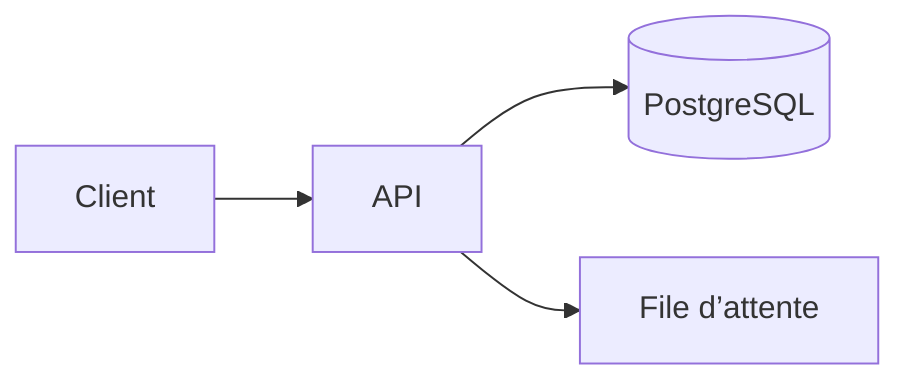

# Lancement de la v2

Ce qui change pour l’équipe, en trois parties.

## Le contexte

- La facturation passe sur la nouvelle API
- Les anciens clients migrent en novembre

## Le schéma

---

Pause : démonstration en direct.

## Le calendrier

| Étape          | Date       | Qui        |
| -------------- | ---------- | ---------- |
| Gel des merges | 2026-11-02 | Équipe API |
| Bascule        | 2026-11-09 | Astreinte  |

### Points d’attention

- [x] Prévenir le support
- [ ] Sauvegarder la base

# Questions

Des questions ? Écrivez-les dans `#lancement-v2`.
